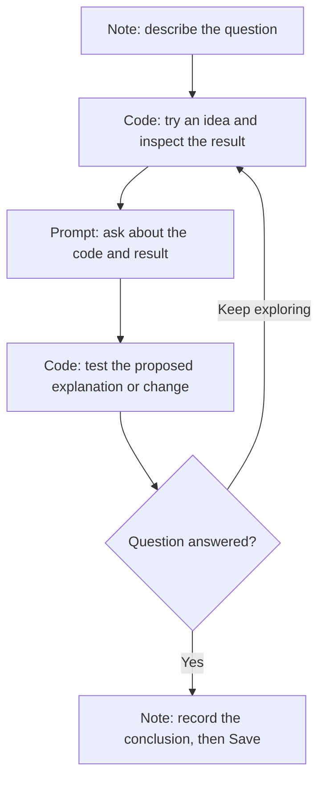

# How to Use a Dialog

A **dialog** is a Dialeng notebook: an ordered document where you combine
explanations, executable code, results, and conversations with an AI. The words
*dialog* and *notebook* refer to the same thing in Dialeng. A dialog is saved as
an `.ipynb` file.

Use a dialog to work through a question and leave a readable account of what
you tried, what happened, and what you concluded. You can revise earlier cells
as your understanding changes.

## Choose the right cell

| Cell | What you put in it | What happens | When to use it |
|---|---|---|---|
| **Note** | Markdown text | Displays formatted text; there is nothing to execute | State your goal, explain an assumption, add headings, or record a conclusion |
| **Code** | Python | Runs in the dialog's kernel and displays results or errors | Calculate, inspect data, define functions, or check an idea |
| **Prompt** | A question or instruction for the AI | Generates a response using the relevant notebook context | Ask for an explanation, review a result, debug an error, or explore a next step |

A Prompt cell contains both your prompt and the AI's response. Both are
editable. The dialog contains all these cells; it is not another cell type.
Optional **Shell** cells run bash commands when enabled in Settings, and
extensions can provide additional cell types.



## Work through your first dialog

This example uses only Python's built-in functions. For installation and
starting the app, see the [Quick Start](../../README.md#-quick-start).

### 1. Create a dialog and select a kernel

In the Files panel, navigate to the folder where you want to work. Click **+**,
enter a name such as `task_durations`, choose **Dialog**, and click **Create**.
If the folder inherits a `TEMPLATE.ipynb`, the new dialog starts with its cells.

Select **Local Python** in the kernel picker to run this example. Dialeng
requires a selected kernel before running Code or Prompt cells. If you dismiss
the picker, you can still read the dialog; trying to run a cell opens it again.
The kernel status bar lets you select or restart a kernel later.

For real AI responses, choose an authenticated provider and a model in the
toolbar, then select a mode such as **Learning**, **Concise**, or **Standard**.
**Mock** mode lets you try the interface without making an LLM request; its
responses are demonstrations. Provider setup is covered in the
[GUI Overview](gui_overview.md#header--toolbar) and the
[OpenAI Codex setup guide](openai_codex_oauth.md).

### 2. Add a Note with your goal

Use **+ Note** and enter:

```markdown
# Compare task durations

Goal: calculate the average duration of three tasks, in minutes.
Check the result before using it in a report.
```

Notes render as Markdown. Double-click a rendered note to edit it; press
`Escape` or click outside to return to the preview.

### 3. Add and run a Code cell

Place a Code cell below the note:

```python
durations = [10, 20, 30]
average = sum(durations) / len(durations)
print(f"Average duration: {average} minutes")
```

Click **Run**, press `Ctrl+Enter` to run and stay, or press `Shift+Enter` to run
and advance. The output should be:

```text
Average duration: 20.0 minutes
```

The variables `durations` and `average` now exist in this dialog's kernel.
Later Code cells can use them without defining them again.

### 4. Add a Prompt below the result

Use **+ Prompt** after the Code cell and enter:

```text
Explain how the code above calculates the average duration.
Suggest a simple assertion I can use to check this example.
```

Run the Prompt cell. With a real provider selected, the response streams into
the lower part of the same cell. The preceding Note, code, and displayed result
give the AI the context for your question. You do not need to paste them into
the prompt again.

You can stop generation with **Cancel**. Double-click your prompt or the
response to edit either one. Running the same Prompt cell again generates a
replacement response from its current prompt and preceding context; add a new
Prompt cell when you want to keep the earlier exchange as a separate step.

### 5. Check the idea with code

Add a Code cell below the response and run:

```python
assert average == 20.0
print("Check passed")
```

An AI response can suggest code, but a code block in its prose does not run
just because it is displayed. Copy code you want to test into a Code cell and
run it. Separately, enabled AI tools can execute actions during a prompt run;
see [AI context and tools](#ai-context-and-tools) below.

### 6. Record your conclusion and save

Finish with a Note:

```markdown
## Conclusion

The average of 10, 20, and 30 minutes is 20 minutes.
The assertion passed for this example.
```

Click **Save** or press `Ctrl+S` / `Cmd+S`. Saving is explicit by default;
autosave is an optional setting. Wait for the saved status before closing the
app. A saved dialog preserves its cells and results, while live Python
variables belong to the running kernel.

## Keep document order and execution order straight

The order on the page tells a reader how to follow your work and determines
which cells can become context for a Prompt. Python state follows the order in
which you actually **run** Code cells.

Editing a cell does not execute it. Moving or deleting a Code cell does not
undo its previous effects in the kernel. For example, changing `durations` in
the editor leaves the old Python value in memory until you run that cell again.
Outputs can also describe an earlier version of the code until you rerun it.

After changing an earlier definition, rerun it and the Code cells that depend
on it. When you want to check that your work is reproducible, restart the
kernel and run the required Code cells in order from the top. Restarting clears
live variables; saved text and displayed outputs are not a substitute for
rebuilding them. Project CRAFT setup, if present, runs as part of kernel setup.

## AI context and tools

For a real AI request, Dialeng builds a fresh transcript from the current
eligible cells **above** the Prompt, then adds the current prompt. This includes
notes, code and its recorded output, and earlier prompt/response pairs. Edits
to earlier prompts or AI responses therefore affect later requests.

There is a size limit, so a long dialog does not send every earlier cell:

- **Hidden** cells are excluded from ordinary notebook context. Hiding a cell
  does not delete it or clear anything it previously created in Python.
- **Pinned** cells above the Prompt are retained when older unpinned cells fall
  outside the context window. Hidden cells are excluded even when pinned.
- Cells **below** the Prompt are outside its ordinary notebook context,
  including pinned ones. Place a new Prompt after the results it needs.
- Collapsing a cell only changes its presentation; use the visibility control
  when you want to exclude it from context.

Keep goals and assumptions in a short Note near the start, pin it if needed,
and hide obsolete experiments that would confuse later questions.

The AI receives recorded notebook content rather than an automatic dump of
every Python variable. Print or display a value in a Code cell when you want to
discuss it. You can also explicitly inject a current kernel value in a Prompt:

```text
The current average is $`average`. Explain what it means in minutes.
```

If you expose a Python function with `&` syntax, the AI can call it as a tool.
Built-in tools may also be available depending on Settings, including tools
that read or change files. Inspect the tool steps shown with a response to see
what ran. See [Tool Calling](../how_it_works/10_tool_calling.md) for variable
references, function tools, and confirmation settings.

Some projects also have `CRAFT.ipynb` files that supply shared instructions and
kernel setup. If a new dialog already has context or helper functions, check
the project's [CRAFT and template setup](../how_it_works/16_craft_template_autorun.md).

## Common situations

| Situation | What to do |
|---|---|
| Python raises `NameError` after reopening or restarting | Run the cells that define the missing names, in dependency order |
| A result still shows an old value | Rerun the edited Code cell and the calculations that depend on it |
| The AI misses a result farther down the page | Put the Prompt after that result |
| The AI misses an older assumption | Check visibility and pin a concise Note above the Prompt |
| A prompt returns a demonstration response | Switch from Mock to a real provider and model |
| An edit or Save is rejected while a prompt is running | Wait for it to finish, or cancel it before retrying |
| You want a later reader to understand the work | Add Notes for the goal, choices, and conclusion; keep the Code checks and relevant results |

For a tour of every control, see the [GUI Overview](gui_overview.md).
For the implementation behind these behaviors, read
[How a Dialog Works](../how_it_works/00_dialog_overview.md).
