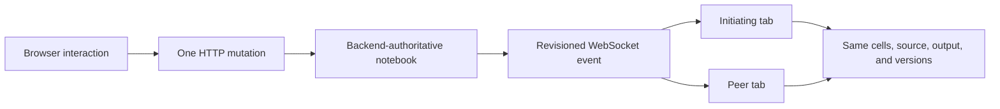

# Notebook Interaction Regression QA

This guide is the repeatable manual regression suite for Dialeng notebook
editing, execution, collaboration, and Jupyter output rendering. Run it after
changes to cell routes, WebSocket events, Monaco integration, notebook
revisions, output rendering, or keyboard shortcuts.

## Automated Coverage

The highest-risk paths in this guide are automated in `tests/e2e/` using a real
Dialeng subprocess and Chromium. Run them before starting the broader manual
matrix:

```bash
uv run playwright install chromium
uv run pytest -q -m e2e tests/e2e
```

Automated modules map to this guide as follows:

| Automated module | Covered manual areas |
| --- | --- |
| `test_cell_mutations.py` | Type transitions and structural operations |
| `test_prompt_providers.py` | Mock run, provider/model switch, rerun |
| `test_shift_enter_navigation.py` | Long-notebook focus and trailing cells |
| `test_prompt_editing.py` | Repeated prompt input/output context edits |
| `test_collaboration.py` | Two-tab source, output, and structure convergence |
| `test_kernel_lifecycle.py` | Attach, restart, process death, WebSocket reconnect |
| `test_notebook_deletion.py` | Deleting a notebook open in multiple tabs |
| `test_rich_outputs.py` | HTML, JSON, and image MIME rendering |

See [Browser E2E Testing](../how_it_works/22_browser_e2e_testing.md) for fixture,
fault-injection, CI, and failure-artifact details. Continue to use the manual
matrix for exploratory combinations, visual judgment, and real Colab/provider
validation.

## Test Isolation

Never run destructive cases against the repository's source notebooks. Copy
the workspace and use a non-default port:

```bash
QA_ROOT="$(mktemp -d /tmp/dialeng-qa-XXXXXX)"
cp -R notebooks/. "$QA_ROOT/"
uv run dialeng "$QA_ROOT" --port 8765
```

Create `qa_regression.ipynb` in that workspace. Use a Local Python kernel for
the core suite. Open the notebook in two browser tabs for all collaboration
cases. Keep server logs and both browser consoles visible.

The intended state flow is:



Unless a case intentionally tests recovery, the browser must not request
`/recovery`, reload the page, jump to the top, or show "The notebook changed"
warnings.

## Core Interaction Matrix

### 1. Kernel And Initial State

1. Open a notebook with no kernel.
2. Confirm the kernel picker stays open until Apply, Cancel, or close.
3. Select Local Python and apply it.
4. Confirm setup progress appears as toasts and the toolbar becomes ready.
5. Restart the kernel and confirm the toolbar, queue, and outline reset without
   replacing notebook cells.

Expected: no cell output is cleared merely by opening the kernel picker. A
server restart can require reattachment, but the notebook remains editable.

### 2. Text Editing And Command Mode

1. Create a Note cell and enter a heading plus body text.
2. Click a blank area of another cell header.
3. Confirm the Note switches to preview, saves once, and updates the peer tab.
4. Double-click the preview, edit again, and press Escape.
5. Focus a Monaco editor, then click its blank header or badge.
6. Press `q`, `c`, `v`, or `D D` and confirm the command acts on the selected
   cell instead of inserting letters into code.

Expected: the active DOM cell is authoritative in edit mode; the explicit
command-mode selection is authoritative after leaving the editor.

### 3. Cell-Type Transitions

Use both the dropdown and command-mode shortcuts:

- `Cmd/Ctrl+Shift+J`: Code
- `Cmd/Ctrl+Shift+K`: Note
- `Cmd/Ctrl+Shift+L`: Prompt

Run these sequences:

1. Code -> Note -> Prompt -> Note -> Code before execution.
2. Execute Code, then run the same sequence.
3. Execute Prompt, edit its response, then Prompt -> Note -> Prompt.
4. Change Note -> Prompt while its text editor is open.
5. Change a type, immediately add a cell, then delete both cells.

Expected: source is preserved, output that is incompatible with the new type
is cleared, every tab changes type once, and one shortcut sends one mutation.
No cell becomes undeletable.

### 4. Add And Shift+Enter

1. Add Code, Note, and Prompt from every add row: before the first cell,
   between cells, and after the last cell.
2. Rapidly invoke the three global add shortcuts.
3. Leave the final Code cell empty and press Shift+Enter.
4. Enter code in the final cell and press Shift+Enter repeatedly.
5. Add below a non-final selected cell.
6. In a notebook long enough to scroll, run a middle Prompt from its toolbar
   and with Shift+Enter; repeat with a middle Code cell.
7. Confirm the next cell is highlighted, its editor receives keyboard focus,
   and it remains visible both immediately and after execution completes.
8. Run the final Code or Prompt cell and confirm exactly one new Code cell is
   added, revealed, and focused.
9. Use Ctrl/Cmd+Enter and a batch run and confirm those operations do not steal
   focus or advance the selected cell.

Expected: each new cell uses the semantic position visible when its serialized
request is dispatched. The viewport remains stable, then reveals only the new
cell when needed. Running never jumps to the beginning of the page, completion
does not move focus a second time, and the active editor matches the highlighted
cell. For `N` cells there are exactly `N + 1` add rows.

For a slow Prompt run, also attempt source editing, Save, provider/model changes,
and cell add/delete while streaming. Each must return immediately with a visible
Wait/Cancel conflict, never hang. Cancel once and confirm the operation releases;
close one of two observing tabs and confirm the server-owned run completes in the
remaining tab.

### 5. Move, Duplicate, Clipboard, Merge, And Delete

1. Move a middle cell up and back down.
2. Try moving the first cell up and the last cell down.
3. Duplicate a selected cell with `q`.
4. Copy a cell with `c`, select another cell, and paste with `v`.
5. Merge adjacent Code cells with `Shift+M`.
6. Delete a newly added final cell with `D D`.
7. Delete the final remaining cell and confirm an empty notebook is valid.

Expected: boundary moves are no-ops. Round trips restore the exact ID order.
Duplicate/copy preserve type and source. Merge joins source once and removes
only the lower cell. Delete targets the visually selected cell and focuses a
surviving neighbor.

### 6. Two-Tab Collaboration

In tab A, then repeat in tab B:

1. Edit and save Code source.
2. Edit Note source and Prompt input/output.
3. Add, move, change type, duplicate, merge, and delete cells.
4. Run Code and Prompt cells.
5. Change mode, provider, model, and safe mode.

Expected: durable source, output, order, versions, and toolbar state converge
in both tabs. Cursor, scroll, open panels, and modal visibility remain local.
Concurrent unsaved Monaco edits may differ until one tab commits or runs.

### 7. Queue And Latest-Source Execution

1. Put `import time; time.sleep(1.5); print("queue-first")` in one Code cell.
2. Put `print("queue-second")` in the next Code cell.
3. Run both immediately.
4. Edit an already executed cell and rerun it without first blurring Monaco.

Expected: the first cell is running, the second displays `Queued (position
1)...`, and both finish in order. Existing output remains visible until the
backend confirms queue/running state. The rerun executes the latest Monaco
model, not the previous source.

### 8. Jupyter Output Rendering

Run each case in a fresh Code cell:

```python
# stdout, stderr, and one structured traceback
import sys
print("stdout-marker")
print("stderr-marker", file=sys.stderr)
raise ValueError("qa-error")
```

```python
# update_display_data replaces the original display
from IPython.display import display, HTML, update_display
h = display(HTML("<b>display-first</b>"), display_id=True)
update_display(HTML("<b>display-updated</b>"), display_id=h.display_id)
print("display-done")
```

```python
# deferred clear removes stale output
from IPython.display import clear_output
print("clear-stale")
clear_output(wait=True)
print("clear-fresh")
```

```python
# formatter-only repr failure should not obscure successful rich output
class BadRepr:
    def __repr__(self): return None
BadRepr()
```

Expected: stdout and stderr remain distinct; exactly one traceback is shown;
only `display-updated` remains; only `clear-fresh` remains; formatter-only
`__repr__` noise is suppressed when it is not the computation failure.

Also repeat with PNG/JPEG, SVG, HTML tables, Markdown, JSON, progress displays,
and a deliberately unsupported widget MIME bundle.

### 9. Prompt Cells

1. Run a Prompt in Mock mode.
2. Edit the prompt input after it has a response and confirm the response remains unchanged.
3. Edit its generated response and confirm the prompt input remains unchanged.
4. Commit the response by Escape or a header click.
5. Edit the response again, click outside the cell, and confirm the second edit persists.
6. Clear the full response intentionally and confirm the empty value persists.
7. In two tabs, start editing a response in tab A, update it in tab B, then leave the editor in tab A. Confirm tab A never goes blank and converges to tab B's newer backend response with a conflict notification.
8. Run a real provider prompt containing `$`variable`` injection.
9. Run a prompt exposing one fenced tool with `&`tool``.
10. Cancel a slow prompt and confirm late chunks do not reappear.
11. Run with no kernel/provider and confirm old output remains visible.
12. Run a Prompt in Mock mode, switch to Concise or Standard, select another
    authenticated provider/model, and rerun the same cell with Shift+Enter.
13. Repeat the same Prompt several times after completion and after cancellation.

Expected: input and editable output are independent, synchronize across tabs,
and never reset each other. Tool steps are shown separately from the final
answer. Provider failures do not erase prior output. Every terminal path restores
an enabled Run button, and changing provider does not make Shift+Enter a silent
no-op.

### 10. Notebook State Controls

1. Toggle hidden, pinned, exported, input/output collapse, and output clamp.
2. Keep the outline open while editing heading Notes and running namespace
   changes.
3. Save, download, and reopen the notebook.
4. Delete the open notebook from another tab.

Expected: controls are backend-authoritative and survive reload when they are
persisted. Outline changes are incremental. A deleted open notebook receives a
terminal event, stops execution, and returns to the workspace gracefully.

## Existing Notebook Smoke Suite

Use the disposable copy. Notebook-specific port literals must match the QA
server port.

| Notebook | Representative checks | 2026-07-10 result |
|---|---|---|
| `shell_integration.ipynb` | `%bash` variable expansion and `!uname -a` | Pass |
| `mistlefoot_demo.ipynb` | sub/sup, highlight, emoji previews; programmatic and rich HTML rendering | Pass |
| `test_dialoghelper.ipynb` | setup, `curr_dialog`, `read_msg`, `add_msg`, `msg_str_replace`, `del_msg` | Pass after setting `dh_settings['port'] = 8765` in the disposable kernel |
| `test_tool_calling.ipynb` | variables/functions, live `$` injection, and Codex/Bedrock fenced-tool calls | Pass |
| `test_dialoghelper_advanced.ipynb` | advanced cross-dialog and data-flow cases | Manual extended run |
| `test_openai_codex_prompt.ipynb` | stateless context edits, image context, tools, and skills | Manual external-provider run |
| `demo_project/colab_test.ipynb` | Colab, fastai download/training, progress displays | Manual Colab/GPU run |
| `test_capture.ipynb` | browser screen capture permissions and image context | Manual OS-permission run |

Do not run training, Colab allocation, screen capture, or paid-provider cases in
unattended CI.

## 2026-07-10 QA Findings

The full browser pass found and verified fixes for:

- critical HTMX loading depending on a public CDN;
- stale rerun source serialization and action controls detached by header OOB;
- durable notebook revisions overwriting WebSocket stream revisions;
- rapid add requests calculating positions before earlier adds converged;
- Note/Prompt edits relying on browser blur ordering;
- blank header clicks retaining Monaco edit mode;
- advertised Code/Note/Prompt shortcuts having no implementation;
- repeated modifier events sending duplicate type requests;
- Jupyter `stdout`/`stderr` names being mistaken for protocol revision streams;
- `D D` targeting a stale Monaco focus instead of command-mode selection;
- local IPython printing both a formatter traceback and a structured error.

The final run showed no recovery request during normal code execution, two-cell
queueing completed in order, peer tabs converged, and every structural state
kept the `cells + 1` add-row invariant.

## Failure Evidence

When a case fails, capture:

1. notebook and cell IDs;
2. action sequence and whether Monaco/text editing was active;
3. both tabs' ordered cell IDs, source, output, and versions;
4. server operation logs and any `/recovery?reason=...` request;
5. browser warnings/errors;
6. kernel type, runtime ID/generation, provider, and model;
7. whether the failure survives a clean disposable workspace.

This evidence distinguishes a document conflict, event-stream gap, stale DOM,
editor-focus bug, kernel transport issue, and renderer defect.
