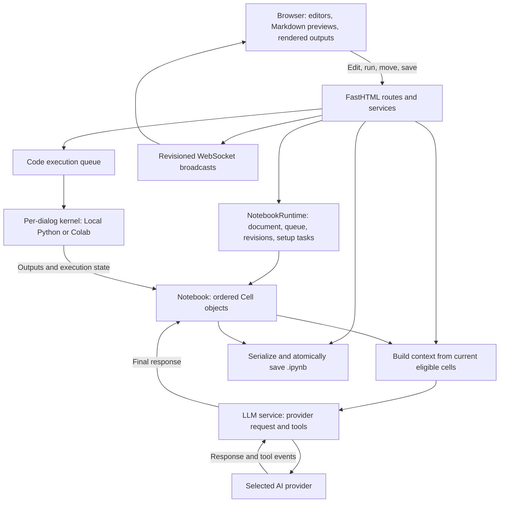
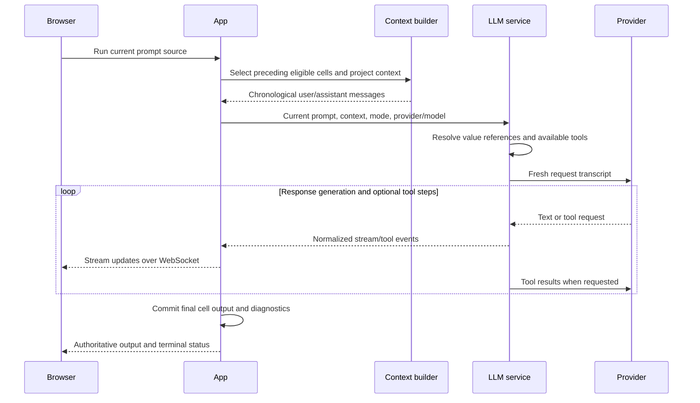

# How a Dialog Works

A dialog is an ordered notebook document, backed by a live runtime while it is
open in Dialeng. Code cells use a Python kernel; Prompt cells build an AI
request from the current notebook; Note cells supply readable Markdown and
context. All three share the same document and collaboration channel.

Start with [How to Use a Dialog](../guides/how_to_use_a_dialog.md) for a worked
example. This overview connects the implementation pieces before the more
detailed subsystem documents.

## Contents

- [Architecture overview](#architecture-overview)
- [Three kinds of state](#three-kinds-of-state)
- [Opening and editing a dialog](#opening-and-editing-a-dialog)
- [Running code](#running-code)
- [Running a prompt](#running-a-prompt)
- [Saving and reopening](#saving-and-reopening)
- [Where to read or change the implementation](#where-to-read-or-change-the-implementation)

## Architecture overview

The server owns notebook content and execution state. Browser tabs submit
changes and render authoritative updates. The supported deployment uses one
ASGI worker because the live runtimes are process-local.

## Three kinds of state

| State | What it contains | Lifetime and practical consequence |
|---|---|---|
| **Notebook document** | Ordered cells, source, recorded output, metadata, provider/model and kernel preferences | Lives in server memory and is serialized on Save; editing source changes the document |
| **Kernel namespace** | Live Python variables, imports, functions, and objects created by execution | Belongs to the attached kernel; editing the document does not update these objects, and restarting the kernel clears them |
| **AI request transcript** | Selected notebook messages, project context, the current prompt, and available tools | Rebuilt for each real prompt run; earlier edited content affects the next request |

For example, suppose a Code cell has run `x = 10`. Changing its text to `x = 20`
updates the document, but the kernel still has `x == 10` until execution. Its
recorded output may also be stale. A later AI request can see the edited source
and the old recorded output together. Dialeng does not infer and recompute a
dependency graph to reconcile them.

Likewise, moving a Code cell changes document chronology and future prompt
context, but does not reverse or replay Python execution. Saving a notebook
does not serialize its live Python heap.

## Opening and editing a dialog

1. The app loads `.ipynb` JSON through the document serialization layer, or
   creates a new notebook, using an inherited `TEMPLATE.ipynb` when applicable.
2. A `Notebook` holds ordered `Cell` objects. A `NotebookRuntime` owns that
   document together with mutation coordination, the execution queue, setup
   tasks, and revision counters.
3. FastHTML renders the page. Code editors use lazily created Monaco views;
   Notes and completed prompt text use Markdown previews. Rendering an output
   is separate from executing the cell that produced it.
4. The browser joins the notebook's WebSocket channel. Edits and structural
   actions are committed on the server and broadcast to the connected tabs.
5. If no kernel is attached, the user chooses one before running cells. Kernel
   setup applies the project path, exported-module synchronization, and CRAFT
   code as appropriate for the backend. Opening a dialog does not replay all
   its ordinary Code cells.

Source versions and notebook/structure revisions let the server reject stale
changes. A per-notebook mutation lock serializes coordinated mutations, and
operation IDs deduplicate supported retried operations. An active Prompt run
also guards conflicting edits, saves, structural changes, and model changes
until terminal cleanup completes.

Connected tabs share the notebook and its attached kernel. They do not get
independent Python namespaces. WebSocket events carry stream revisions; a
reconnecting browser or one that detects a gap requests an authoritative
recovery snapshot. This synchronizes browser state, rather than executing
notebook cells again.

See [State Management](01_state_management.md),
[Performance and Reliability](21_performance_reliability.md), and
[Workspace UI State](28_workspace_ui_state.md) for ownership and recovery details.

## Running code

The cell run route first checks for a selected kernel and commits the submitted
source with its version check. A Code cell then enters the dialog's execution
queue. The queue runs cells in submission order; kernel execution is serialized
per notebook.

`KernelService.execute_cell()` clears the previous outputs when execution
starts and sends the source to the selected backend. Local Python uses a
subprocess; Colab uses its remote kernel connection. Both preserve a namespace
between executions in that kernel.

As execution proceeds, stdout, stderr, expression results, rich displays, and
errors become `CellOutput` records and browser updates. Completion records the
execution count and success/error state. The authoritative document retains
the results for later display, saving, and AI context.

An error or interrupt can leave earlier statements' effects in the namespace;
execution is not a transaction with rollback. Deleting the cell later removes
its document content, not variables or external side effects it created.

See [Kernel Execution](04_kernel_execution.md) and
[Colab Kernel](12_colab_kernel.md) for the queue, streaming, and interruption paths.

## Running a prompt

A real Prompt run uses the selected provider/model and dialog mode. Mock mode
has a separate simulated streaming path and makes no LLM request.

### Which notebook content becomes context?

`build_context_messages()` selects from cells **before** the current Prompt:

1. Exclude cells marked `skipped` by the visibility control.
2. Retain eligible pinned cells, even when they exceed the ordinary budget.
3. Prefer recent unpinned cells within an approximate character budget and cell
   count limit.
4. Combine the selected cells in their original notebook order.
5. Convert them to messages and prepend applicable CRAFT Note/Prompt context.

The current defaults target 24,000 approximate characters and at most 100
unpinned cells. These are selection limits rather than a guarantee about the
provider's final token count: pinned content is preserved, the newest unpinned
cell can exceed the remaining budget, and CRAFT and the current request add
content. Pinning does not include a cell below the current Prompt or override
its hidden state.

| Earlier cell | Default conversion to AI messages |
|---|---|
| **Code** | User content containing Python source, recorded text output, and supported image output blocks |
| **Note** | User message containing the Markdown source |
| **Prompt** | User message for its source, followed by an assistant message for its response when present |

The current Prompt's source is supplied separately; its previous response is
not included as an earlier exchange when rerunning that same cell. Earlier
responses use their current edited text. Collapse state does not control
context eligibility. Normalized message blocks are cached by cell identity,
version, type, and visibility/pin state; dynamic value injection runs afresh.

### Values, tools, and response storage

The ordinary transcript contains recorded notebook content, not every live
Python object. Explicit references such as `` $`x` `` evaluate a current kernel
value, while `` &`my_function` `` exposes a callable tool. Enabled built-ins,
extensions, and provider-supported skills can add tools or instructions.
Tool calls can act on the kernel or files according to the tool's behavior;
merely rendering a Python code block in a response does not execute it.

The provider receives a fresh transcript for each run. Dialeng does not depend
on a persistent provider conversation to remember the dialog. Within a run,
tool results can feed subsequent generation steps.

Streamed text is provisional browser output. At completion or cancellation,
the app commits the assembled response to the Prompt cell, records run
diagnostics, broadcasts the authoritative output, and releases the active-run
guard. An error that produces no replacement content preserves the previous
response. Operational diagnostics are kept out of the model context; the
message converter also strips the rendered tool-step wrapper from earlier
responses.

See [LLM Integration](06_llm_integration.md), [Tool Calling](10_tool_calling.md),
and [CRAFT and Templates](16_craft_template_autorun.md) for the detailed paths.

## Saving and reopening

Changes first affect the in-memory document. **Save** serializes it to `.ipynb`;
autosave is separately configurable and disabled by default. The normal atomic
save writes a temporary file, flushes it, and replaces the destination. An
external disk change is rejected unless overwrite is explicit.

| Dialeng cell | Representation in `.ipynb` |
|---|---|
| **Code** | Jupyter code cell with outputs and execution count |
| **Note** | Markdown cell |
| **Prompt** | Markdown cell with `solveit_ai` metadata; a Solveit-compatible reply separator joins prompt and response |

Reopening loads the saved document. Its outputs can be displayed without
having recomputed them. If the server still has an attached live kernel, that
kernel can retain its namespace; a newly created or restarted kernel needs
the relevant Code cells executed again. Saving or reopening alone does not
restore Python objects from the saved outputs.

## Where to read or change the implementation

Paths below are relative to the repository root. Start with the overview, then
follow the symbol or linked subsystem document for the behavior you need.

| Responsibility | Main implementation |
|---|---|
| Document and cell fields | [`Notebook`](../../dialeng/document/notebook.py), [`Cell` / `CellOutput`](../../dialeng/document/cell.py) |
| Notebook load/save format | [`document/serialization.py`](../../dialeng/document/serialization.py) |
| Runtime ownership and mutation coordination | [`NotebookRuntimeRegistry`](../../dialeng/services/runtime_registry.py) |
| HTTP run path, source/output commits, prompt lifecycle | [`app.py`](../../dialeng/app.py), route `/dialeng/{nb_id}/cell/{cid}/run` |
| Code scheduling and backend execution | [`ExecutionQueue`](../../dialeng/services/kernel/execution_queue.py), [`KernelService`](../../dialeng/services/kernel/kernel_service.py) |
| Context selection and inspection report | [`build_context_messages`](../../dialeng/services/dialoghelper_service.py) |
| Cell-to-message conversion | [`cell_to_llm_messages`](../../dialeng/core/dispatch.py) |
| Provider streaming, value references, tool resolution | [`LLMService`](../../dialeng/services/llm/llm_service.py) |
| Atomic saves and optional autosave | [`persistence_service.py`](../../dialeng/services/persistence_service.py) |

When adding a cell type, consider its rendering, serialization, execution, and
AI message conversion together. The [Extension Platform](25_extension_platform.md)
describes the supported registration APIs. When changing a lifecycle path,
check the [runtime and recovery contracts](21_performance_reliability.md) so
multiple tabs, cancellation, saving, and reconnection stay consistent.
