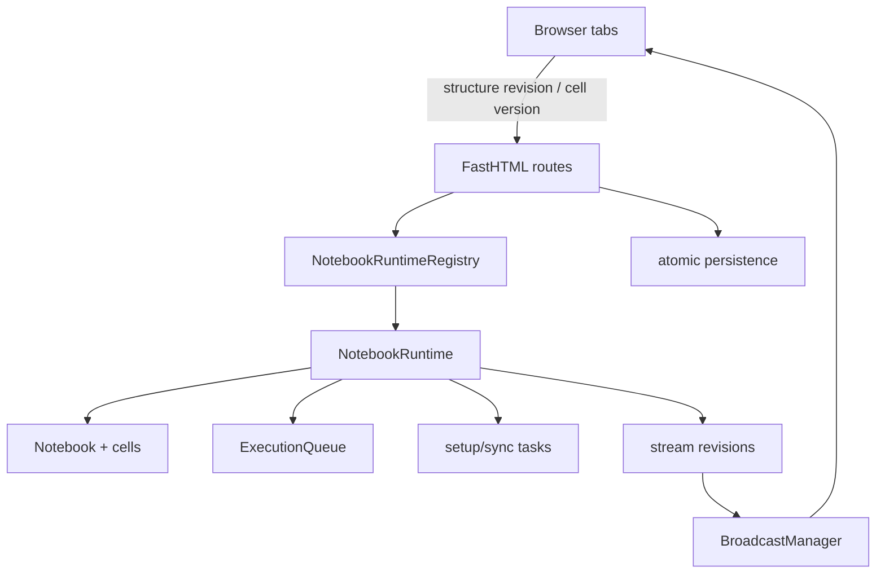
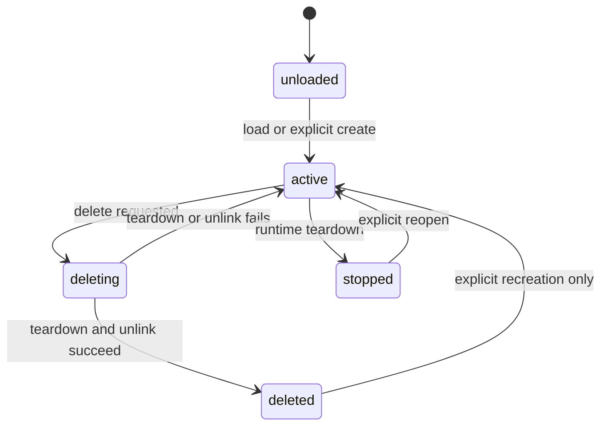

# State Management

Dialeng keeps notebook state backend-authoritative. The in-memory `Notebook`
document is owned by one `NotebookRuntime`; browser tabs submit versioned
mutations and reconcile from revisioned events rather than acting as competing
sources of truth.

## Architecture



The supported deployment is one ASGI worker. Runtime state is process-local;
starting multiple workers is rejected/documented as unsupported until a shared
coordination layer exists.

## Notebook Document

`dialeng/document/notebook.py` defines durable notebook state:

- ordered `Cell` objects;
- dialog mode;
- provider-qualified LLM selection and model;
- local or Colab kernel preference;
- safe shell mode;
- path, modified flag, and disk signature.

`dialeng/document/cell.py` defines source, output, execution metadata, collapse
state, skipped/pinned/export flags, and a monotonically increasing cell
`version`. Notebook metadata remains Solveit-compatible and persists
`dialeng_provider` plus the existing model fields.

The document converts to and from standard `.ipynb` JSON through
`document/serialization.py`. Prompt input and editable assistant output share a
markdown cell separated by the Solveit reply marker.

## Runtime Ownership

`NotebookRuntimeRegistry` owns all mutable notebook-scoped runtime state:

```python
@dataclass
class NotebookRuntime:
    notebook_id: str
    lifecycle: LifecycleState
    notebook: Notebook | None
    mutation_lock: asyncio.Lock
    execution_queue: ExecutionQueue | None
    kernel_generation: int
    notebook_revision: int
    structure_revision: int
    outline_revision: int
    setup_task: asyncio.Task | None
    sync_task: asyncio.Task | None
    data_queues: dict[str, asyncio.Queue]
    stream_revisions: dict[str, int]
    completed_operations: OrderedDict[str, Any]
```

Compatibility field maps expose selected runtime fields to older call sites
without creating a second source of state. New code should use registry methods
or a service instead of adding another application-global dictionary.

### Lifecycle



Deletion tombstones prevent a stale tab from invoking a load-or-create path.
Save, run, and snapshot requests against a deleted notebook return `410 Gone`.
Only explicit creation clears the tombstone.

## Mutation Serialization

Routes that mutate a notebook use `serialized_notebook_mutation`:

1. Resolve the notebook runtime.
2. Acquire its async mutation lock.
3. Compare an optional notebook or structure revision, depending on the route.
4. Return HTTP `409` on a stale ordering assumption.
5. Detect an optional `operation_id` replay.
6. Apply the operation once and retain its bounded result.

`NotebookMutationService` owns canonical add, delete, move, duplicate, and
merge operations without transport side effects. Routes advance revisions,
invalidate the outline, and broadcast the resulting canonical order.

The notebook revision identifies durable document mutations, while each
WebSocket stream has its own event sequence. Keeping those counters separate
allows multiple UI events for one document revision and prevents unbroadcast
metadata changes from creating false transport gaps. The structure revision
changes only when ordered cell IDs change, so a source/output commit cannot
invalidate a concurrent Shift+Enter add. Cell run source persistence acquires
the same mutation lock before queueing execution, ensuring revisioned events
are broadcast in commit order.

Cell source/output updates also carry `expected_version`. A stale commit does
not overwrite newer backend content; it receives a conflict response/event and
adopts the current version.

## Execution State

`ExecutionQueue` holds references to cells owned by the notebook. Deleting a
queued cell removes it from the queue first. Completion callbacks verify that
the runtime, notebook, and target cell still exist before writing final output.

Kernel switches and restarts increment `kernel_generation`. Setup, CRAFT, and
project-sync tasks capture that generation and abort before touching a newer
kernel. Runtime teardown cancels queue/setup/sync work and is idempotent.

Local kernels own a subprocess plus input/output multiprocessing queues.
Shutdown sends a graceful control message, escalates through terminate/kill,
joins the process after every path, closes both queues, joins queue feeder
threads, and closes the process handle. This prevents semaphore leaks during
development reloads.

## Revisioned Synchronization

Independent stream revisions cover notebook structure, kernel state, outline,
LLM inventory, output, and persistence. The initial page embeds revision
baselines. WebSocket events include stream, revision, and event ID.

- duplicates and old revisions are ignored;
- a gap requests one full recovery snapshot;
- reconnect compares durable client/server revisions;
- healthy sockets do not poll full state;
- kernel snapshots advance only the kernel stream unless used as part of a full
  recovery response.

See [Real-time collaboration](03_real_time_collaboration.md) for protocol and
backpressure details.

## Persistence

Explicit save remains the default. `Notebook.save()` writes through
`persistence_service.atomic_write_json`:

1. Serialize the full notebook.
2. Write a same-directory temporary file.
3. Flush and `fsync` it.
4. Atomically replace the canonical path.
5. Update the notebook disk signature.

If replace fails, the prior canonical file remains intact and the temporary
file is removed. If the on-disk signature changed since load/save, Dialeng
rejects the write until the user chooses reload or overwrite.

### Optional autosave

Autosave is deliberately disabled by default:

```json
{
  "persistence": {
    "atomic_explicit_save": true,
    "autosave": {
      "enabled": false,
      "debounce_ms": 1500,
      "idle_only": true,
      "recovery_snapshots": true,
      "max_recovery_files": 5
    }
  }
}
```

With autosave disabled, mutations create no autosave timer or recovery file.
When enabled, repeated mutations coalesce into one debounced save, idle-only
mode defers active execution, explicit save flushes pending work, and shutdown
attempts a bounded final flush.

Recovery snapshots live under `.dialeng/recovery/` with bounded retention. A
newer recovery is offered for inspect, restore, or discard; it never silently
replaces the canonical notebook. Recovery JSON is parsed and loaded as a
notebook before atomic replacement, so corrupted recovery data cannot damage
the canonical file. `dialeng init` adds `.dialeng/recovery/` to the project
`.gitignore` without ignoring shareable `.dialeng/skills/` content.

## Caches and Invalidation

State versions provide cache keys:

- prompt context blocks: cell ID/version/type/skipped/pinned;
- note headings: note-cell version;
- namespace outline: notebook, kernel generation, execution count;
- directories: resolved path plus filesystem signature.

Dynamic prompt expressions are not cached and re-evaluate for every prompt.
Project file watching invalidates only affected directory listings and notifies
open explorers.

## Diagnostics

`GET /dialeng/{id}/diagnostics` reports content-free lifecycle data:

- runtime lifecycle and mutation lock;
- kernel generation and connection state;
- queue order and active setup phase;
- stream revisions and WebSocket client count;
- pending autosave state.

`GET /dialeng/diagnostics/performance` adds bounded counters, timings, browser
health, and registry summaries without prompt text, source, output, images, or
credentials.

## Testing Invariants

Tests assert:

- unique cell IDs and canonical order after generated mixed mutations;
- stale revisions fail and duplicate operation IDs are idempotent;
- source/output conflicts retain the newer backend value;
- queue and runtime cleanup are idempotent;
- deleted notebooks reject stale mutations until explicit recreation;
- atomic-save failure preserves prior bytes;
- autosave disabled means no background writes;
- corrupted recovery never replaces canonical state;
- reconnect gaps converge through authoritative recovery.

## Key Files

| File | Responsibility |
|---|---|
| `document/notebook.py` | durable notebook model and serialization entrypoints |
| `document/cell.py` | cell state, versions, outputs, Jupyter conversion |
| `services/runtime_registry.py` | ownership, lifecycle, mutation locks, revisions |
| `services/notebook_mutation_service.py` | canonical structural operations |
| `services/persistence_service.py` | atomic save, autosave, recovery, conflicts |
| `services/broadcast_service.py` | bounded per-client WebSocket delivery |
| `services/websocket_protocol.py` | join, heartbeat, cancellation, recovery negotiation |
| `app.py` | composition and compatibility route wiring |

## Related Documents

- [Real-time collaboration](03_real_time_collaboration.md)
- [Kernel execution](04_kernel_execution.md)
- [LLM integration](06_llm_integration.md)
- [Performance and reliability](21_performance_reliability.md)
