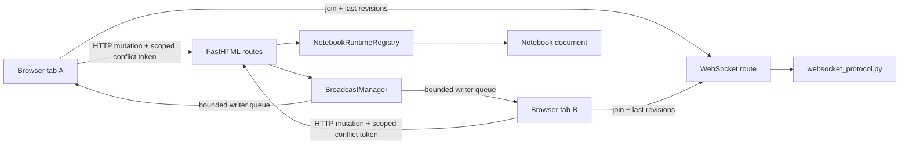
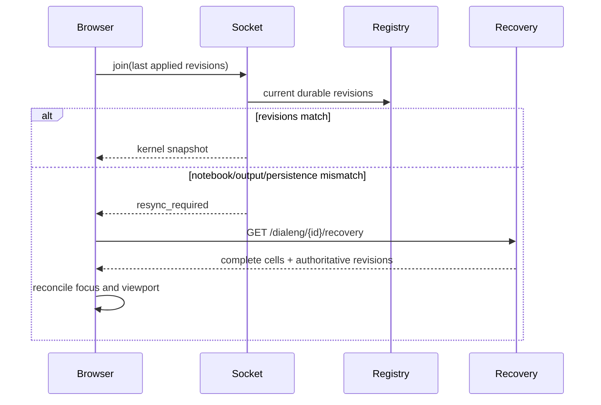

# Real-Time Collaboration

Dialeng collaboration is backend-authoritative and WebSocket-first. Browser
tabs share the current notebook document, kernel, queue, provider selection,
and output state, while each tab keeps only local presentation state such as
focus, scroll position, open panels, and modal visibility.

## Architecture



The supported deployment is one ASGI worker. Runtime ownership is process-local;
multiple workers would create conflicting notebook and kernel registries.

## Backend-Authoritative State

The backend owns:

- canonical cell order and IDs;
- source/output versions;
- notebook event revision, structure revision, and lifecycle;
- execution queue order and running cell;
- kernel generation, connection, and setup state;
- LLM provider/model selection;
- save, conflict, autosave, and recovery state.

The browser owns:

- focused cell, cursor, and selection;
- viewport anchor and scroll position;
- open settings, diagnostics, explorer, outline, and kernel modal state;
- lazy Monaco editor views. Monaco models retain source but do not override a
  newer backend cell version.

## Revision Domains

Events use independent streams so token or stdout traffic does not advance the
durable notebook event revision:

| Stream | Examples |
|---|---|
| `notebook` | add, delete, move, source version, toolbar state |
| `kernel` | attach, setup, queue, restart, connection health |
| `outline` | heading and namespace invalidation |
| `llm` | provider/model inventory |
| `output` | prompt/code stream and final output |
| `persistence` | modified, saving, saved, recovery state |

Every protocol event includes a unique `event_id`, stream, and monotonically
increasing stream revision. `notebook_client.js` rejects duplicate IDs and old
revisions. A gap in a non-authoritative event triggers one recovery request.

Protocol stream names are separate from payload channels. In particular, a
Jupyter `code_stream_chunk` uses `stream="output"` for revision ordering and
`output_stream="stdout"` or `"stderr"` for rendering. Reusing `stream` for both
concepts caused every post-reload stdout event to look like a revision gap.

Conflict detection is intentionally separate from event ordering:

- each WebSocket stream's `revision` orders transport events and drives gap
  recovery, including multiple UI events for one document mutation;
- `notebook_revision` identifies the latest durable document mutation and is
  carried alongside notebook events as a conflict token;
- `structure_revision` changes only when ordered cell IDs change;
- each cell's `version` protects its source and editable output.

The browser updates these tokens from every accepted event rather than reading
the startup kernel snapshot repeatedly. A delayed execution output or source
commit therefore cannot make an unrelated add/move/delete request stale.

```json
{
  "type": "cell_move",
  "notebook_id": "demo~analysis",
  "stream": "notebook",
  "revision": 18,
  "structure_revision": 7,
  "event_id": "6f5...",
  "ordered_cell_ids": ["a", "c", "b"]
}
```

The initial HTML includes a revision baseline. Kernel snapshots contain
diagnostics for all domains but are authoritative only for their `kernel`
stream; they cannot suppress a same-revision structural event.

## Connection and Recovery



Healthy tabs do not poll full snapshots. A heartbeat verifies the browser
transport without rebuilding state. Reconnect uses exponential backoff with
jitter and sends the tab's last revisions. Recovery replaces the full cell
container only when a gap or durable mismatch proves granular convergence is
unsafe.

FastHTML WebSockets bind the handler argument named `msg`. Browser controls
therefore use an outer envelope:

```json
{"msg": "{\"type\":\"heartbeat\"}"}
```

The inner JSON supports join, heartbeat, LLM cancellation, and tool
confirmation flows. The socket handshake key identifies a connection because
FastHTML may supply different callback wrappers on connect and disconnect.

## Structural Mutations

Add, delete, move, duplicate, and merge requests are serialized by the notebook
runtime mutation lock. Ordering-sensitive requests include:

- `expected_structure_revision`: stale cell-order assumptions receive HTTP
  `409` and trigger recovery without being invalidated by source or output;
- `operation_id`: a browser retry returns the first result without applying the
  mutation twice.

`expected_revision` remains accepted for older clients, but current browsers
use the scoped structure token for structural routes. The source commit made by
`/cell/{id}/run` also uses the mutation lock. This matters for Shift+Enter,
which sends run and next-cell requests together: whichever request acquires the
lock first broadcasts its notebook event first, while the add remains valid as
long as the cell order itself did not change.

Type conversion is cell-local and has one additional race: choosing a type
blurs an open note/prompt editor, which can commit its source immediately before
the select request. The type request therefore carries the current `source`,
`expected_version`, and `expected_cell_type`. The backend accepts an identical
source commit that won that race, but rejects a genuinely different type/source
from another tab. The resulting `cell_type_change` is still a normal revisioned
notebook event.

Blank cell-header clicks explicitly leave text edit mode before selecting the
cell. This makes the command-mode selection authoritative for destructive and
clipboard shortcuts even while Monaco's internal focus flag is settling. The
Code/Note/Prompt keyboard shortcuts send one guarded backend mutation instead of
programmatically retriggering potentially rebound HTMX listeners.

`NotebookMutationService` applies canonical structural changes. Routes then
advance the notebook revision and broadcast transport-specific payloads.

Most structural events do not replace existing cells:

| Event | Browser action | Unaffected Monaco views |
|---|---|---|
| add | insert server-rendered cell unit at canonical position | retained |
| delete | dispose removed editor and remove its cell unit | retained |
| move | reorder existing cell and add-row DOM nodes | retained |
| source update | update model/textarea if backend version is newer | retained |
| type change | replace the changed cell from revisioned server HTML because its editor kind changes | retained |

`structure_controller.js` rejects duplicate IDs or incomplete cell units before
DOM reconciliation. An empty order is valid and renders only the leading add
row, which is required when deleting the final cell. If granular state cannot
be trusted, the browser performs authoritative recovery instead of guessing.

## Source and Output Conflicts

Each cell has a version. Source/output commits include `expected_version`:

1. The backend compares it with the current cell version.
2. A match commits and broadcasts canonical source/output.
3. A mismatch keeps the newer backend value and emits `cell_conflict`.
4. The stale tab updates its version and warns the user.

Running a cell first commits the editor's current source, so all tabs see the
same input and output. Existing output remains visible until the backend marks
the request queued/running. Failure to attach a kernel does not erase valid
output.

## Backpressure

`BroadcastManager` gives every socket a bounded outbound queue and writer task.
A slow or suspended tab cannot block another tab.

Event policies are explicit:

- structural events and terminal lifecycle events are never silently dropped;
- snapshots and queue/provider status coalesce to the newest queued value;
- adjacent stdout/stderr chunks for the same cell and stream are combined;
- writer sends have timeouts;
- overflow of a non-droppable event disconnects that client, which then
  converges through reconnect recovery.

The browser also frame-batches prompt and code output. Hidden tabs retain data
without doing every expensive visual render. Per-message WebSocket diagnostics
are disabled unless `window.DIALENG_DEBUG_WEBSOCKET = true`, avoiding console
overhead on high-volume streams. Final output remains
backend-authored, preserving `clear_output`, `update_display_data`, progress
bars, rich MIME, and formatter-error normalization.

## Notebook Deletion

Deleting an open notebook is a terminal lifecycle transition:

1. Mark runtime `deleting`.
2. Cancel queued work and setup/sync tasks.
3. Release local or Colab kernel resources.
4. Remove the file only after teardown succeeds.
5. Broadcast `notebook_deleted` to all tabs.
6. Tombstone the notebook ID so stale save/run/snapshot requests return
   `410 Gone` instead of recreating an empty file.

Only explicit notebook creation clears the tombstone. Open tabs stop heartbeat
and reconnect work and show the workspace state.

## Testing

Automated coverage includes:

- duplicate, missing, and reordered revisions;
- reconnect mismatch and full recovery;
- changed send wrappers and multiple-client disconnect cleanup;
- a deliberately slow client, coalescing, batching, and structural overflow;
- generated mixed structural mutations with unique-ID/order invariants and
  idempotent retries;
- code → note → prompt conversion followed by add/delete and final-cell deletion;
- source/output version conflicts;
- deletion teardown, tombstones, and explicit recreation;
- independent Node tests for revision, event, structure, batching, and
  notification controllers.

The manual browser matrix uses a 200-cell notebook in two tabs and checks lazy
Monaco limits, add/move/delete synchronization, Shift+Enter insertion,
streaming output, save state, diagnostics, reconnect, workspace, and plain-file
editing.

## Related Documents

- [State management](01_state_management.md)
- [Kernel execution](04_kernel_execution.md)
- [Editor transitions](17_editor_cell_transitions.md)
- [Performance and reliability](21_performance_reliability.md)
