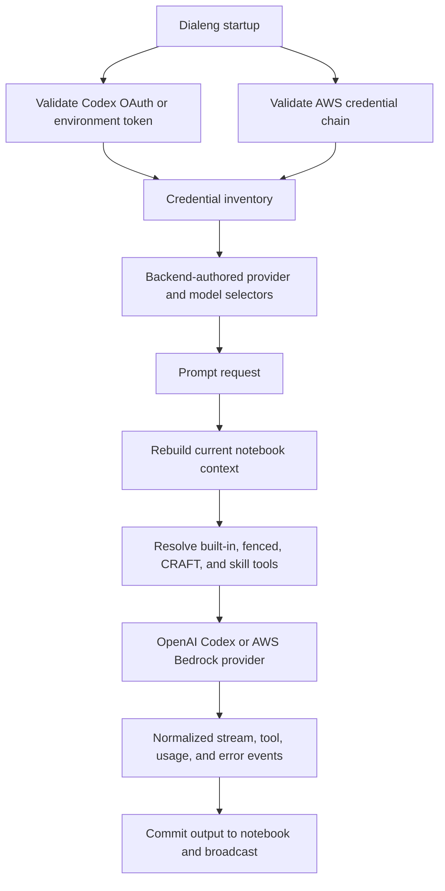

# LLM Integration

Dialeng supports two production LLM transports: OpenAI Codex subscription
access and AWS Bedrock. Prompt execution remains stateless: every run rebuilds
the complete context from the notebook's current cells, including user-edited
prompt inputs and assistant outputs.

## Provider Flow



## Provider Inventory

| Provider ID | Authentication | Implementation |
|---|---|---|
| `openai_codex` | Dialeng OAuth or `DIALENG_OPENAI_CODEX_ACCESS_TOKEN` | Dialeng-owned Responses transport |
| `claudette:bedrock` | Standard AWS credential chain | Claudette with `AnthropicBedrock` |

Codex is preferred when both providers are authenticated. If neither is
available, Mock mode remains usable. Deterministic E2E runs replace the
inventory with a network-free test provider.

Provider and model are persisted as `dialeng_provider`, `dialeng_model`, and
`solveit_model` notebook metadata. The backend validates every provider/model
combination before saving or running it.

## Prompt Execution

1. Collect visible cells above the current prompt plus applicable CRAFT cells.
2. Preserve notebook chronology and the user's current edits.
3. Convert text and rich image outputs into provider-neutral message blocks.
4. Resolve variable expressions, fenced functions, built-ins, and Codex skills.
5. Start the selected provider with a fresh transcript; no provider session is reused.
6. Normalize text, reasoning summaries, tool calls, tool results, usage, and errors.
7. Persist the final response and broadcast the authoritative cell state.

OpenAI Codex sends the complete transcript with `store=false` and does not use
response chaining. Bedrock rebuilds a fresh Claudette chat history for each
request. Both therefore follow the notebook rather than stale conversation
memory.

## Configuration

```json
{
  "models": {
    "defaults": {
      "openai_codex": "gpt-5.4",
      "bedrock": "claude-haiku-4-5",
      "fallback": "gpt-5.4"
    },
    "bedrock_map": {
      "claude-haiku-4-5": "us.anthropic.claude-haiku-4-5-20251001-v1:0"
    },
    "openai_codex_map": {
      "gpt-5.4": "gpt-5.4"
    }
  },
  "llm": {
    "openai_codex_enabled": true,
    "openai_codex_transport": "auto"
  }
}
```

`openai_codex_transport` accepts `auto`, `websocket`, or `sse`. Auto prefers
WebSocket and falls back to SSE only before output or a tool side effect begins.

## Failure Behavior

- An unavailable selected provider blocks the run without clearing prior output.
- Invalid provider/model combinations are rejected by the backend.
- Authentication failures refresh Codex credentials once before any output is emitted.
- Retryable connection, rate-limit, and server failures use bounded retries only
  before output or side effects.
- Cancellation closes the active provider stream and preserves the committed
  notebook state.

See [Multi-Provider LLM And Codex](20_multi_provider_llm_and_codex.md) for the
Codex transport and OAuth details.
