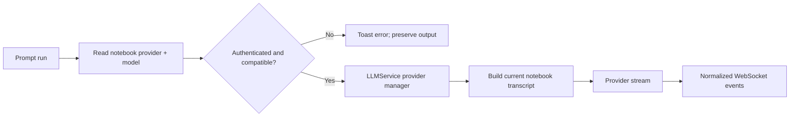
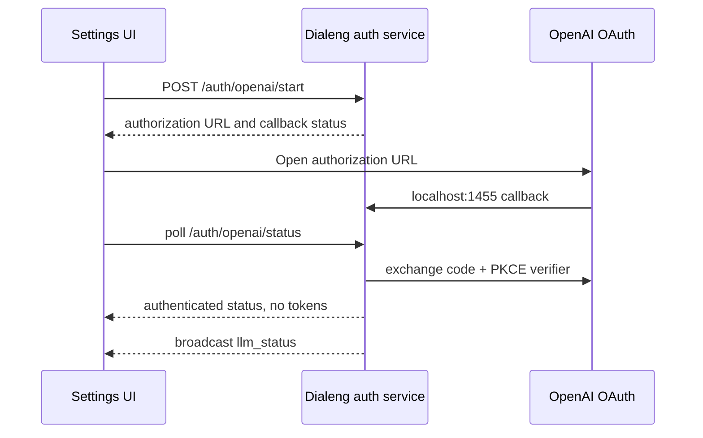

# Multi-Provider LLM And OpenAI Codex Architecture

Dialeng resolves an LLM provider and model for every prompt execution. The
notebook remains the source of conversation state: each run sends the current
cells above the prompt and does not continue a hidden provider-side session.

## Provider Inventory

`credential_service.py` probes every backend independently and builds a
`CredentialInventory`. A failed Anthropic probe does not hide a valid Bedrock,
Claude Code, or OpenAI Codex login.

Provider IDs are backend-qualified:

| Provider ID | Authentication |
|---|---|
| `claudette:anthropic_api` | `ANTHROPIC_API_KEY` |
| `claudette:bedrock` | AWS credential chain |
| `claude_agent_sdk` | Claude Code subscription |
| `openai_codex` | OpenAI Codex subscription OAuth |

The selected provider is persisted as `metadata.dialeng_provider`; the model is
persisted as both `dialeng_model` and the compatible `solveit_model`. Legacy
notebooks without provider metadata migrate to the highest-priority available
Claude backend. If a saved provider later becomes unavailable, Dialeng keeps the
selection visible and rejects execution without clearing the previous response.

`LLMService` caches one initialized instance per provider key and protects first
initialization with a per-provider async lock. Context construction, variable
injection, tool discovery, CRAFT tools, `pyrun`, and confirmation remain above
the provider layer.

## Codex Transport

`OpenAICodexProvider` is implemented in Dialeng and does not import Golm. It
uses the OpenAI Codex subscription Responses transport with WebSocket first and
SSE fallback. Every request has `store=false`, contains a fresh complete
notebook transcript, and omits `previous_response_id`.

The provider:

- converts text and base64 image blocks into Responses input items
- normalizes text, reasoning summaries, tool calls, tool results, usage, and errors
- disables parallel tool calls while Dialeng persists tool steps sequentially
- retries only before streamed output or tool side effects
- refreshes OAuth once on a pre-stream `401`
- closes the active stream when prompt cancellation is requested

Hidden reasoning is never displayed. Only reasoning-summary events are mapped
to Dialeng thinking events.

The implementation was informed by the protocol/lifecycle patterns in
[`golm-ai`](https://github.com/sgaseretto/golm/tree/main/packages/golm-ai) and
[`golm-agent`](https://github.com/sgaseretto/golm/tree/main/packages/golm-agent),
but no Golm package is a dependency.

## OAuth Lifecycle

The server owns one OpenAI login flow and identity. Credentials are stored under
`~/.dialeng/auth.json` with mode `0600`; writes use a temporary file and atomic
replace. `DIALENG_OPENAI_CODEX_ACCESS_TOKEN` has precedence and is never stored
or refreshed.

If port `1455` is unavailable, the user can paste the final redirect URL or
`code#state`. State and PKCE are verified before exchange. Login, refresh, and
logout invalidate provider instances and broadcast updated choices to all tabs.

## Backend-Authoritative Selection

The toolbar has separate provider and model selectors. Provider changes are
validated on the server, select a provider-compatible default model, and return
the replacement model selector. `kernel_snapshot` includes the same LLM state,
and a separate `llm_status` event refreshes authentication and model catalogs
without reloading the page.
