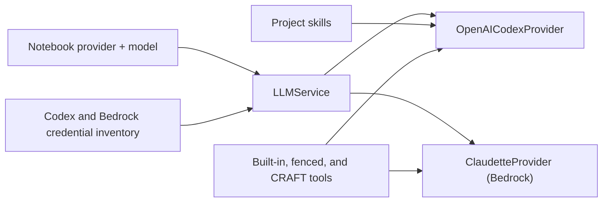
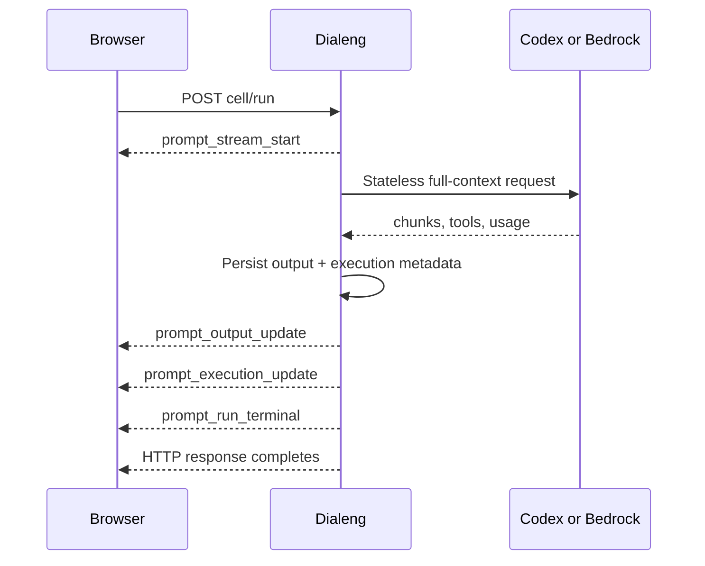

# OpenAI Codex And Bedrock Architecture

Dialeng's provider manager resolves a provider for every prompt request and
caches only initialized transport objects. Conversation state is never cached;
the notebook remains the authoritative context.

## Components

`LLMService` owns provider/model validation, prompt parsing, variable injection,
tool discovery, and skill augmentation. Providers only translate the normalized
request and emit normalized events.

## Codex Authentication And Transport

Codex credentials come from `DIALENG_OPENAI_CODEX_ACCESS_TOKEN` or Dialeng's
private `~/.dialeng/auth.json` OAuth store. Login uses PKCE and a loopback
callback, with manual completion available when the callback port cannot be
opened. Browser status responses never expose tokens.

The Codex provider uses WebSocket first and SSE as a pre-output fallback. It
sends a fresh Responses request with `store=false`, complete text/image context,
tool definitions, and `parallel_tool_calls=false`. Hidden reasoning is never
shown; only supported reasoning summaries are normalized for the UI.

Project skills are discovered from `.dialeng/skills/`. Their compact metadata
is added to the Codex system prompt, while `read_skill` provides constrained,
on-demand access to skill files.

## Bedrock Transport

The Bedrock provider uses the AWS credential chain and configured region to
construct `AnthropicBedrock`, then passes it to Claudette. It supports the same
provider-neutral notebook context, built-in tools, fenced tools, images, usage,
and output event contract as Codex.

## Selection And Collaboration

Provider and model changes are backend-authoritative and broadcast to every tab.
Codex is the default when both providers are authenticated. A notebook with an
unknown provider cannot run until the user selects an available provider; Dialeng
does not silently reinterpret unsupported provider metadata.

Project configuration is validated before provider initialization. Every model
must explicitly belong to `openai_codex` or `bedrock`; removed provider keys and
unknown provider defaults stop startup with a path-specific diagnostic rather
than being ignored. Import-time bootstrap uses in-memory defaults until the CLI
has selected the actual project root.

## Prompt Operation Boundary

Prompt execution has one operation ID from request through terminal commit.
While it is active, notebook mutations, explicit saves, and provider/model
changes receive an immediate `409 prompt_operation_conflict` response with Wait
and Cancel choices. Deleting an open notebook first cancels its active prompt.
Closing a browser tab does not cancel a server-owned run; another tab can keep
observing it and the result remains notebook-authoritative.

Prompt Shift+Enter navigation is deferred until `prompt_run_terminal`. This
keeps next-cell creation out of the active mutation window. Cleanup removes the
operation marker in an unconditional `finally` path, so persistence or broadcast
failures cannot permanently block the notebook.

## Diagnostics, Usage, And Failures

Each prompt cell stores `dialeng_llm_execution` metadata containing the provider,
model, transport, operation ID, time to first token, duration, retries, sanitized
request/response IDs, tool-step count, status, and normalized input/cached/output/
total token usage. The compact cell panel renders this metadata, and the toolbar
sums usage across prompt cells. Neither is included by context construction.

Codex failures are mapped to authentication, model entitlement, rate limit,
network, malformed tool call, server, or generic provider categories. The UI
offers Connect, Choose Model, or Retry as appropriate. A failed run with no new
assistant content updates diagnostics but preserves the previously authored
response.

## Validation

Normal CI uses the deterministic provider. Authenticated Codex validation is
explicitly opt-in and uses independent one-call browser scenarios for current
context, images, tools, skills, and persistence/reload. Tests wait for the
backend terminal boundary and capture screenshots, traces, browser errors, and
redacted server logs on failure.
