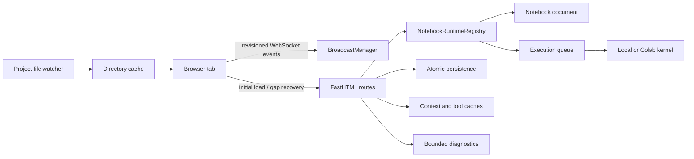
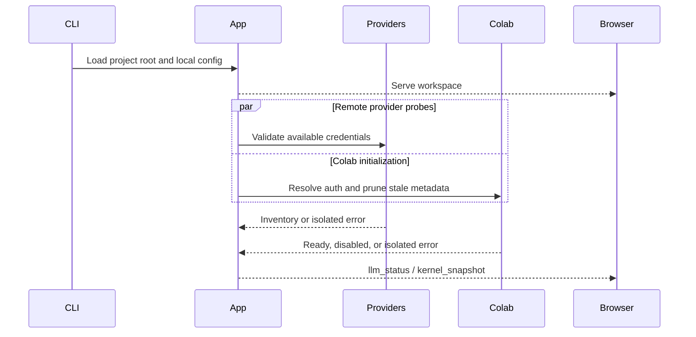
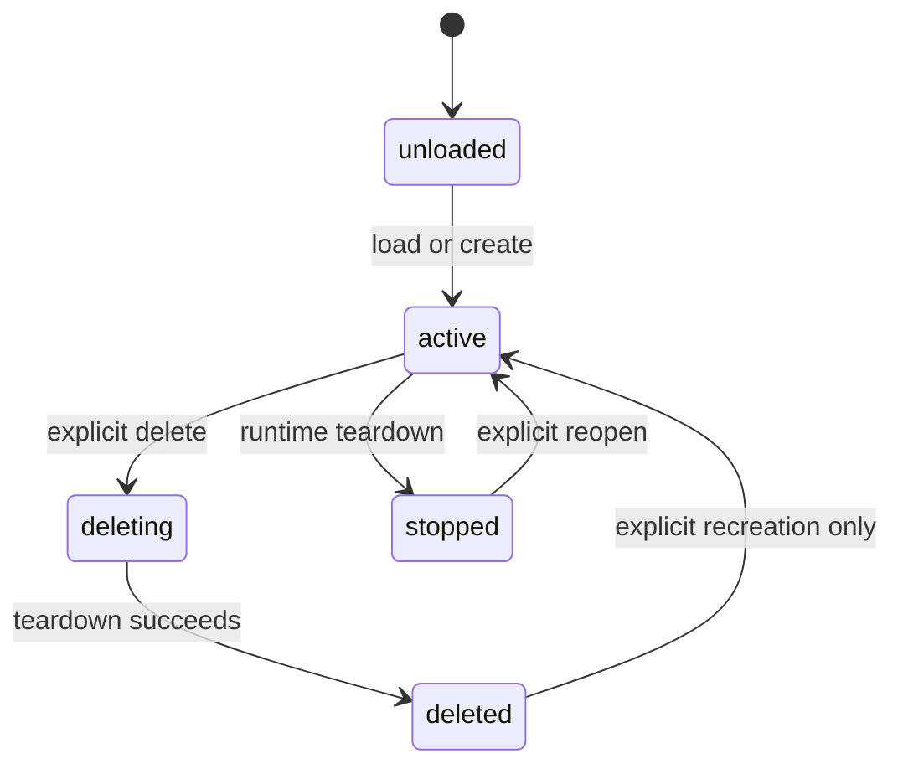

# Performance, Reliability, and Recovery Architecture

This document describes the runtime, transport, persistence, rendering, cache,
and diagnostics changes introduced by the performance and reliability roadmap.
The design keeps Dialeng backend-authoritative while avoiding unnecessary
polling, blocking startup work, eager editor creation, and unsafe persistence.

## 1. Architecture Overview



The supported deployment remains one Dialeng ASGI worker. Runtime state is
process-local by design. Starting multiple workers is unsupported until a
shared coordination backend is introduced.

## 2. Non-Blocking Startup

Startup performs only local configuration and credential discovery before the
application becomes available. Remote provider validation and Colab setup run
as independent background tasks owned by the ASGI lifespan.



Provider selectors can show `validating` while probes run. A failed provider or
Colab initialization does not suppress another provider or prevent local
notebook use.

The ASGI lifespan owns:

- remote provider and Colab initialization;
- AUTORUN processing;
- event-loop lag monitoring;
- project filesystem watching;
- bounded autosave flush and kernel cleanup during shutdown.

## 3. Runtime Registry and Serialized Mutations

`NotebookRuntimeRegistry` owns each notebook's mutable runtime state in one
`NotebookRuntime` object. Compatibility field maps let existing call sites
migrate without maintaining independent dictionaries.

The runtime includes notebook document state, lifecycle, execution queue,
kernel generation, setup/sync tasks, mutation lock, stream revisions, data
queues, and bounded completed operation IDs.

Structural and source mutations use a per-notebook async lock. Browser requests
may include:

- `expected_revision`: rejects stale ordering assumptions with HTTP `409`;
- `operation_id`: makes a retried operation idempotent.



Deletion tombstones prevent stale tabs from implicitly recreating deleted
notebooks. Queue completion callbacks also verify that the notebook and target
cell still exist before committing output.

## 4. Revisioned WebSocket Protocol

Normal state propagation is WebSocket-first. Periodic full kernel snapshots are
not requested while the connection is healthy.

Protocol events contain:

```json
{
  "type": "cell_move",
  "notebook_id": "demo~analysis",
  "stream": "notebook",
  "revision": 12,
  "event_id": "unique-event-id",
  "authoritative": false
}
```

Revision domains are independent:

- `notebook`: cell order, source versions, and structure;
- `kernel`: connection, setup, and queue state;
- `outline`: headings and namespace state;
- `llm`: provider and model inventory;
- `output`: ordered execution and prompt output events;
- `persistence`: save and recovery state.

The page receives an initial revision baseline together with its rendered cell
structure. Kernel snapshots advance only the `kernel` revision because they do
not contain authoritative cell structure. A full recovery snapshot advances
all streams after replacing the complete cell container.

Browser-to-server control messages use FastHTML's outer `msg` field. Join,
heartbeat, cancellation, and tool-confirmation payloads are encoded inside it.

### Reconnect and gap recovery

1. The browser reconnects with its last applied revisions.
2. The server compares notebook, output, and persistence revisions.
3. A mismatch emits `resync_required`.
4. The browser performs one `GET /dialeng/{id}/recovery` request.
5. The complete rendered cell structure and runtime snapshot replace stale
   state while preserving the focused cell and scroll position when possible.

Duplicate event IDs and already-applied revisions are ignored. A non-
authoritative revision gap triggers the same one-shot recovery path.

## 5. Backpressure and Output Batching

`BroadcastManager` gives each browser socket an independent bounded queue and
writer task. A slow or suspended tab therefore cannot block healthy tabs.

Event policies are explicit:

- structural and terminal lifecycle events are preserved;
- kernel snapshots, provider status, and queue updates coalesce to the newest
  pending value;
- adjacent output chunks for the same cell and stream are combined;
- a client that overflows on non-droppable events is disconnected and recovers
  on reconnect;
- send timeouts remove clients that cannot make progress.

Connections use the WebSocket handshake key rather than callback-function
identity, because FastHTML may create a new `send` wrapper for disconnect.

The browser batches prompt and code chunks before DOM insertion. Final
authoritative output still comes from backend completion, preserving
`clear_output`, `update_display_data`, progress-bar, rich MIME, and error
semantics.

## 6. Atomic Persistence and Optional Autosave

Explicit save remains the default workflow. Atomic explicit saves are a safety
property and do not enable autosave.

```json
{
  "persistence": {
    "atomic_explicit_save": true,
    "autosave": {
      "enabled": false,
      "debounce_ms": 1500,
      "idle_only": true,
      "recovery_snapshots": true,
      "max_recovery_files": 5
    }
  }
}
```

### Explicit saves

- write a temporary file in the notebook directory;
- flush and `fsync` it;
- atomically replace the canonical file;
- retain the previous file if replacement fails;
- reject an external modification unless overwrite is explicit;
- report `Modified`, `Saving`, `Saved`, or `Save failed` in the toolbar.

### Opt-in autosave

Autosave creates no timer or background write when `enabled` is false. When
enabled, mutations schedule one debounced task per notebook. Repeated edits
replace the pending task, idle-only mode waits for active execution/streaming,
and server shutdown attempts a bounded final flush.

Recovery snapshots are optional and retained under `.dialeng/recovery/` with a
bounded count. Dialeng never silently replaces the canonical notebook. The UI
offers inspect, restore, or discard. A malformed recovery file is rejected
before canonical bytes are changed and remains available for inspection.

## 7. Large Notebook Rendering

Code and shell cells initially render lightweight Monaco placeholders. An
`IntersectionObserver` creates editor views only for visible and near-visible
cells. Focusing a placeholder creates its editor immediately.

Models and views have separate lifecycles:

- one model retains source for each initialized cell;
- editor view state retains cursor and selection;
- distant editor views are disposed after an idle delay;
- remote source updates can update a model without creating a view;
- structural operations reconcile only affected cells.

Off-screen cells use `content-visibility`, rich images use lazy decoding, and
large output blocks collapse behind an explicit expansion action. The initial
HTML does not load Monaco; the loader is requested only when a cell enters the
activation window.

## 8. Modular Runtime Boundaries

The first extraction pass is deliberately behavior-preserving rather than a
rewrite:

- `routes/diagnostics.py` and `routes/websocket.py` register routes from
  explicitly supplied services and callbacks;
- `websocket_protocol.py` parses browser control messages without FastHTML
  globals;
- `notebook_mutation_service.py` owns canonical add, delete, move, duplicate,
  and merge behavior while routes own transport side effects;
- `notebook_client.js` owns revision/event-ID bookkeeping;
- `event_dispatcher.js` provides independently testable event routing;
- `structure_controller.js` validates backend-authored order before DOM work;
- `execution_ui.js` provides bounded frame batching for streamed prompt text;
- `notifications.js` owns toast timing and bounded status history;
- `browser_diagnostics.js` owns content-free browser measurements.

`app.py` and `app.js` remain composition/coordinator layers for compatibility
flows that have not yet earned a stable service boundary. New stateful behavior
should be added to a service or controller and wired from those files rather
than extending global dictionaries or the WebSocket conditional chain.

## 9. Caches and Invalidation

### Prompt context

Normalized context blocks are cached by cell ID, version, type, skipped state,
and pinned state. Editing one cell invalidates only that block. Dynamic Python
variable and expression injection remains outside the cache and executes for
every prompt.

The context inspector reports included, skipped, truncated, and dynamic cells,
image counts, CRAFT contributions, and a token estimate without exposing
credentials or hidden model reasoning.

### File explorer

Directory listings use an LRU keyed by resolved path and directory signature.
`watchfiles` invalidates affected parent directories and broadcasts a targeted
`file_explorer_changed` event. A closed explorer does not refresh itself.

### Outline

Heading extraction is cached by note-cell version. Kernel namespace results are
cached by notebook, kernel generation, and execution count. A closed outline
does not request namespace data.

## 10. Diagnostics

`PerformanceMonitor` stores bounded, content-free counters, gauges, durations,
and recent events. Values are truncated and redacted before exposure.

Development endpoints:

- `GET /dialeng/diagnostics/performance`: server metrics and registry summary;
- `POST /dialeng/diagnostics/browser`: long-task, editor, visible-cell, and DOM
  counts reported by a browser tab;
- `GET /dialeng/{id}/diagnostics`: notebook runtime, kernel, queue, setup,
  revisions, and autosave state.

The toolbar diagnostics panel distinguishes browser connectivity, kernel state,
queue work, setup phases, revisions, autosave, and recent status messages. It
provides explicit interrupt and restart actions. Cancelling an LLM response
states that the Python kernel was not interrupted.

Request metrics normalize route paths to avoid unbounded notebook/cell labels.
Prompt text, source code, output payloads, images, credentials, and tokens are
not recorded.

## 11. Benchmarks and Tests

`benchmarks/performance_baseline.py` records representative document,
serialization, context, and registry costs. `tests/test_performance_benchmark.py`
keeps broad regression ceilings deterministic in CI.

Coverage includes:

- bounded and independent WebSocket delivery;
- output chunk coalescing and structural overflow;
- control-message framing and connection cleanup;
- reconnect revision negotiation and full recovery;
- expected revisions and idempotent mutations;
- generated mixed add/move/duplicate/merge/delete sequences with canonical
  order and unique-ID invariants after every operation;
- atomic replacement failure and external modification conflicts;
- autosave disabled-by-default behavior and coalescing;
- malformed recovery snapshots;
- context, directory, heading, and namespace caches;
- large notebook placeholder rendering and lazy images;
- provider isolation, Codex transport failures, and Colab resilience.
- local-kernel process, queue feeder, and semaphore cleanup across repeated
  start/stop cycles.

Manual browser validation uses a 200-cell notebook and two tabs to verify lazy
editor bounds, off-screen disposal, add/move/delete synchronization,
Shift+Enter insertion, streaming output, save state, diagnostics, settings,
workspace, file editor, heartbeat, and reconnect behavior.

## 12. Operational Guidance

- Keep autosave disabled unless the project explicitly wants background
  persistence.
- Use the diagnostics panel before restarting a kernel; browser, provider, and
  kernel failures are separate states.
- Treat `/dialeng/{id}/recovery` as a convergence mechanism, not a normal
  polling endpoint.
- Run one ASGI worker. Multiple workers would each own conflicting notebook and
  kernel registries.
- Stop Dialeng with `Ctrl+C` so local subprocesses and Colab assignments receive
  bounded cleanup.

## 13. Related Documents

- [State management](01_state_management.md)
- [Real-time collaboration](03_real_time_collaboration.md)
- [Kernel execution](04_kernel_execution.md)
- [LLM integration](06_llm_integration.md)
- [Editor transitions](17_editor_cell_transitions.md)
- [Performance, Reliability, and UX Roadmap](../superpowers/plans/2026-07-09-performance-reliability-ux-roadmap.md)
