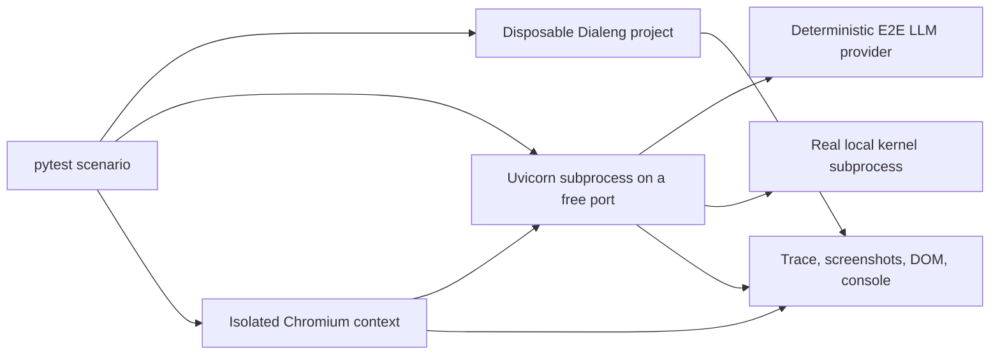

# Browser E2E Testing

Dialeng's browser regression suite uses Python Playwright with pytest. Each test
starts the real ASGI application in a subprocess, creates an isolated project,
and drives Chromium through the same HTTP and WebSocket paths used by users.

## Architecture



`DIALENG_E2E=1` is the only switch that registers the deterministic provider
and fault-injection routes. The credential inventory is replaced entirely in
that mode, so developer Anthropic, OpenAI, AWS, and Google credentials cannot
be selected accidentally. Normal Dialeng servers do not expose the E2E routes.

The deterministic provider has three models:

- `e2e-fast` emits predictable chunks and usage without delay.
- `e2e-slow` follows the same contract with cancellable streaming.
- `e2e-error` emits a predictable provider error.

## Scenarios

The suite covers cell add/convert/move/duplicate/merge/delete, Mock and provider
prompt reruns, long-notebook Shift+Enter behavior, editable prompt context,
two-tab synchronization, kernel and WebSocket recovery, open-notebook deletion,
and HTML/JSON/image Jupyter outputs.

Browser assertions wait for semantic state such as cell versions, structure,
kernel generations, authoritative WebSocket updates, and rendered MIME output.
They do not rely on fixed browser sleeps. CI runs the unit suite first and then
the browser suite once, without retries.

## Failure Artifacts

Failed tests write to `test-results/<test-name>/`:

- a full-page screenshot and DOM snapshot for every tab;
- a Playwright trace with screenshots, DOM snapshots, and sources;
- browser console events and page exceptions;
- redacted combined server logs and notebook diagnostics;
- the final disposable `.ipynb` files.

Token-like values are redacted before text artifacts are persisted. CI uploads
this directory only when the browser job fails.

## Running Tests

```bash
uv sync --group dev
uv run playwright install chromium
uv run pytest -q -m e2e tests/e2e
```

External smoke tests are never part of pull-request CI. Run one explicitly only
when its credentials and network side effects are intended:

```bash
DIALENG_RUN_EXTERNAL_OPENAI=1 uv run pytest -m external_openai -q
DIALENG_RUN_EXTERNAL_COLAB=1 uv run pytest -m external_colab -q
```

The Colab smoke test validates authentication and assignment listing without
allocating a new runtime. Full manual CPU/GPU attach tests remain in the Colab
guides because they consume external quota.

The Codex suite starts a normal isolated Dialeng server without the deterministic
provider. It validates direct streaming and the browser prompt flow for context
edits, images, kernel-defined tools, project skills, save/reload persistence,
browser console errors, and redacted server diagnostics.
