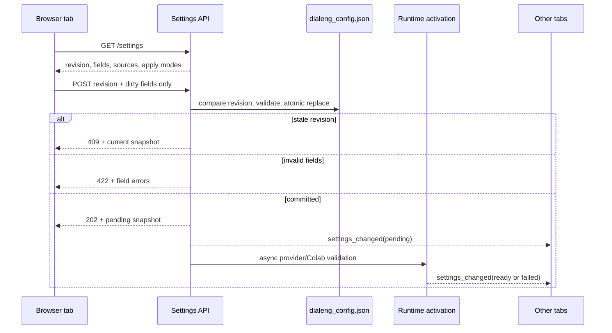

# Backend-Authoritative Settings

Dialeng stores project configuration in `dialeng_config.json`. The settings UI
is a view and editor for that backend state; it is not an independent source of
truth.

## Lifecycle

The revision is a SHA-256 digest of canonical JSON. The browser sends only
dirty paths, so an untouched field cannot overwrite a value changed in another
tab. If a peer update arrives while a field is dirty, Dialeng advances the
revision and refreshes clean fields but preserves that local edit for review.

## Typed Definitions

`services/settings_service.py` defines each core setting with:

- dotted configuration path;
- boolean, integer, or string type;
- default value;
- optional bounds or allowed values;
- apply mode;
- optional environment override.

The server rejects unknown core fields and invalid values before persistence.
Controls rendered by extension settings sections register a compatible dynamic
definition, preserving the existing renderer API while making those submitted
values participate in validation.

## Effective Values And Sources

Every snapshot distinguishes `configured_value` from `effective_value` and
reports `project`, `default`, or `environment` as the source. An environment-
managed control is disabled and identifies its environment variable. For
example, `DIALENG_COLAB_AUTH_PROVIDER` takes precedence over
`colab.auth_provider` without allowing the panel to imply that a project edit
would override it.

## Persistence And Activation

Configuration writes use a same-directory temporary file, `fsync`, and
`os.replace`. A failed replacement leaves the previous file intact and removes
the temporary file.

Persistence and activation are separate phases. Once validated JSON is
committed, the request returns immediately. Provider probing and Colab setup run
in a serialized background task so network or subprocess probes do not block
the FastAPI event loop. Activation state is broadcast as `pending`,
`validating`, `ready`, or `failed`. A failure is reported as "saved but not
activated" rather than falsely claiming the runtime accepted it.

Apply modes are:

| Mode | Meaning |
|---|---|
| `live` | Existing pages or services update without a restart. |
| `new_kernel` | Existing kernels are preserved; the value applies on the next attachment. |
| `reload` | A browser reload is required. |
| `server_restart` | Dialeng must restart. Colab auth-provider changes use this mode to avoid tearing down active runtimes. |

Display variables and optional autosave state apply immediately in the browser.
Shell-cell availability remains restart-bound because cell-type controls are
server-rendered.

## `.dialeng` Data

Project-local data contains shareable `.dialeng/skills/` and optional private
`.dialeng/recovery/` snapshots. `dialeng init` adds only the recovery directory
to `.gitignore`; it does not ignore skills. User-global `~/.dialeng/` contains
OpenAI OAuth, Colab OAuth/client caches, and Colab session metadata and must not
be committed.

## Tests

`tests/test_settings_service.py` covers validation, effective sources, atomic
writes, extension controls, route status codes, and stale revisions.
`tests/e2e/test_settings.py` runs a real server and verifies live CSS changes
plus clean/dirty two-tab synchronization.
