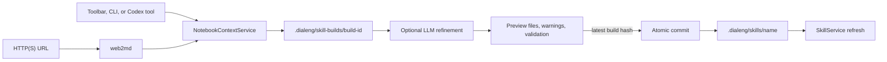

# Notebook-To-Skill Creation

## Overview

Dialeng separates notebook extraction, skill authoring, review, and installation
so an LLM never writes directly into the active skill directory. The extraction
shape is inspired by `nbs2ctx`, but uses Dialeng's internal cell model so Prompt
input and the user's edited assistant response remain distinct authored context.

## Discovery And Precedence

`SkillService` scans two roots. Packaged skills under
`dialeng/builtin_skills/` load first, followed by project skills under
`.dialeng/skills/`. A project skill may intentionally override a built-in by
name. The backwards-compatible `skills` property still returns project-owned
skills; `all_skills` and `model_skills` include resolved built-ins.

Runtime validation checks frontmatter, name and description, non-empty
instructions, a 500-line instruction limit, size limits, duplicate names, and
resolved path confinement. `read_skill` constrains resources to the registered
skill directory.

## Extraction

`NotebookContextService` resolves project-relative notebooks, supported text/code
files, directories, glob patterns, and HTTP(S) URLs. Web pages are converted to
Markdown through `web2md`. It rejects local paths outside the project, malformed
URLs, unsupported files, checkpoints, and `.dialeng` internals. Sources are
sorted and de-duplicated for deterministic builds.

The renderer applies these rules:

- skipped cells are omitted;
- Notes become Markdown sections;
- Code and extension cells become fenced Python source;
- Prompt cells become separate User and Assistant sections;
- pinned and exported state is recorded as reference metadata;
- text output is bounded and opt-in;
- rich images and binary output are omitted;
- common token, key, secret, and password forms are redacted;
- total extracted UTF-8 bytes are bounded by `skills.max_source_bytes`.
- local text/code files retain a language-appropriate fenced representation;
- web references record their URL, converted-content hash, and UTC fetch time.

The bundle can also emit an escaped `<documents>` structure compatible with the
document boundaries used by notebook-to-context tools.

## Staging And Refinement

`SkillCreationService.create_build` writes a deterministic `SKILL.md`, one
reference per source, provenance metadata, and a private build manifest. It
does not modify `.dialeng/skills`.

`refresh_build_sources` re-reads local files and reconverts web pages while
preserving the reviewed `SKILL.md`. It changes the preview hash, so installation
still requires a new explicit review/confirmation.

Browser and CLI callers may invoke `refine_build`. The selected provider receives
the complete extracted references in a fresh stateless request and must return a
JSON `instructions` string. Dialeng owns frontmatter and reference files, so a
malformed response cannot change the target name, escape the build directory, or
silently replace source provenance. If refinement fails, the deterministic draft
remains available with a warning.

Codex can perform the same workflow with dedicated tools. The packaged
`skill-creator` instructs it to build, inspect, optionally update the staged
instructions, inspect again, and commit only after an explicit user request.

## Commit Semantics

Every preview has a SHA-256 hash over its installable files. Commit rejects an
expected hash that no longer matches, validation failures, path escapes, and an
existing target unless the explicit update flow requested replacement.

Files are copied to a sibling temporary directory and renamed into place. During
an update, the old directory is renamed to a temporary backup and restored if
replacement fails. After success, the staging directory is removed and
`SkillService` is force-refreshed.

## HTTP API

- `GET /dialeng/skills` lists resolved skills, diagnostics, project sources, and builds.
- `POST /dialeng/skills/build` stages and optionally refines a build.
- `GET /dialeng/skills/build/{id}` returns the authoritative preview.
- `POST /dialeng/skills/build/{id}/update` replaces staged instructions.
- `POST /dialeng/skills/build/{id}/refresh` refreshes local and web references.
- `POST /dialeng/skills/build/{id}/commit` validates the preview hash and installs.

The browser modal uses these APIs and renders all generated files. It never
constructs or installs a skill from client-only state.

## Security Boundary

Notebook content is untrusted source material. Redaction is a defense-in-depth
warning mechanism, not a complete secret scanner. Users must review every file,
especially when outputs are included. Generated scripts are not produced or
executed automatically. Staged builds are ignored by Git because they can contain
private notebook context; installed skills remain ordinary project files that a
user may review and commit.
