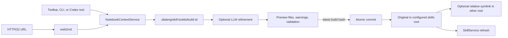
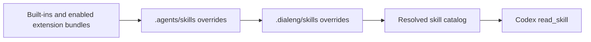

# Notebook-To-Skill Creation

## Overview

Dialeng separates notebook extraction, skill authoring, review, and installation
so an LLM never writes directly into the active skill directory. The extraction
shape is inspired by `nbs2ctx`, but uses Dialeng's internal cell model so Prompt
input and the user's edited assistant response remain distinct authored context.

## Discovery And Precedence

`SkillService` scans packaged skills under `dialeng/builtin_skills/`, enabled
extension skill bundles, project-shared `.agents/skills/`, and finally
Dialeng-specific `.dialeng/skills/`. Matching frontmatter names resolve with
`.dialeng` above `.agents`, and both above packaged sources. Packaged sources keep
their existing first-discovered behavior; duplicate names within the same local
root or among packaged sources are non-fatal diagnostics. Invalid overrides do
not replace valid lower-precedence skills.

The `skills` property returns resolved project-owned skills from both local
roots, including CLI list/validate. Shared skills use source `agents`;
Dialeng-local skills keep source `project`. `all_skills` and `model_skills` also
include resolved packaged skills. HTTP previews and execution metadata retain
the selected skill's source and hash.

Both local roots are resolved and confined to the selected project on every
discovery scan. Root diagnostics participate in the cached directory signature,
so adding/removing a root or changing a root symlink refreshes the catalog and
diagnostics. SKILL.md modification times and sizes trigger reloads as before;
resources are read on demand. There is no parent-directory or user-global scan.
Creation/update default to `.dialeng/skills/` and can select `.agents/skills/` as
the original instead. Directory symlinks created in the other root are not
recursively traversed by discovery: the original supplies the one catalog entry
and its source provenance. Removing an independent override restores the next
valid skill. A disabled override masks lower-precedence versions and cannot be
read by the model.

Runtime validation checks frontmatter, name and description, non-empty
instructions, a 500-line instruction limit, size limits, duplicate names, and
resolved path confinement. `read_skill` constrains resources to the registered
skill directory.

## Extraction

`NotebookContextService` resolves project-relative notebooks, supported text/code
files, directories, glob patterns, and HTTP(S) URLs. Web pages are converted to
Markdown through `web2md`. It rejects local paths outside the project, malformed
URLs, unsupported files, checkpoints, and `.dialeng` internals. Sources are
sorted and de-duplicated for deterministic builds.

The renderer applies these rules:

- skipped cells are omitted;
- Notes become Markdown sections;
- Code and extension cells become fenced Python source;
- Prompt cells become separate User and Assistant sections;
- pinned and exported state is recorded as reference metadata;
- text output is bounded and opt-in;
- rich images and binary output are omitted;
- common token, key, secret, and password forms are redacted;
- total extracted UTF-8 bytes are bounded by `skills.max_source_bytes`.
- local text/code files retain a language-appropriate fenced representation;
- web references record their URL, converted-content hash, and UTC fetch time.

The bundle can also emit an escaped `<documents>` structure compatible with the
document boundaries used by notebook-to-context tools.

## Staging And Refinement

`SkillCreationService.create_build` writes a deterministic `SKILL.md`, one
reference per source, provenance metadata, and a private build manifest. It
does not modify either installed skills root. `skills.install_root` (`dialeng`
by default, or `agents`) and `skills.link_other_root` (false by default) supply
creation defaults. Browser, CLI, HTTP, and model-tool callers can override them.
The chosen values are validated and saved in `SkillBuild`; later configuration
changes cannot redirect an existing draft. Older manifests without these fields
retain the original `.dialeng`/no-link behavior.

`refresh_build_sources` re-reads local files and reconverts web pages while
preserving the reviewed `SKILL.md`. It changes the preview hash, so installation
still requires a new explicit review/confirmation.

Browser and CLI callers may invoke `refine_build`. The selected provider receives
the complete extracted references in a fresh stateless request and must return a
JSON `instructions` string. Dialeng owns frontmatter and reference files, so a
malformed response cannot change the target name, escape the build directory, or
silently replace source provenance. If refinement fails, the deterministic draft
remains available with a warning.

Codex can perform the same workflow with dedicated tools. The packaged
`skill-creator` instructs it to build, inspect, optionally update the staged
instructions, inspect again, and commit only after an explicit user request.

## Commit Semantics

Every preview has a SHA-256 hash over its installable files and the name,
original root, and link choice. Both `target` and optional `link_target` are
included in the preview. Commit rejects an
expected hash that no longer matches, validation failures, path escapes, and an
existing target unless the explicit update flow requested replacement.

Installation is serialized within the server process. Both destination roots
must resolve within the project; the original must not itself be a symlink.
The other-root path must be absent or already link to that exact original.
Independent directories/files and unrelated links are rejected even in update
mode. Roots resolving to the same directory are rejected when linking is enabled.

Files are copied to a sibling temporary directory and renamed into place. A
requested alias uses a relative directory symlink. During an update, the old
directory is renamed to a temporary backup. If replacement or link creation
fails, the new original is removed and the backup restored; a failed first
installation leaves no installed skill. The staged build remains available for
retry. After success, the staging directory is removed and `SkillService` is
force-refreshed. Turning linking off does not remove preexisting aliases, and
changing settings does not migrate installed skills.

## HTTP API

- `GET /dialeng/skills` lists resolved skills, diagnostics, project sources, builds, and creation defaults.
- `POST /dialeng/skills/build` stages and optionally refines a build, accepting optional `install_root` and `link_other_root` overrides.
- `GET /dialeng/skills/build/{id}` returns the authoritative preview.
- `POST /dialeng/skills/build/{id}/update` replaces staged instructions.
- `POST /dialeng/skills/build/{id}/refresh` refreshes local and web references.
- `POST /dialeng/skills/build/{id}/commit` validates the preview hash and installs.

The browser modal uses these APIs and renders all generated files. It never
constructs or installs a skill from client-only state.

## Security Boundary

Notebook content is untrusted source material. Redaction is a defense-in-depth
warning mechanism, not a complete secret scanner. Users must review every file,
especially when outputs are included. Generated scripts are not produced or
executed automatically. Staged builds are ignored by Git because they can contain
private notebook context; installed skills remain ordinary project files that a
user may review and commit.
