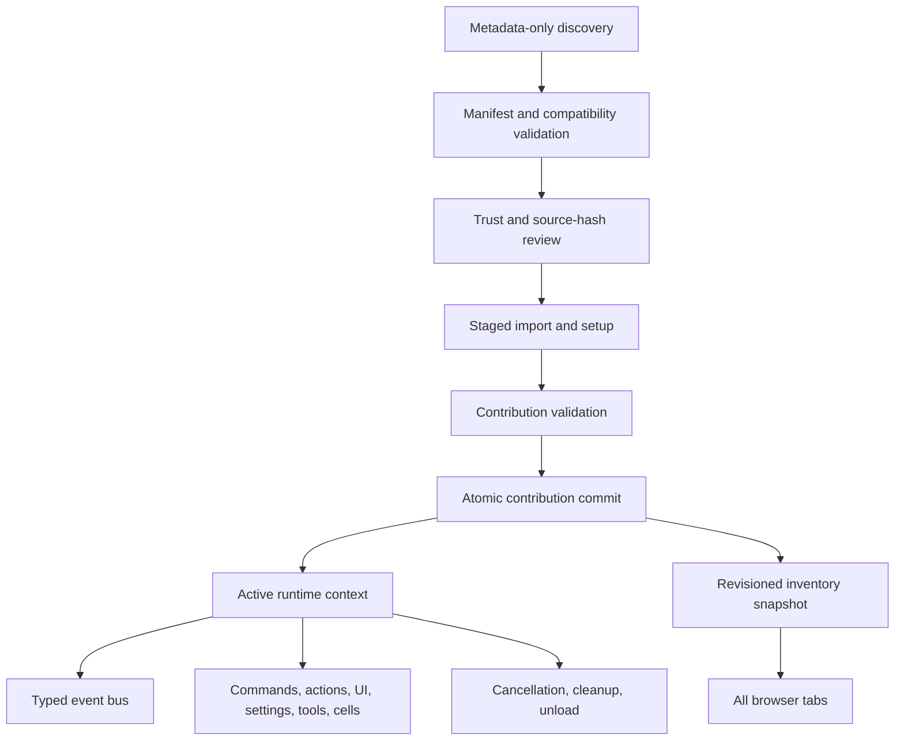
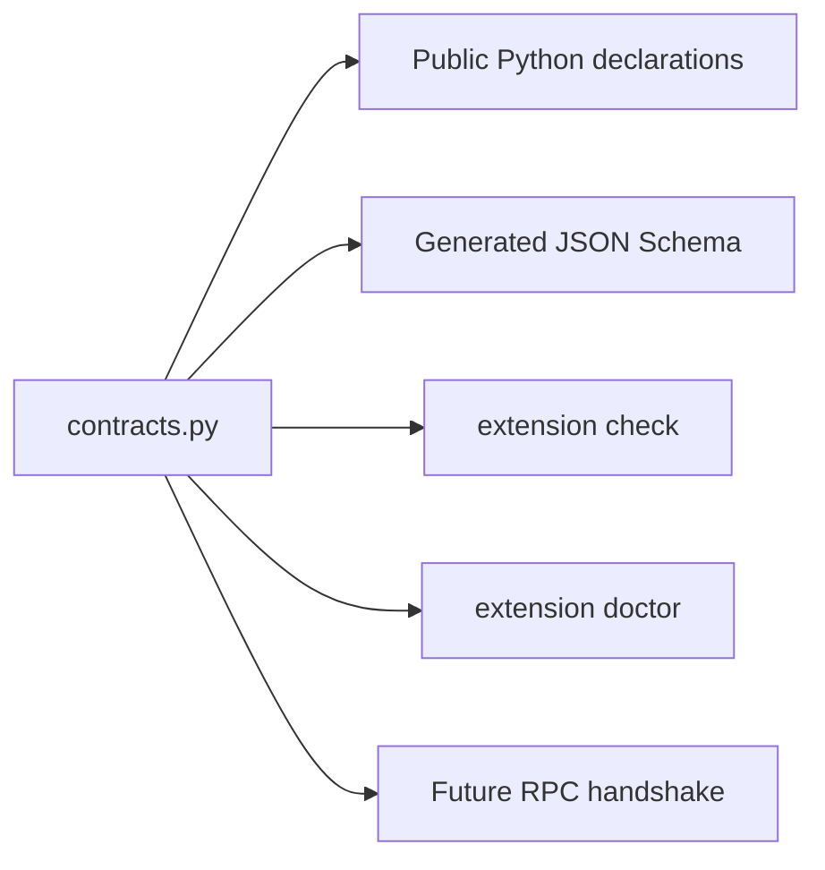

# Extension Platform Internals

## Architecture

`manifest.py` validates API compatibility, scope, assets, resources, and source
hashing. `discovery.py` inspects built-in, installed-package, user, project, and
development sources without importing entry points. Precedence is development,
project, user, package, then built-in; equal-precedence duplicate IDs become
diagnostics rather than arbitrary winners.

`contracts.py` is the canonical public contract source. It owns Extension API,
manifest schema, and future RPC protocol versions; Dialeng-owned setting, cell,
kernel, and provider declarations; the compatibility policy; and the generated
JSON Schema catalog at `dialeng/schemas/extension-api-v1.schema.json`. A CI test
compares the committed catalog with a fresh generation so documentation and
runtime declarations cannot drift silently.

## Transactional Activation

`ExtensionManager.activate` serializes mutations with one async lock:

1. Refresh metadata and resolve the winning source.
2. Require a matching trust record.
3. Reject stale validation evidence when a build record exists.
4. Create a unique module namespace and `RegistrationScope`.
5. Import and call `setup(api, ctx)` while registration capture is active.
6. Reject setup timeouts and unmanaged extension-owned tasks.
7. Validate declarations, assets, and contribution categories.
8. Atomically replace all contributions for the owner in `ContributionStore`.
9. Publish the active runtime, then clean up the previous runtime.
10. Emit lifecycle events and broadcast a revisioned inventory.

An exception before commit cleans the candidate context and module. The previous
owner remains in the live registries. A successful replacement rebuilds affected
maps and lists from base values plus current owners, which removes registrations
deleted by the new version and prevents callback/deserializer accumulation.

## Ownership

Every captured contribution records kind, qualified name, owner, extension
version, source location, and replacement policy. Maps and ordered lists are
rebuilt through one contribution ledger. Core registrations are retained as base
values and cannot be overwritten by extensions.

Built-ins use the same `setup(api, ctx)` facade and synthetic `builtin.*` owners.
Legacy AUTORUN code is staged under `legacy.autorun.*` owners. Both are visible in
inventory; only manifest-managed sources expose enable/disable controls.

## Trust Model

Trust records are atomic private JSON under `~/.dialeng`. Exact-version trust
binds ID, version, source hash, canonical root, origin, and permission fingerprint.
Project trust omits version/hash but still binds project source and permissions.
One-session trust is memory-only. RPC-safe extensions run in supervised isolated
hosts; contributions that require kernel/provider/Python-renderer objects remain
explicitly privileged in-process trusted code.

The isolated host cannot directly read project files, open network connections,
or spawn processes. It uses a core-side broker that rechecks exact manifest path
patterns and the `network`, `subprocess`, `notebook`, and `kernel` capabilities.
Resolved paths reject traversal and symlink escapes. Child audit hooks are
defense-in-depth; process isolation is not an OS sandbox. Declared
assets/resources are normalized and cannot escape the extension root.
Diagnostics redact likely tokens, authorization values, cookies, and secret
settings.

## Backend And Browser State

The manager snapshot contains discovered, shadowed, active, blocked, failed,
legacy, and built-in records; owned contributions; tasks; trust; source/update
hashes; resources; and event diagnostics. Mutations broadcast `extension_snapshot`
to every tab. Browser code reconciles dynamic settings, type choices, toolbar,
status, panels, and versioned assets without recreating notebook editors. A full
reload is reserved for kernel/provider changes and custom-cell renderer changes
that affect cells currently in the DOM.

Declared ES modules receive only `window.dialeng.extensions`. WebSocket events
also dispatch `dialeng:<event-type>` custom events. Cleanup hooks are associated
with asset ownership and run once before old assets are removed.

## Events And Failure Policy

The event bus selects handlers by event, order, and qualified name. Async handlers
have per-registration deadlines. Transform payloads chain; guard failures fail
closed; observer errors are diagnosed and isolated. Three consecutive failures
disable only that handler until its owning extension reloads.

Core integration includes app/project startup and shutdown, project files, trust,
notebook open/save/delete, cell structure/type, execution queue/output/terminal,
prompt context/request/stream/terminal, tool calls, kernels, settings, and extension
lifecycle.

## Commands, Actions, And Settings

Commands are long-lived operations with backend operation IDs, argument schema,
availability predicates, progress broadcasts, cancellation signals, and explicit
cancellation routes. Actions validate request/response objects, attach operation
IDs, and log durations. Extension settings use the existing settings revision and
activation system and are automatically namespaced.

## Custom Cells

A cell extension contributes registration, renderer, Jupyter serializer,
deserializer, and LLM converter as one bundle. When the extension is disabled or
missing, Dialeng creates an unsupported extension cell that retains raw source,
metadata, and original Jupyter type. Re-saving therefore does not destroy data.

## Studio, Skills, And Packages

`ExtensionProjectService` scaffolds notebooks, exports deterministic Python,
compiles it, activates it in a subprocess, runs extension tests, and records the
validated source hash. Its constrained read/update tools use path boundaries and
optimistic content hashes. The built-in `extension-creator` skill can author and
validate, but activation always returns a user-confirmation requirement.

Package discovery reads `dialeng.extensions` metadata and packaged manifests
before importing. Resource bundles can enable skills/templates/CRAFT/notebook
templates independently of runtime Python. nbdev is optional; when configured,
its export/test/clean checks run before Dialeng regenerates the canonical module.

## Compatibility Matrix

| Contract | API 1 |
|---|---|
| Python `setup(api, ctx)` | Stable |
| API compatibility policy | `1.0.0`, compatible range `>=1,<2` |
| Generated contract catalog | `dialeng/schemas/extension-api-v1.schema.json` |
| Metadata/syntax check without import | `dialeng extension check PATH` |
| Project and runtime health report | `dialeng extension doctor` and `/dialeng/extensions/doctor` |
| `extension.toml` schema | Version 1 |
| Project/user/development/package discovery | Supported |
| Commands/actions/settings/events/tools | Supported |
| Toolbar/status/panel/assets | Supported |
| Complete custom-cell bundle | Supported |
| Kernel/provider registration | Supported, may require browser/server restart |
| Skills/templates/CRAFT/notebook-template bundles | Supported |
| AUTORUN decorators | Legacy adapter; migrate for new work |
| Process isolation | Default for RPC-safe contributions; supervised per-extension host |
| Privileged mode | Explicit for kernels/providers/custom cells/Python renderers/internal imports |
| Reproducible environment | `.dialeng/extensions.lock`, `lock`, `sync`, drift `check`, `update` |
| Automatic dependency installation | Locked Git/package restoration delegated to Git and `uv` |
| Online marketplace | Not supported |
