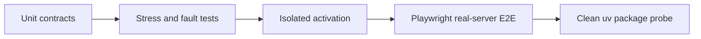

# Extension Platform Verification Baseline

This document is the repeatable acceptance baseline for Extension API 1.

## Automated Layers



Run the complete baseline:

```bash
uv run python -m compileall -q dialeng tests
node --check dialeng/static/js/app.js
uv run pytest -q
uv run pytest -q tests/e2e
```

Focused extension commands:

```bash
uv run pytest -q \
  tests/test_extension_platform.py \
  tests/test_extension_project_service.py \
  tests/test_extension_reference_fixtures.py \
  tests/test_extension_stress.py
uv run pytest -q tests/e2e/test_extension_platform.py
```

## Contract Coverage

- Metadata parsing, compatibility, path safety, hashing, malformed diagnostics,
  duplicate precedence, and no-import discovery.
- One-session/version/project trust and source/permission invalidation.
- Atomic registration, rollback, removal, cleanup, unique modules, and 500 reloads.
- Event ordering, transforms, guards, deadlines, failure isolation, and threshold.
- Command schema, availability, operation IDs, progress, and cancellation.
- Action schema and namespace isolation.
- Settings namespacing, persistence, apply mode, and secret redaction.
- Managed tasks, project path boundaries, network permission, and cleanup deadline.
- Custom-cell Jupyter/LLM round trip and unsupported fallback preservation.
- Asset declaration/path checks, source-hash cache keys, and listener cleanup.
- Studio scaffold/build/isolated activation/test/stale-build rejection.
- Deterministic export and optional nbdev verification.
- Installed wheel metadata discovery without pre-trust import.
- Independent skill/template resource activation.

## Browser Scenarios

The deterministic Playwright suite verifies:

1. `hello-workspace`: review/trust, enable, command, shortcut surface, live setting,
   persistent state, reload, disable, and two-tab inventory convergence.
2. `execution-guard`: local kernel attach, blocked source never reaching the kernel,
   visible error, disable cleanup, and normal execution afterward.
3. `diagram-cell`: type conversion, editing, save/reload, collaboration, CSS/JS
   load once, cleanup once, and data-preserving disabled fallback.
4. `project-inspector-package`: panel, command, and independently enabled skill.
5. Extension Studio: scaffold, build, isolated validation, and no implicit activation.
6. Broken update rollback followed by corrected update activation.

The shared E2E harness captures screenshots, Playwright traces, browser console and
page errors, redacted server logs, diagnostics, and final project/notebook artifacts
on failure.

## Performance And Fault Baseline

Current non-regression checks assert 25 disabled local manifests discover within a
generous two-second shared-CI bound, 500 source reloads retain one contribution set,
one event handler, one browser asset, one task, and one runtime module; concurrent mutations serialize, and repeated event failures stop
at the third call. Package tests build a wheel and use an isolated `uv` environment
to confirm entry-point metadata and bundled resources.

The target is not a universal wall-clock promise. It detects material regressions
in count, lifecycle, and bounded discovery behavior across machines.

## Manual Acceptance

Before releasing changes to extension internals:

1. Start a clean project and create each Studio template.
2. Inspect trust text and verify source is not imported before trust.
3. Enable the four reference fixtures with two tabs and a long notebook open.
4. Reload each while editors are active; confirm scroll, selection, modal state,
   outputs, and unsaved settings remain intact.
5. Change source after `prepare`; confirm activation requires revalidation.
6. Introduce syntax, setup, event, action, asset, and cleanup failures; verify the
   prior extension or core notebook remains usable.
7. Restart Dialeng and verify trusted enabled state and resources restore.
8. Run local and Colab notebooks while unrelated extensions reload.
9. Run Mock, Codex, and Bedrock prompts with an extension tool when credentials
   exist; provider and Colab checks remain opt-in.
10. Disable all fixtures and compare registry, handler, task, browser asset, and
    listener counts with baseline.

Real Codex, Bedrock, and Colab validation is environment-dependent and must be
reported as skipped, not silently assumed, when credentials are unavailable.

## Implementation Acceptance Record

On 2026-07-11 the initial Extension API 1 implementation was verified with
CPython 3.11.14:

- 338 non-browser unit/integration tests passed; one unrelated optional install
  test was skipped and 24 browser/external tests were deliberately deselected.
- The complete deterministic browser run produced 16 passes plus one
  timing-sensitive settings-status assertion; that assertion was corrected to
  accept both successful status messages and its targeted rerun passed. Seven
  real-provider scenarios remained explicitly skipped.
- All six extension-platform Playwright scenarios passed together after the
  final guard-control and isolated-HOME fixes.
- The focused extension contract suite passed 67 tests, including 100 reloads,
  rollback, stale validation, command cancellation, package activation, and all
  four reference fixtures.
- Ruff, Python 3.11 compilation, JavaScript syntax, and `git diff --check` passed.
- The Dialeng wheel contained the extension runtime and `extension-creator`
  skill; the opt-in clean-venv wheel install and idempotent `dialeng init` smoke
  passed.

The opt-in authenticated Codex suite also passed all six scenarios: direct
streaming, notebook context correction, image context, kernel tools, project
skills, and output persistence after reload. The non-allocating Colab OAuth and
assignment-list smoke passed. No authenticated Bedrock test marker or real Colab
runtime allocation was available in this suite, so provider-specific extension
claims for those paths remain unverified rather than implied.
