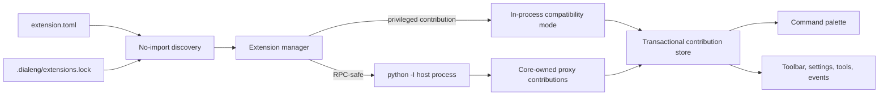
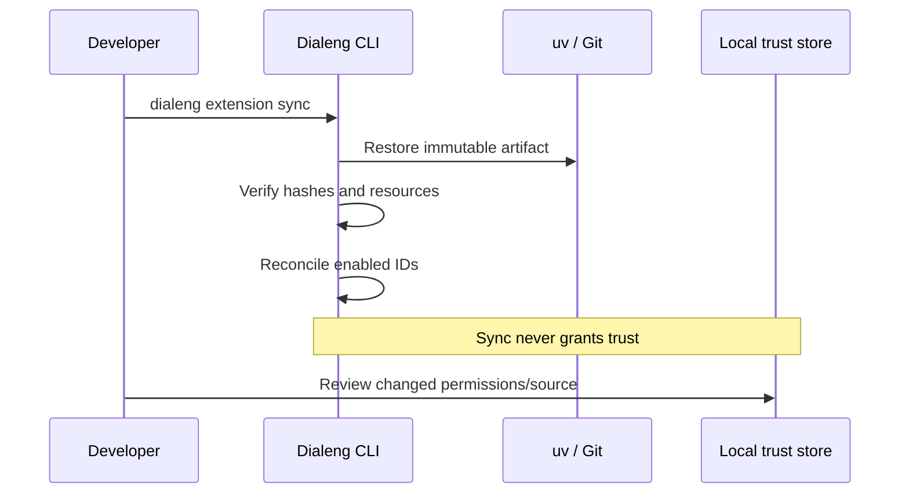

# Extension Runtime, Commands, And Environments

Dialeng Extension API 1 has three separate responsibilities: metadata discovery,
core-owned contribution registration, and extension code execution. Keeping those
boundaries explicit allows the browser, lockfile, and isolated host to share one
backend-authoritative model.

## Runtime Selection

Commands, actions, tools, observe/transform/guard events, declarative toolbar
items, shortcuts, settings, and declared assets are RPC-safe. Dialeng starts one
lazy subprocess for each active extension using `python -I`, a controlled working
directory, and a sanitized environment. Setup returns JSON-safe contribution
definitions; the server reconstructs registrations with proxy handlers. The
extension module is never imported into the server.

Callbacks, custom cells, kernels, providers, panels, status renderers, services,
and imports from internal core/FastHTML modules remain `privileged_in_process`.
The Extension Manager and doctor report the selected mode before trust. This is a
compatibility mode, not an invisible fallback.

The host protocol uses a private Unix-domain socket on POSIX and an authenticated
`127.0.0.1` connection as the portable fallback. Each process receives a random
single-host token, authenticates before RPC starts, and uses protocol version,
request and operation IDs, structured results/errors, state snapshots, progress,
heartbeats, cancellation, and 4 MiB frame bounds. Standard output and error are
logs only, so extension `print()` calls cannot corrupt protocol messages. The
supervisor enforces request deadlines, a CPU limit, an RSS limit, process-group
termination, and at most three consecutive recovery attempts.
A crashed host fails its current operation; a later operation starts a fresh host.
Three consecutive failures disable restart. Candidate hosts initialize and stage
all contributions before the manager atomically replaces the previous healthy host.

Subprocess isolation protects Dialeng from `os._exit`, blocking loops, malformed
protocol output, accidental memory growth, and most lifecycle leaks. It is not a
complete hostile-code sandbox. Python code still runs as the current OS user; a
future platform sandbox would be required to prevent every direct syscall. Public
path resolution and other brokered APIs enforce manifest permissions and reject
traversal and symlink escapes at the core boundary. Isolated extensions use
`ctx.read_text`, `read_bytes`, `write_text`, `write_bytes`, `request_http`,
`run_process`, `change_cell_type`, and `invoke_kernel`; the server performs the
actual operation after permission validation. Direct project-file, socket, and
process attempts are denied even when the related permission is declared.

## Reproducible Environments

`.dialeng/extensions.lock` is committed. `~/.dialeng/extension_trust.json` and
runtime state are private. A lock entry includes extension/version identity,
project-relative path or immutable Git/package/wheel coordinates, source/artifact and
manifest hashes, API compatibility, permission fingerprint, enabled resources,
and the project `uv.lock` fingerprint. It never contains absolute paths, tokens,
or trust decisions.

`lock` and `sync` serialize through a private guard and write the committed file
atomically. Source trees and wheels are cached by SHA-256 under the user cache;
`sync --offline` restores only project artifacts, this populated cache, and uv's
package cache. Missing artifacts produce a terminal diagnostic before enabled
state changes. Wheels are installed into the project's `.venv` when present.
`check` is read-only and reports drift by field. `update [ID]` writes a new
resolution and marks source or permission changes as requiring trust review.
Dependency solving remains `uv`'s responsibility.

## Command Palette

The palette is a view of the command registry, not a second action system. The
notebook-scoped catalog contains both core and extension commands with ownership,
category, shortcuts, argument schema, and current availability. Invocation always
uses the existing command route, which rechecks ownership, availability, argument
types, and operation state.

The client opens with `Cmd/Ctrl+Shift+P`, fuzzy-searches all descriptive fields,
traps keyboard focus, restores prior focus, and stores favorites, recents, and
shortcut overrides in browser-local state. Extension and kernel snapshots refresh
the catalog. Long commands use the operation progress stream and cancellation uses
the existing control WebSocket, with REST fallback.

## Notebook-Native Development

`extension.ipynb` remains authoritative. Cells may declare:

- `#| extension implementation` or legacy `#| export` for runtime Python.
- `#| extension test` for generated pytest coverage.
- `#| extension documentation` for generated reference documentation.
- `#| extension example` for documented examples.
- `#| extension non-export` for exploration that must not ship.

Builds generate deterministic Python, tests, `REFERENCE.md`, line maps, and hashes
for the notebook, manifest, module, documentation, and combined build. Validation
maps Python syntax lines back to notebook cell IDs/source lines. Preview parses
registration calls, permissions, assets, and resources without importing code.
Reviewed activation requires a fresh successful build and tests, then still
requires local trust. The `extension-creator` skill can edit source, invoke these
checks, and request review, but cannot trust or activate code.

## Verification Contract

Release validation covers malformed manifests before import, independently
packaged API fixtures, 500 transactional isolated reloads, process exit, infinite
loops, excessive memory, malformed/authenticated RPC, cancellation, direct
capability attacks, traversal/symlink attacks, failed upgrades, 1,000-command
search, two-tab lifecycle updates, deterministic and interrupted lock writes,
concurrent lock/sync, online and offline Git restoration, unavailable artifacts,
real wheel installation, permission/environment/source drift, and clean `uv`
environments. Browser failures retain screenshots, DOM, console events, server
logs, and Playwright traces.
