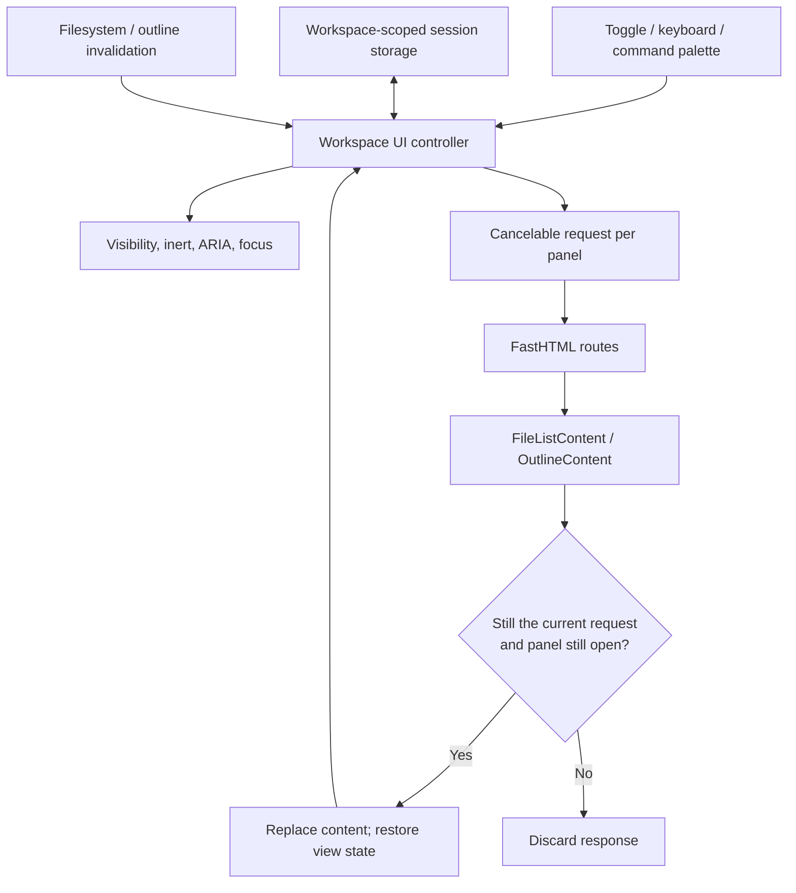

# Workspace UI State

Files, Outline, and Settings have stable panel shells. The browser owns which
panel is visible and how it is being viewed; FastHTML owns the content returned
by the filesystem and outline routes. Refreshing data cannot reopen a panel or
replace its header, and it does not reset the user's collapsed Outline sections.

## Ownership and persistence

`dialeng/static/js/workspace_ui.js` initializes `window.dialengWorkspaceUI` on
`DOMContentLoaded`, before the general application initialization. Existing
toolbar and command-palette entry points in `app.js` delegate to this controller.

| State | Owner and lifetime |
|---|---|
| Directory entries, active document, kernel status, outline data | Backend; refreshed as HTML fragments |
| `leftPanel`: `files`, `outline`, or `null` | Browser tab; stored for the current workspace |
| Last successful directory and Files scroll position | Browser tab; stored for the current workspace |
| Collapsed Outline sections and scroll position | Browser tab; stored separately for each notebook |
| Settings visibility, focus return targets, pending requests, errors | Browser memory; never restored as an open dialog on navigation |
| Settings values, dirty drafts, revisions and validation | Existing settings subsystem; see [23_settings_architecture.md](23_settings_architecture.md) |

The versioned session-storage key is
`dialeng.workspace-ui.v1:<workspace-id>`. The server derives the opaque workspace
ID from the resolved root directory. This isolates different roots served at the
same origin without putting an absolute filesystem path in the storage key.
Session storage isolates independent tabs; browsers may initially copy it when
duplicating a tab, after which the tabs evolve independently. Invalid or
unavailable storage falls back to an in-memory view. Outline history is bounded
to 30 notebooks. No document content or kernel state is stored here.

Files is the initial desktop panel; narrow screens initially show no panel.
Saved choices take precedence. On a plain-file or empty-workspace page, an
Outline preference displays Files while retaining that preference for the next
notebook. The browsed folder stays independent of the currently open document.
If a restored folder was deleted, `/files` safely returns the workspace root and
the browser stores that canonical location.

## Update flow



`/files` returns exactly one `#file-list-content` root.
`/dialeng/{nb_id}/outline` returns exactly one `#outline-content` root, without an
`aside` or visibility class. The controller fetches these server-rendered HTML
fragments with `HX-Request`, replaces the matching content root, and processes
the inserted fragment through HTMX. Folder and breadcrumb buttons carry
`data-explorer-path`; delegated click handling encodes it with `URLSearchParams`.
They never insert a wrapper inside another wrapper with the same ID.

Each new request cancels its predecessor. Response application also checks the
request object's identity: abort alone cannot guarantee that a late response
will not be delivered. Closing a panel cancels its outstanding request. A
filesystem invalidation during folder navigation refreshes the requested
destination, rather than navigating back to the previously displayed folder.
Create/delete completions invalidate their affected directory instead of
applying response HTML to whichever directory happens to be visible later.

Outline state is captured again just before replacement, so a section changed
while the request is in flight retains the latest user choice. Restored scroll
positions are applied only once the matching directory or notebook content is
available; the initial page's placeholder content cannot overwrite them.
Keyboard focus is restored to the corresponding control when possible.

Extension-driven Settings refreshes also retain the outer sidebar. They preserve
search, section expansion, scroll and focus, and use the controller's current
visibility instead of an open/closed value captured before the request. A stale
extension response is ignored, and edits begun while it was loading defer the
replacement. Existing settings revision and conflict handling remain in charge
of field values.

## Freshness and failure

Closed panels retain stale state without making requests. Opening a panel
always revalidates it, including filesystem changes missed while the tab had no
notebook WebSocket. Reconnection, returning to the tab, coming online, and
restoration from the browser's back/forward cache also revalidate the visible
panel. This does not introduce polling for closed panels.

During loading, existing content stays visible and the panel exposes
`aria-busy`. A failed request preserves that content and presents an inline
Retry action. Failure does not commit a new directory to session storage.

## Keyboard and narrow screens

Panel visibility derives CSS classes, `inert`, `aria-hidden`, and the toolbar's
`aria-expanded`/`aria-controls` from the same state. Folder and breadcrumb
controls are native buttons. Notebook keyboard shortcuts do not consume their
Enter key. Escape closes the active panel when focus is outside an editor;
Settings retains its existing unsaved-change confirmation before closing.
Closing returns focus to an available trigger.

At widths up to 768px, the left panel is a fixed drawer with a dismissible
backdrop. It leaves notebook width unchanged, makes the underlying content
inert, and wraps Tab navigation within the drawer. Selecting a file or an Outline
heading dismisses the drawer to reveal the selected content. Settings uses the same focus
and inert policy. Other dialogs can still take focus above these surfaces.
Reduced-motion preferences disable panel transitions.

## Verification and extension points

Run the focused regression coverage with:

```bash
uv run pytest -q tests/test_workspace_panels.py tests/test_file_explorer_state.py tests/e2e/test_workspace_ui.py
```

The browser tests cover navigation and reload persistence, independent tabs,
storage failures, panel scroll, directory disappearance, late responses,
Outline changes made during refresh, retry, keyboard focus, and narrow layout.
Use the existing `toggleFileExplorer()`, `toggleOutline()`, `refreshOutline()`,
and `refreshFileExplorer()` entry points when integrating another toolbar or
command. Do not toggle panel classes or replace an entire sidebar independently.
