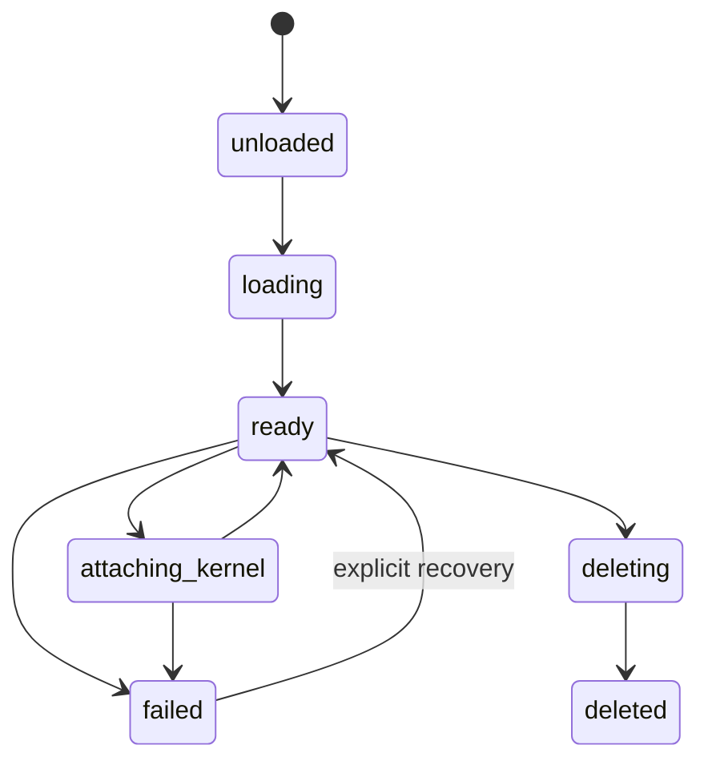
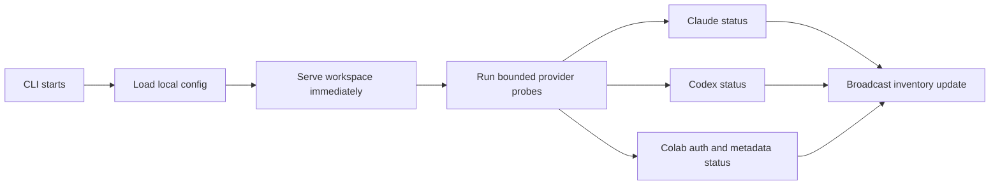
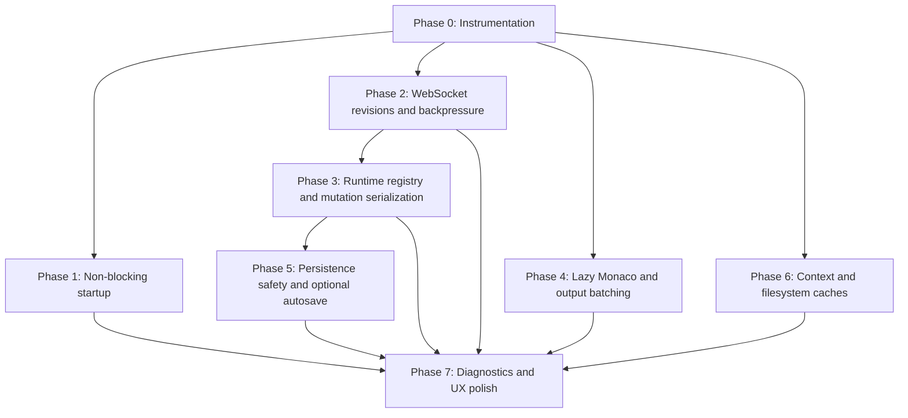

# Dialeng Performance, Reliability, and UX Roadmap

**Status:** Implemented and validated
**Created:** 2026-07-09
**Scope:** Server startup, notebook runtime state, WebSocket synchronization,
persistence, editor rendering, prompt context, diagnostics, and end-to-end UX.

## 1. Purpose

Dialeng has grown from a single-process notebook prototype into a multi-kernel,
multi-provider development environment with collaborative browser state, remote
Colab runtimes, tool-enabled prompt cells, file editing, and project services.
The current architecture works, but several paths now do more work than they
need to and some responsibilities are concentrated in large modules.

This document records a staged improvement plan so future work can be evaluated
against shared goals instead of being implemented as isolated optimizations.
It is intentionally a roadmap rather than an implementation specification. Each
workstream should receive its own implementation plan and benchmark before code
changes begin.

### Implementation tracker

| Workstream | Status | Evidence |
|---|---|---|
| A. Performance instrumentation | Implemented | `performance_service.py`, diagnostics endpoints, `benchmarks/`, regression tests |
| B. Non-blocking startup | Implemented | Local inventory at startup, background provider/Colab tasks, ASGI lifespan ownership |
| C. WebSocket revisions | Implemented | Initial revision baseline, event IDs, reconnect negotiation, gap recovery |
| D. Backpressure and batching | Implemented | Per-client bounded queues, coalescing, chunk batching, slow-client tests |
| E. Runtime registry | Implemented | `NotebookRuntimeRegistry`, mutation locks, expected revisions, idempotency |
| F. Persistence | Implemented | Atomic explicit save plus disabled-by-default autosave/recovery |
| G. Large notebook rendering | Implemented | Lazy Monaco, retained models/view state, off-screen disposal, bounded outputs |
| H. Modularization | Implemented incrementally | Diagnostics/WebSocket route modules, mutation/protocol services, revision/event/structure/batching/notification browser controllers |
| I. Prompt context | Implemented | Versioned context blocks and exact context inspector |
| J. Explorer and outline | Implemented | Directory watcher/cache and heading/namespace caches |
| K. Diagnostics and UX | Implemented | Runtime panel, save/conflict/recovery state, browser diagnostics, status history |
| L. Tests and fault injection | Implemented | 225-test suite, generated mutation sequences, transport/backpressure/persistence/provider/Colab faults, repeated kernel lifecycle, and two-tab browser matrix |

The implemented design is documented in
[Performance, Reliability, and Recovery Architecture](../../how_it_works/21_performance_reliability.md).

## 2. Goals

1. Make the server and browser become usable quickly, even when remote
   credentials or Colab services are slow.
2. Keep notebook, kernel, queue, and browser state consistent under concurrent
   requests, reconnects, failures, and multiple tabs.
3. Keep large notebooks responsive without eagerly creating every editor or
   rendering every output.
4. Reduce avoidable polling, filesystem scans, DOM mutations, and repeated LLM
   context work.
5. Make failures understandable through actionable UI state and useful,
   privacy-safe diagnostics.
6. Reduce regression risk by splitting high-complexity server and browser code
   into explicit lifecycle and event boundaries.

## 3. Non-Goals

- Turning Dialeng into a multi-user hosted SaaS platform.
- Adding Redis, a database, or distributed coordination before a real
  multi-process requirement exists.
- Replacing FastHTML, HTMX, Monaco, or the current kernel abstraction.
- Enabling autosave by default.
- Optimizing without measurements that demonstrate a meaningful bottleneck.

## 4. Current Baseline and Constraints

The following current behaviors motivate this roadmap:

- `dialeng/app.py` owns routes, global runtime dictionaries, startup services,
  notebook lifecycle, kernel coordination, broadcasting, and several UI flows.
- `dialeng/static/js/app.js` owns Monaco lifecycle, keyboard commands,
  collaboration events, kernel state, prompt streaming, file editing, and
  structural reconciliation.
- `_init_colab()` performs credential resolution, session validation, and stale
  metadata pruning through thread pools whose results are awaited during
  initialization.
- A healthy WebSocket connection receives backend-authored snapshots, while
  each notebook tab also fetches a full kernel snapshot every five seconds.
- `BroadcastManager.broadcast_text()` sends to connected clients sequentially.
- `initCell()` eagerly initializes Monaco for each code or shell cell, and
  fallback full-cell reconciliation can recreate every editor.
- `build_context_messages()` reconstructs the prompt context from notebook
  cells for each prompt execution.
- Notebook runtime state is spread across dictionaries for notebooks,
  execution queues, setup tasks, sync tasks, generations, revisions, data
  queues, and WebSocket connections.
- Notebook saves serialize the full notebook. Explicit saves are user-driven,
  and autosave is not currently a required part of the workflow.

Dialeng is primarily a local development server. The first implementation of
these improvements should preserve single-worker operation and make that
constraint explicit.

## 5. Design Principles

### 5.1 Backend-Authoritative State

The backend remains authoritative for notebook structure, cell versions,
runtime lifecycle, queue order, provider selection, and kernel state. The
browser may optimistically preserve focus and viewport state, but must reconcile
against backend events.

### 5.2 Event-Driven Normal Operation

WebSocket events should drive steady-state updates. HTTP snapshots should be
used for initial hydration, explicit refresh, reconnect recovery, or detected
revision gaps, not as constant parallel state transport.

### 5.3 Explicit Lifecycle States

Resources should move through named states instead of being inferred from the
presence or absence of objects in several dictionaries.



### 5.4 Measure Before and After

Every performance workstream must define a baseline, target, and regression
test. Improvements should be retained only when they reduce measured latency,
resource use, or failure frequency without weakening correctness.

### 5.5 Optional Background Persistence

Explicit save remains the default behavior. Autosave, debounced writes, and
recovery snapshots are an optional mode that users enable deliberately.

## 6. Success Metrics

Initial targets should be validated on representative small, medium, and large
notebooks before becoming release gates.

| Area | Proposed target |
|---|---|
| Server shell availability | UI responds without waiting for remote credential validation |
| Healthy-tab snapshot traffic | No periodic full snapshot requests while WebSocket health is confirmed |
| Reconnect recovery | State converges after reconnect without duplicate execution or DOM replacement |
| Slow browser tab | Does not delay output delivery to other tabs |
| Large notebook interaction | Opening and scrolling remain responsive with 200+ mixed cells |
| Streaming output | Browser updates are frame-batched and do not produce long main-thread stalls |
| Explicit save | Atomic replacement or clear failure without corrupting the prior file |
| Optional autosave | Disabled by default and produces no background notebook writes when disabled |
| Prompt preparation | Reuses unchanged cell conversion and token estimates |
| Diagnostics | A user can identify provider, kernel, queue, connection, and last-error state without server access |

## 7. Workstream A: Performance Instrumentation

### Objective

Create a low-overhead baseline before changing architecture.

### Proposed measurements

- Server startup phases and time until the first page can be served.
- Credential inventory probe duration per provider.
- Colab credential resolution, session validation, assignment, connection, and
  setup duration.
- HTTP route latency grouped by route and response status.
- Event-loop lag and long-running synchronous work.
- WebSocket clients, outbound queue depth, dropped/coalesced events, and send
  latency.
- Notebook load/save time, serialized bytes, cell count, and output bytes.
- File explorer scan time and entry count.
- Monaco initialization count and duration.
- Browser long tasks, DOM update batches, and visible-cell count.
- Prompt context construction time, selected cell count, converted bytes,
  image bytes, estimated tokens, and cache hit rate.
- LLM time to first event, time to first visible token, tool duration, and total
  completion duration.

### Implementation guidance

- Extend the existing structured operation logging rather than introducing a
  second logging format.
- Use correlation IDs across HTTP request, queue entry, kernel execution,
  provider stream, and final persistence.
- Avoid logging prompt content, credentials, tokens, image data, or full tool
  results.
- Add a development-only diagnostics endpoint or in-memory ring buffer with
  bounded size.

### Acceptance criteria

- Each later workstream has a reproducible benchmark.
- Instrumentation can be disabled or reduced in normal operation.
- Metrics do not materially change prompt or cell execution latency.

**Estimated effort:** Small to medium.

## 8. Workstream B: Non-Blocking Startup and Provider Discovery

### Problem

Remote credential checks and Colab validation can delay server readiness. The
current Colab setup uses thread pools and waits for each result before startup
continues.

### Proposed architecture

1. Load local configuration and cached credential metadata synchronously.
2. Start the FastHTML application and render provider states as `validating`.
3. Run independent provider probes concurrently in the ASGI lifespan.
4. Initialize Colab services asynchronously without blocking unrelated local
   notebook use.
5. Broadcast provider and Colab status changes when validation completes.
6. Keep provider-specific failures isolated.



### UX behavior

- Provider selectors show `Validating...` rather than disappearing.
- Local kernels remain available while Colab validation runs.
- A failed provider shows an actionable message without preventing another
  provider from being used.
- Kernel attachment explicitly waits for the selected provider or Colab auth
  only when that dependency is required.

### Acceptance criteria

- The workspace responds before network probes finish.
- Slow or failed Colab validation does not delay local notebook opening.
- Concurrent tabs observe the same final provider inventory.
- Startup and settings refresh share one async initialization path.

**Estimated effort:** Medium.

## 9. Workstream C: WebSocket-First State and Revision Recovery

### Problem

Periodic snapshot polling duplicates WebSocket state delivery, creates noisy
logs, and scales linearly with open tabs. Reconnect correctness currently
depends on a mixture of snapshots, events, and client assumptions.

### Proposed protocol

Every backend event should include:

```json
{
  "type": "cell_move",
  "notebook_id": "demo~analysis",
  "stream": "notebook",
  "revision": 42,
  "event_id": "...",
  "payload": {}
}
```

- `revision` increases monotonically per event stream.
- The browser records the last applied revision.
- Duplicate events are ignored.
- A gap triggers one HTTP snapshot fetch.
- A reconnect sends the last known revision.
- If the server can replay retained events, it sends the missing events;
  otherwise it sends a full snapshot.
- Snapshot polling is disabled while the socket is healthy.
- A low-frequency heartbeat verifies transport health without rebuilding state.

### Event streams

Use separate revision domains where ordering requirements differ:

- Notebook structure and cell versions.
- Kernel and queue lifecycle.
- Outline state.
- LLM/provider inventory.
- Ephemeral output streaming.

Streaming chunks should remain ordered but should not force full notebook
revision increments for every token or stdout fragment.

### Acceptance criteria

- No five-second snapshot loop during healthy operation.
- Reordered, duplicated, and omitted test events converge correctly.
- Reconnect does not clear valid output or create duplicate cells.
- Browser visibility changes do not cause reconnect storms.

**Estimated effort:** Medium to large.

## 10. Workstream D: WebSocket Backpressure and Output Coalescing

### Problem

Sequential sends let a slow or suspended browser tab delay all clients. Fine
grained stdout and token events can also create excessive DOM work.

### Proposed server model

- Give each client a bounded outbound queue and one writer task.
- Assign event policies by type:
  - Preserve all structural operations and terminal lifecycle events.
  - Preserve ordered prompt/tool events.
  - Coalesce kernel snapshots and queue updates to the newest value.
  - Batch adjacent stdout/stderr chunks for the same cell.
- Apply send timeouts and disconnect clients that cannot make progress.
- Track dropped, coalesced, and delayed events in diagnostics.

### Proposed browser model

- Batch text output and prompt chunks per cell.
- Flush at most once per animation frame or after a bounded byte threshold.
- Pause expensive visual updates for hidden tabs while retaining ordered data.
- Render one final authoritative output when execution completes.

### Acceptance criteria

- A deliberately stalled client does not increase latency for a healthy client.
- Structural events are never silently dropped.
- Progress bars, `clear_output`, display updates, and tool events retain their
  current semantics.
- Large stdout workloads do not freeze scrolling or keyboard input.

**Estimated effort:** Medium.

## 11. Workstream E: Notebook Runtime Registry and Mutation Serialization

### Problem

Runtime state currently spans independent dictionaries. Correctness relies on
every route clearing and updating all of them in the correct order.

### Proposed model

Introduce a `NotebookRuntime` object managed by `NotebookRuntimeRegistry`:

```python
@dataclass
class NotebookRuntime:
    notebook_id: str
    lifecycle: LifecycleState
    notebook: Notebook | None
    mutation_lock: asyncio.Lock
    execution_queue: ExecutionQueue | None
    kernel_generation: int
    notebook_revision: int
    outline_revision: int
    setup_task: asyncio.Task | None
    sync_task: asyncio.Task | None
    data_queues: dict[str, asyncio.Queue]
```

The exact fields may differ, but ownership should be explicit.

### Mutation rules

- Structural operations acquire the notebook mutation lock.
- Client operations carry an expected notebook revision when ordering matters.
- Operations receive idempotency IDs so browser retries do not duplicate cells
  or executions.
- Kernel generation changes and notebook lifecycle changes occur through named
  registry methods.
- Deletion, restart, kernel switch, shutdown, and explicit recreation use one
  lifecycle API.
- Single-worker operation is checked at startup until a shared state backend is
  intentionally designed.

### Acceptance criteria

- No route updates runtime dictionaries directly.
- Concurrent add, move, delete, run, restart, and notebook deletion tests have
  deterministic outcomes.
- Cleanup is idempotent.
- Runtime diagnostics can be generated from one object.

**Estimated effort:** Large.

## 12. Workstream F: Persistence and Optional Autosave

### Decision

Autosave remains **disabled by default**. Users who prefer explicit saves should
observe no background notebook writes, recovery snapshots, or autosave timers.

### Proposed configuration

```json
{
  "persistence": {
    "atomic_explicit_save": true,
    "autosave": {
      "enabled": false,
      "debounce_ms": 1500,
      "idle_only": true,
      "recovery_snapshots": true,
      "max_recovery_files": 5
    }
  }
}
```

Names are provisional and should follow the final configuration schema.

### Default explicit-save behavior

- `Ctrl/Cmd+S`, `S S`, and the save button remain the canonical persistence
  actions.
- The toolbar shows `Modified`, `Saving`, `Saved`, or `Save failed`.
- Explicit saves should write a temporary file in the same directory, flush it,
  and atomically replace the prior notebook where the platform supports it.
- If atomic replacement fails, the prior notebook remains intact and the user
  receives an actionable error.
- This safety mechanism does not imply autosave.

### Optional autosave behavior

When `persistence.autosave.enabled=true`:

- Mutations schedule one debounced save per notebook.
- Repeated edits reset the debounce timer.
- `idle_only=true` avoids writing while a cell or prompt is actively streaming,
  unless a maximum delay is reached.
- Explicit save immediately flushes pending autosave work.
- Closing the server attempts a bounded final flush.
- Recovery snapshots are created only if enabled and are stored outside the
  normal notebook path.
- Recovery retention is bounded by count and age.
- On startup, Dialeng reports newer recovery data and asks whether to restore,
  inspect, or discard it. It must not overwrite the notebook automatically.

### External change handling

- Track a disk signature such as modification time, size, and optionally a
  content hash at load/save.
- Reject writes when the file changed externally unless the user explicitly
  chooses overwrite or reload.
- Show a diff or clear conflict summary before destructive resolution.

### Acceptance criteria

- Autosave is false by default in new and migrated configurations.
- With autosave disabled, tests observe no background writes.
- Explicit saves cannot leave a partially written notebook.
- Autosave coalesces rapid edits into one write.
- Recovery never silently replaces the canonical notebook.

**Estimated effort:** Medium for atomic explicit saves; medium to large for the
optional autosave and recovery mode.

## 13. Workstream G: Monaco and Large-Notebook Rendering

### Problem

Eager Monaco creation and full-editor reinitialization make cost proportional
to total code-cell count rather than visible work.

### Proposed editor lifecycle

1. Render lightweight code-cell placeholders and hidden source values.
2. Use `IntersectionObserver` to prepare editors near the viewport.
3. Create Monaco immediately for the focused cell.
4. Preserve one Monaco model per code cell independently from the editor view.
5. Dispose editor views far outside the viewport while retaining models and
   selection state within a bounded cache.
6. Never recreate unaffected editors after a structural operation.

### Output rendering

- Use `content-visibility: auto` and intrinsic-size hints for off-screen cells.
- Lazy-decode large images and plots near the viewport.
- Collapse outputs above configurable byte, line, or height limits.
- Keep a bounded in-DOM preview with an explicit `Show full output` action.
- Consider storing exceptionally large outputs as local artifacts referenced by
  notebook metadata, but only after compatibility implications are documented.

### UX requirements

- Focus, cursor, selection, and viewport remain stable during cell operations.
- Keyboard navigation can focus an uninitialized editor without visible delay.
- Search behavior clearly states whether off-screen cells are included.
- Printing or exporting forces complete rendering only when required.

### Acceptance criteria

- Initial Monaco editor count is bounded by visible and near-visible cells.
- Scrolling through a 200-cell notebook avoids long main-thread tasks.
- Add, move, delete, type change, and collaboration tests do not recreate
  unrelated editors.
- Rich output behavior remains compatible with fastprogress, Matplotlib, and
  interactive HTML.

**Estimated effort:** Medium to large.

## 14. Workstream H: Frontend and Backend Modularization

### Frontend proposal

Split `app.js` into modules with one public coordinator:

- `notebook_client.js`: lifecycle, revisions, reconnect, terminal states.
- `event_dispatcher.js`: event registration by type rather than one long
  conditional chain.
- `editor_manager.js`: Monaco models, views, focus, and lazy initialization.
- `structure_controller.js`: add/move/delete reconciliation and viewport state.
- `execution_ui.js`: queue, streaming, output batching, and cancellation.
- `prompt_ui.js`: prompt streaming, tools, thinking, and usage.
- `file_editor.js`: plain-file editing and lease behavior.
- `notifications.js`: toast lifecycle and status history.

Event registration should resemble:

```javascript
eventDispatcher.register('cell_move', handleCellMove);
eventDispatcher.register('kernel_snapshot', applyKernelSnapshot);
eventDispatcher.register('notebook_deleted', handleNotebookDeleted);
```

### Backend proposal

Split route concerns while retaining one application composition root:

- Notebook document routes.
- Cell mutation and execution routes.
- Kernel and Colab routes.
- LLM/auth/settings routes.
- File explorer/editor routes.
- Dialoghelper compatibility routes.
- WebSocket protocol and broadcast services.

### Acceptance criteria

- `app.py` becomes composition and shared dependency wiring rather than the
  owner of every implementation.
- Browser event handlers can be tested independently.
- Route modules use services instead of importing mutable application globals.
- No behavior changes are mixed into the first mechanical extraction PR.

**Estimated effort:** Large, but divisible into incremental PRs.

## 15. Workstream I: Prompt Context Performance and Transparency

### Proposed caching

- Cache normalized context blocks by cell ID and cell version.
- Cache token estimates by provider tokenizer/model family where available.
- Recompute only changed cells and expressions that are explicitly dynamic.
- Keep variable/expression injection fresh for every prompt.
- Cache discovered tools and schemas by kernel generation plus source identity.
- Cache skill metadata by existing content hash and modification state.

### Context inspector UX

Before or after a prompt run, users should be able to inspect:

- Included, skipped, pinned, and truncated cells.
- User/assistant role conversion.
- Images and their encoded sizes.
- Injected variables and expressions, with sensitive-value controls.
- Available built-in, CRAFT, fenced, and skill tools.
- Estimated input tokens and model limit.
- Why any older context was omitted.

The inspector must represent the exact provider request preparation, not a
separate approximation.

### Acceptance criteria

- Re-running an unchanged bottom prompt has a high context-cache hit rate.
- Editing one earlier cell invalidates only dependent cached blocks.
- Dynamic expressions continue to re-evaluate on each run.
- Context inspector output matches provider request tests.

**Estimated effort:** Medium.

## 16. Workstream J: File Explorer and Outline Efficiency

### File explorer

- Cache directory listings by resolved path and filesystem signature.
- Use `watchfiles` to invalidate affected directories.
- Avoid scanning unrelated directories for a local refresh.
- Load very large directories incrementally or provide filtering.
- Keep active notebook and kernel indicators as separate lightweight state so a
  kernel event does not require a filesystem rescan.

### Outline

- Reuse heading extraction by note-cell version.
- Query kernel namespace only when execution or kernel generation changes.
- Keep outline revisions separate from general notebook snapshots.
- Avoid rebuilding the closed outline panel.
- Debounce repeated dirty events produced by one operation.

### Acceptance criteria

- File explorer refresh cost is proportional to the affected directory.
- External file creation appears without manual full-tree rescans.
- A closed outline causes no namespace request.
- Multiple output events from one execution trigger at most one outline refresh.

**Estimated effort:** Small to medium.

## 17. Workstream K: Diagnostics and UX Feedback

### Kernel diagnostics panel

Show:

- Kernel type, runtime identity, Python version, and connection state.
- Queue order, running cell, and setup phase.
- Kernel generation and last activity.
- Colab endpoint/session metadata with secrets redacted.
- Last keep-alive, reconnect, interrupt, restart, or setup error.
- Suggested recovery action.

### Connection UX

- Distinguish browser connection, backend availability, kernel connection,
  provider authentication, and execution state.
- Avoid one generic green/red dot for unrelated subsystems.
- Retain a small notification history instead of losing all context when a
  toast disappears.
- Provide `Retry`, `Reconnect`, `Open settings`, and `Copy diagnostics` actions
  where appropriate.

### Save and conflict UX

- Persistent dirty/saving/saved indicator.
- Clear external-change and stale-tab conflict messages.
- Preserve existing output when execution cannot start.
- Explain whether cancellation stopped a queued cell, interrupted the kernel,
  or only stopped an LLM stream.

### Accessibility

- Ensure status transitions use appropriate live regions without announcing
  every token or progress update.
- Preserve logical focus after structural operations and modal dismissal.
- Verify keyboard-only operation for workspace, explorer, kernel modal,
  settings, notifications, and conflict dialogs.
- Respect reduced-motion preferences.

**Estimated effort:** Medium and suitable for incremental delivery.

## 18. Workstream L: Testing and Fault Injection

### Browser end-to-end tests

Add Playwright scenarios for:

- Two tabs editing, running, moving, and deleting the same notebook.
- WebSocket disconnect during code and prompt streaming.
- Missed revision followed by snapshot recovery.
- Slow-client backpressure.
- Large-notebook scrolling and lazy Monaco activation.
- Kernel modal, provider selection, settings, workspace, and file editor flows.
- Focus and scroll preservation after structural operations.

### Backend state-machine tests

Generate operation sequences across:

- Add, move, duplicate, merge, and delete cells.
- Save and external file changes.
- Queue, run, cancel, interrupt, and restart.
- Kernel switch, Colab disconnect, notebook deletion, and explicit recreation.
- Concurrent expected revisions and duplicate operation IDs.

Assert invariants after every operation:

- Cell IDs remain unique.
- Backend order is canonical.
- At most one active runtime lifecycle transition owns a notebook.
- Deleted notebooks cannot be mutated until explicit recreation.
- Queue state references existing cells.
- Runtime cleanup is idempotent.

### Fault injection

- Filesystem permission and disk-full failures.
- Corrupted notebook and recovery files.
- Provider timeout, malformed event, 401 refresh, and rate limit.
- Colab proxy token expiry, WebSocket drop, and unassign failure.
- Browser tab suspension and delayed sends.
- Server shutdown during setup, execution, save, and deletion.

**Estimated effort:** Medium initially, then continuous.

## 19. Recommended Delivery Sequence



### Phase 0: Establish measurements

- Add timings, counters, benchmark fixtures, and diagnostic correlation.
- Capture small, medium, large, local-kernel, and Colab baselines.

### Phase 1: Improve startup

- Move provider and Colab validation to async lifespan tasks.
- Make the workspace usable during validation.

### Phase 2: Improve transport

- Introduce revisions and event IDs.
- Remove healthy-state polling.
- Add bounded client queues and output batching.

### Phase 3: Consolidate runtime state

- Introduce the runtime registry and lifecycle states.
- Add mutation locks, expected revisions, and idempotency.

### Phase 4: Improve browser rendering

- Add lazy Monaco views and off-screen content visibility.
- Bound large output rendering.

### Phase 5: Improve persistence

- Implement atomic explicit saves first.
- Add optional autosave and recovery behind disabled-by-default configuration.

### Phase 6: Reduce repeated computation

- Cache context blocks, schemas, headings, namespace snapshots, and directory
  listings using existing revisions and filesystem invalidation.

### Phase 7: Complete UX and diagnostics

- Expose lifecycle, connection, save, conflict, and recovery state clearly.
- Complete accessibility and failure-recovery flows.

Modularization should happen alongside these phases in behavior-preserving
extractions, not as one all-at-once rewrite.

## 20. Risk Matrix

| Risk | Mitigation |
|---|---|
| Revision protocol causes missed UI updates | Retain snapshot recovery and event-gap tests |
| Backpressure drops important events | Explicit per-event retention policy and invariant tests |
| Runtime registry refactor changes behavior | Mechanical migration first, then lifecycle improvements |
| Lazy Monaco breaks focus or shortcuts | Preserve models separately and add keyboard E2E tests |
| Output batching changes progress semantics | Test stream, clear, update-display, and final normalization |
| Context cache sends stale variables/tools | Key dynamic data by kernel generation and always re-evaluate expressions |
| Atomic replacement behaves differently across platforms | Same-directory temporary files and platform-specific tests |
| Optional autosave surprises users | Disabled by default, visible status, explicit configuration and docs |
| Diagnostics expose secrets | Structured redaction tests and no raw credential/event payloads |

## 21. Decisions Recorded

1. Backend-authoritative notebook and runtime state remains the core model.
2. WebSockets become the normal state channel; snapshots remain recovery tools.
3. Single-worker operation remains the supported deployment until shared state
   is designed intentionally.
4. Explicit save remains the default persistence workflow.
5. Autosave and recovery snapshots are opt-in and disabled by default.
6. Large refactors must be incremental and behavior-preserving.
7. Performance work requires before-and-after measurements.

## 22. Continuing Validation

The initial roadmap implementation is complete. Continue recording the
following baselines when dependencies, UI rendering, or transport behavior
change:

- Startup timing with local-only, Claude, Codex, and Colab configurations.
- Request and WebSocket traffic for one, two, and five tabs.
- Browser performance for 20, 100, and 250 cells.
- Streaming behavior for high-volume stdout and rich display updates.
- Prompt preparation for short and long contexts with images and tools.

Use `benchmarks/performance_baseline.py`, the diagnostics panel, and targeted
browser scenarios to detect regressions. Further extraction from `app.py` or
`app.js` should remain mechanical and incremental; it is ongoing maintenance,
not a prerequisite for using the implemented reliability architecture.
