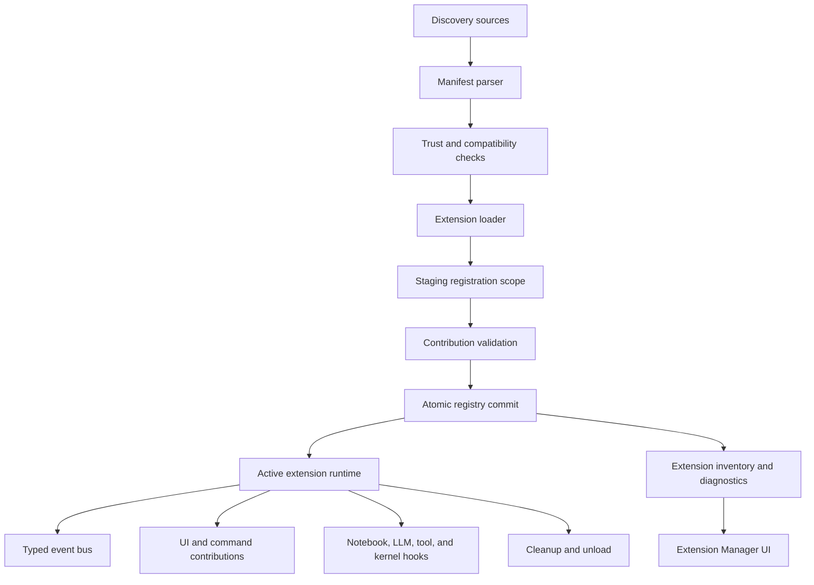
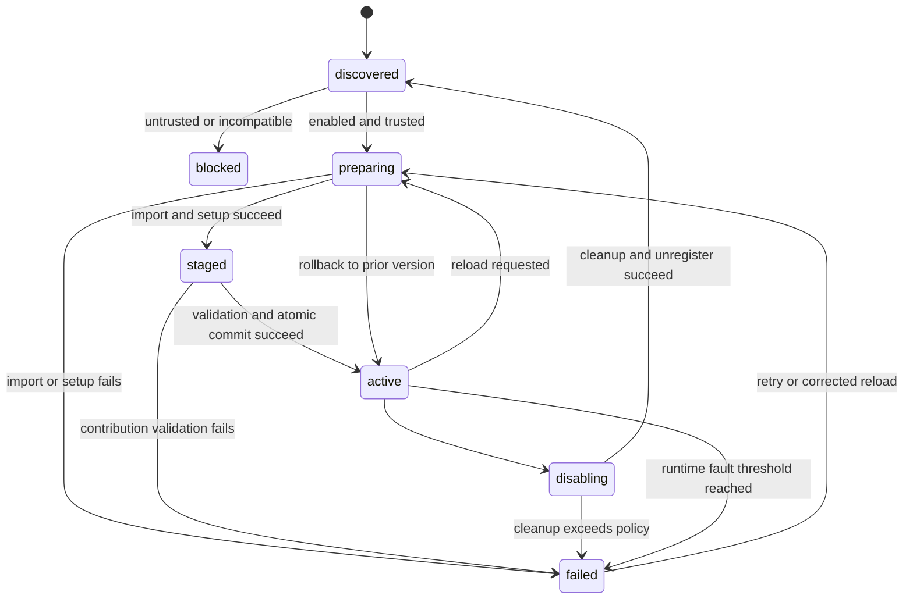
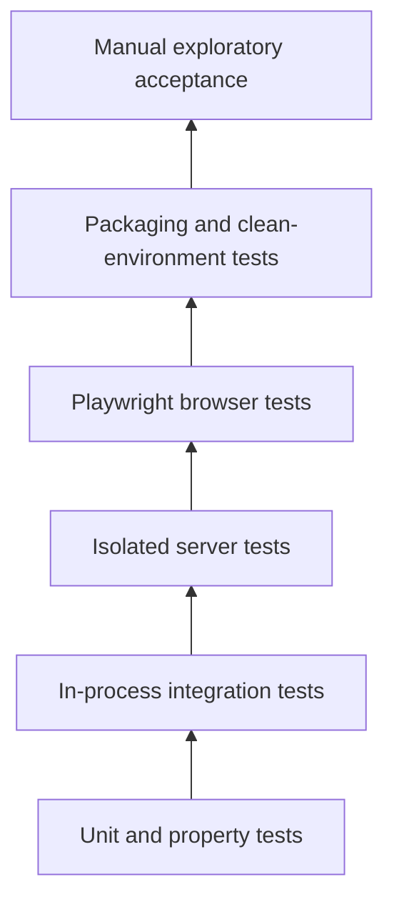

# Dialeng Extension Platform And Self-Extension Plan

**Status:** Implemented; verification baseline recorded in
`docs/how_it_works/26_extension_verification.md`
**Created:** 2026-07-11
**Scope:** Extension discovery, trust, manifests, public APIs, lifecycle events,
transactional reload, UI contributions, notebook-first authoring, nbdev
integration, packaging, diagnostics, and end-to-end verification.

## 1. Purpose

Dialeng already supports several powerful extension mechanisms:

- cell render, serialization, deserialization, and LLM conversion dispatch;
- mutable callbacks around kernel cell execution;
- registration of kernels, LLM providers, services, toolbar items, settings
  sections, and HTTP actions;
- notebook-authored server extensions through `AUTORUN` and `#| export`;
- project behavior through CRAFT, TEMPLATE, skills, and dialoghelper tools;
- notebook-to-Python export and nbdev-compatible package scaffolding.

These capabilities prove that Dialeng can be extended, including from inside a
Dialeng notebook. However, they do not yet form one stable extension platform.
Extension authors must understand internal modules, registrations do not have
an owning extension, hot reload cannot fully remove prior state, project trust
is not explicit, and there is no unified way to create, validate, diagnose,
install, enable, or distribute an extension.

This document defines an incremental implementation that turns those existing
mechanisms into a coherent extension platform without replacing Python,
FastHTML, HTMX, the notebook model, or the current registry implementations.

The target experience is:

1. A user opens Dialeng and chooses **Create Extension**.
2. Dialeng creates a documented extension notebook and manifest.
3. The user and an LLM can implement the extension using a stable public API.
4. Dialeng exports and validates the notebook in an isolated test server.
5. The user reviews registrations, permissions, generated files, and tests.
6. The user explicitly trusts and enables the extension.
7. Dialeng loads or reloads it transactionally and reports its state.
8. The same extension can later be packaged and installed from a local path,
   Git repository, or Python package.

No runtime implementation should begin until this design and its open decisions
have been reviewed.

## 2. Inspirations And Boundaries

### 2.1 Pi ideas worth adapting

[Pi extensions](https://pi.dev/docs/latest/extensions) provide a useful model
for a coherent extension contract:

- one factory receives a supported API and context;
- global and project-local discovery are explicit;
- project-local code loads only after project trust;
- extensions register tools, commands, shortcuts, flags, UI, and events;
- lifecycle events include startup, agent work, tools, messages, and shutdown;
- long-lived resources have an explicit cleanup lifecycle;
- development paths and auto-discovered paths support reload;
- errors are associated with the extension that caused them.

[Pi packages](https://pi.dev/docs/latest/packages) also demonstrate useful
resource bundling, install/remove/list commands, project versus global scope,
per-resource filtering, precedence, and deduplication.

Dialeng should adapt these product ideas, not Pi's implementation language or
session model. Dialeng remains Python-first, browser-based, backend-authoritative,
and notebook-authoritative for LLM context.

### 2.2 nbdev ideas worth adapting

The [nbdev end-to-end workflow](https://nbdev.fast.ai/tutorials/tutorial.html)
combines implementation, examples, tests, and documentation in notebooks, then
exports and verifies them before release. Its modular commands can also be used
independently: `nbdev_export`, `nbdev_test`, `nbdev_clean`, and related tooling.
See [Modular nbdev](https://nbdev.fast.ai/tutorials/modular_nbdev.html).

Dialeng should use nbdev as an optional authoring, verification, and packaging
layer. nbdev should not become the runtime extension loader. A small extension
must remain possible without creating a full published package.

### 2.3 Explicit boundaries

This plan does not:

- execute untrusted extension code automatically;
- promise process isolation for trusted runtime extensions in the first release;
- replace CRAFT, TEMPLATE, skills, or dialoghelper;
- make skills equivalent to runtime extensions;
- let an LLM activate generated server code without user confirmation;
- permit arbitrary browser JavaScript from an extension without declaration;
- require every extension to use nbdev;
- create an online extension marketplace in the first release;
- stabilize every current internal Dialeng function as public API.

## 3. Current Architecture And Gaps

### 3.1 Existing contribution points

| Area | Existing mechanism | Current limitation |
|---|---|---|
| Cell types | Cell registry plus dispatch maps | No owner, unload, schema, or complete round-trip validator |
| Execution | `Callback` and `ExecutionContext` | Primarily kernel-cell lifecycle, global callback list |
| Kernels | `KernelRegistration` | No extension compatibility or teardown contract |
| LLM providers | `ProviderRegistration` | No manifest capability declaration or owner |
| Toolbar | Renderer registrations | No command identity, standard state, or asset contract |
| Settings | Renderer plus dynamic setting definitions | Dynamic definitions have no owner or unregister path |
| HTTP actions | `/dialeng/{nb_id}/ext/{action}` | Global names, untyped form data, no per-extension namespace |
| Services | Global service dictionary | No lifecycle or cleanup contract |
| Notebook authoring | `AUTORUN/*.ipynb` and `#| export` | Coupled to background notebook execution semantics |
| Reload | Delete module and import again | Old registrations and resources may survive |
| Distribution | Manual files or project package | No entry point, manifest, install manager, or compatibility check |
| Diagnostics | Server logs | No authoritative extension inventory or UI |

### 3.2 Correctness risks to fix before adding UX

1. Registrations are not associated with the extension that created them.
2. Callback reload can append duplicate instances.
3. Dispatch deserializers are append-only and can duplicate after reload.
4. Removing code from an extension does not remove its old registration.
5. A partially failing import can leave some registrations active.
6. Bare module stems can collide across built-in, project, user, and package
   extension paths.
7. Extension background tasks, file watchers, sockets, or clients have no
   guaranteed shutdown path.
8. Extension errors are logged, but loading can continue with ambiguous partial
   behavior.
9. A project can execute server-process code without a dedicated trust decision.
10. `AUTORUN` combines server extension loading and background notebook startup,
    although those are separate capabilities and risks.

The extension manager and notebook studio must not be built on top of these
unsafe semantics. Ownership and transactional lifecycle are Phase 1.

## 4. Goals

1. Give extension authors one documented public API instead of direct access to
   global registries and application globals.
2. Make every registration and resource attributable to one extension.
3. Make load, reload, disable, and unload deterministic and reversible.
4. Support built-in, project, user, local-path, Git, and installed-package
   extensions with explicit precedence.
5. Require trust before project or downloaded code runs in the server process.
6. Let extensions contribute tools, commands, shortcuts, UI, settings, actions,
   cell types, callbacks, kernels, providers, assets, and lifecycle handlers.
7. Let users create and test extensions from Dialeng notebooks.
8. Use nbdev directives and verification where they add value without requiring
   a full nbdev project for a single-file extension.
9. Make extension failures visible, attributable, and recoverable.
10. Preserve backend-authoritative notebook and collaboration behavior.

## 5. Design Principles

### 5.1 Public facade over internal registries

Extensions receive an `ExtensionAPI`. They do not receive the global registry.
The API records ownership, validates names, creates cleanup handles, and adapts
to current internal registries. Existing registries remain implementation
details and can be refactored later without changing extension code.

### 5.2 Transactional activation

An extension version is prepared in an isolated registration scope. Dialeng
validates all proposed contributions before replacing the active version. If
import, setup, validation, or commit fails, the previous active version remains
intact.

### 5.3 Explicit trust and permissions

Extensions run with the Dialeng server's operating-system permissions. The UI
must say this plainly. Project and downloaded extensions require trust before
import. A manifest declares capabilities for review and diagnostics; it is not
presented as a security sandbox.

### 5.4 Backend-authoritative extension state

Enabled state, active version, load errors, registrations, and trust decisions
live on the backend. Multiple tabs receive revisioned extension snapshots and
cannot independently enable incompatible versions.

### 5.5 Notebook source of truth, generated Python artifact

For notebook-authored extensions, the notebook is the source of truth. Exported
Python is generated and reviewable. A package may choose Python files as its
source instead, but Dialeng does not silently edit both directions.

### 5.6 Failure isolation by policy and testing

Trusted extensions initially execute in the server process because cell/UI
registrations require local Python objects. Dialeng reduces risk with staged
imports, timeouts where possible, cleanup, fault boundaries, and isolated
validation servers. A future out-of-process extension host can be considered
for tools and services that do not require in-process FastHTML objects.

## 6. Target Architecture



### 6.1 Proposed modules

| Module | Responsibility |
|---|---|
| `dialeng/extensions/manifest.py` | Parse, validate, and normalize manifests |
| `dialeng/extensions/models.py` | Public extension, contribution, status, and event models |
| `dialeng/extensions/api.py` | Stable `ExtensionAPI` and `ExtensionContext` facade |
| `dialeng/extensions/discovery.py` | Built-in, user, project, path, and entry-point discovery |
| `dialeng/extensions/trust.py` | Project identity, trust records, source hashes, review state |
| `dialeng/extensions/loader.py` | Module namespaces, staged import, activation, rollback |
| `dialeng/extensions/runtime.py` | Active instances, resources, state, tasks, cleanup |
| `dialeng/extensions/registry_scope.py` | Ownership ledger and atomic registry updates |
| `dialeng/extensions/events.py` | Typed event definitions and ordered event dispatch |
| `dialeng/extensions/manager.py` | Enable, disable, reload, install metadata, diagnostics |
| `dialeng/extensions/assets.py` | Declared CSS/JS asset resolution and safe serving |
| `dialeng/routes/extensions.py` | Inventory, trust, enable, disable, reload, and action APIs |
| `dialeng/ui/extensions.py` | Extension Manager and Extension Studio UI |
| `dialeng/services/extension_project_service.py` | Scaffold, export, validate, and package extensions |
| `dialeng/builtin_skills/extension-creator/` | Guided LLM workflow using constrained extension tools |

Names can change during implementation, but ownership must remain outside
`app.py` and the global registry module.

## 7. Extension Format

### 7.1 Project layout

The preferred notebook-authored layout is:

```text
.dialeng/extensions/notebook-audit/
├── extension.toml
├── extension.ipynb
├── notebook_audit.py          # generated
├── README.md                  # generated or authored
├── assets/
│   ├── extension.css
│   └── extension.js
├── tests/
│   ├── test_extension.py
│   └── test_browser.py
└── resources/
```

Small Python-only extensions may use:

```text
.dialeng/extensions/hello-toolbar/
├── extension.toml
└── extension.py
```

Installed Python packages expose one or more extension factories through the
`dialeng.extensions` entry-point group.

### 7.2 Manifest

Example `extension.toml`:

```toml
schema_version = 1
id = "com.example.notebook-audit"
name = "Notebook Audit"
version = "0.1.0"
description = "Adds notebook quality checks and an audit panel."
entrypoint = "notebook_audit:setup"
dialeng_api = ">=1,<2"
scope = "project"

[author]
name = "Example Author"
url = "https://example.com"

[permissions]
filesystem_read = ["project"]
filesystem_write = [".dialeng/notebook-audit"]
network = false
subprocess = false
browser_assets = true

[contributes]
commands = true
shortcuts = true
tools = true
toolbar = true
panels = true
settings = true
events = true
cell_types = false
kernels = false
providers = false

[assets]
css = ["assets/extension.css"]
js = ["assets/extension.js"]
```

Manifest validation rules:

- `id` is globally namespaced and immutable for an installed identity.
- `version` and `dialeng_api` use semantic version constraints.
- `entrypoint` resolves only within the extension root or installed package.
- paths are relative, normalized, symlink-resolved, and cannot escape the root.
- declared contribution categories are compared with actual registrations.
- permissions are displayed before trust; undeclared sensitive behavior is
  reported by diagnostics when detectable, but permissions are not a sandbox.
- duplicate IDs at the same precedence are errors, not last-write-wins.
- malformed extensions appear as disabled diagnostics instead of disappearing.

## 8. Discovery, Scope, And Precedence

### 8.1 Sources

| Source | Location | Default behavior |
|---|---|---|
| Built-in | Packaged with `dialeng` | Trusted and enabled by Dialeng release |
| User | `~/.dialeng/extensions/` | Explicitly installed or copied; user trust required once |
| Project | `<project>/.dialeng/extensions/` | Discovered, disabled until project trust |
| Development path | `dialeng --extension PATH` | Session-only, explicit CLI intent |
| Python package | `dialeng.extensions` entry point | Installed, then enabled by scope configuration |

`AUTORUN` remains supported during migration, but new server extensions should
use `.dialeng/extensions`. Background notebooks remain in `AUTORUN` until a
separate naming migration is approved.

### 8.2 Precedence

Recommended precedence for the same extension ID:

1. explicit development path;
2. project-local extension;
3. user extension;
4. installed package;
5. built-in extension.

The higher-precedence source shadows the lower one but does not delete its
configuration. The Extension Manager shows both and explains which is active.
Project configuration can explicitly disable an inherited user extension.

### 8.3 Trust

Trust identity should include:

- canonical project root;
- manifest ID;
- source origin;
- manifest and runtime source hash;
- requested capabilities;
- extension version.

Initial trust choices:

- **Enable once:** valid until server shutdown or source hash changes.
- **Trust this version:** persisted for the exact version and source hash.
- **Trust project extensions:** persisted for the canonical project identity,
  with a warning when capabilities increase or origin changes.
- **Keep disabled.**

Any source change invalidates one-time trust. A new version with additional
permissions requires another review.

## 9. Runtime Lifecycle



### 9.1 Extension factory

Preferred runtime contract:

```python
from dialeng.extensions import ExtensionAPI, ExtensionContext

async def setup(api: ExtensionAPI, ctx: ExtensionContext) -> None:
    api.register_command(...)
    api.on("notebook.saved", on_saved)
    api.add_cleanup(close_resources)
```

The factory runs only in a staging scope. It should perform registration and
bounded initialization, not launch unmanaged background work.

### 9.2 Registration ownership ledger

Every call through `ExtensionAPI` creates a contribution record:

```text
extension_id
extension_version
contribution_type
contribution_name
registration_object
replace_policy
cleanup_handle
source_location
```

The ledger supports:

- collision detection before activation;
- complete unload by extension ID;
- comparison of old and new versions;
- diagnostics showing what an extension contributes;
- rollback if commit fails;
- leak detection after repeated reloads.

### 9.3 Atomic reload algorithm

1. Acquire the extension-manager mutation lock.
2. Resolve and hash the extension source.
3. Validate manifest, trust, compatibility, and dependencies.
4. Create a uniquely namespaced module and staging registry scope.
5. Import the candidate and await its factory with a startup deadline.
6. Validate names, schemas, contribution declarations, and conflicts.
7. Pause new event dispatch to the old version.
8. Atomically swap registry contributions where possible.
9. Activate candidate event handlers and resources.
10. Run old-version cleanup and remove its module namespace.
11. Broadcast a revisioned extension snapshot and refresh affected UI regions.
12. If steps 4-9 fail, discard the candidate and retain the old version.
13. If old cleanup fails after commit, keep the new version active but mark a
    cleanup warning with enough diagnostics to restart safely.

Reload must not perform a blind full-page refresh unless a contribution
explicitly requires it. Toolbar, settings, command, and asset changes should
have targeted refresh behavior. Cell renderer changes may require notebook cell
reconciliation while preserving selection, editors, and scroll position.

### 9.4 Cleanup and task ownership

`ExtensionContext` provides managed resource helpers:

- `ctx.create_task(coro, name=...)`;
- `ctx.add_cleanup(callable)`;
- `ctx.watch_path(path, handler)`;
- `ctx.open_http_client(...)`;
- `ctx.state` for namespaced persistent state;
- `ctx.logger` with extension metadata;
- `ctx.cancel_signal` for unload and shutdown.

Managed tasks are cancelled and awaited with a bounded deadline. Extensions
must not start raw permanent tasks during import. The manager reports unmanaged
tasks where they can be associated with the extension.

## 10. Public Extension API

### 10.1 Core context

`ExtensionContext` exposes stable, capability-aware services:

- extension identity, source, version, and scope;
- canonical project root;
- current Dialeng API version;
- namespaced logger and diagnostics;
- namespaced configuration and persistent state;
- managed background tasks and cleanup;
- backend notification API;
- safe notebook lookup and mutation service;
- runtime/kernel lookup through public protocols;
- event publication and subscription;
- current trust and declared capabilities.

It must not expose application-global dictionaries or mutable registry objects.

### 10.2 Contributions

Initial `ExtensionAPI` methods:

| Method | Purpose |
|---|---|
| `register_tool` | Add a typed LLM tool using the existing tool registry |
| `register_command` | Add a user-invoked command with arguments and availability |
| `register_shortcut` | Bind a command to a namespaced keyboard shortcut |
| `register_toolbar_item` | Add a toolbar control backed by a command or action |
| `register_panel` | Add a supported sidebar, modal, or bottom panel |
| `register_status_item` | Add compact runtime status owned by the extension |
| `register_setting` | Add a typed backend-authoritative setting definition |
| `register_action` | Add a namespaced, typed backend action |
| `register_cell_type` | Register model, renderer, serializer, deserializer, and LLM conversion |
| `register_callback` | Adapt current execution callbacks with ownership |
| `register_kernel` | Register a kernel factory and lifecycle metadata |
| `register_provider` | Register an LLM provider and capability metadata |
| `register_asset` | Declare a CSS or JavaScript module from the manifest root |
| `on` | Subscribe to a typed lifecycle event |
| `add_cleanup` | Register deterministic async or synchronous cleanup |

All public names are internally qualified as `<extension_id>:<local_name>`.
UI labels can remain short.

### 10.3 Commands

Commands provide a common invocation layer for toolbar items, shortcuts, the
future command palette, extension UI, and LLM-authoring tools.

```python
api.register_command(
    "audit-notebook",
    title="Audit notebook",
    description="Check the current notebook for reproducibility issues.",
    args=AuditArgs,
    handler=audit_notebook,
    when="notebook.open && kernel.optional",
)
```

Commands receive a typed `CommandContext` containing the initiating client,
notebook ID, selection, project, cancellation signal, notification helpers, and
public services. Long-running commands report progress and can be cancelled.

### 10.4 Typed actions

Replace global action names with:

```text
POST /dialeng/{nb_id}/extensions/{extension_id}/actions/{action_name}
```

An action declares its request and response schema. Dialeng validates input,
normalizes errors, attaches operation IDs, logs duration, and prevents one
extension from overwriting another action. Existing `/ext/{name}` remains as a
temporary legacy adapter.

### 10.5 Settings

Extension settings use the existing backend-authoritative settings service.
Each setting declares:

- path relative to `extensions.<extension_id>`;
- type, default, choices, bounds, and optional environment override;
- apply mode: `live`, `new_kernel`, `extension_reload`, or `server_restart`;
- secret classification and redaction behavior;
- label, description, grouping, and order.

Disabling an extension preserves its settings. Removing it can optionally keep
or delete settings after explicit confirmation.

## 11. Event Model

### 11.1 Event categories

| Category | Initial events |
|---|---|
| Application | `app.starting`, `app.ready`, `app.stopping` |
| Project | `project.opened`, `project.trust_changed`, `project.files_changed` |
| Notebook | `notebook.opened`, `notebook.before_save`, `notebook.saved`, `notebook.closing`, `notebook.deleted` |
| Cell structure | `cell.added`, `cell.moved`, `cell.duplicated`, `cell.merged`, `cell.type_changed`, `cell.before_delete`, `cell.deleted` |
| Cell execution | `execution.queued`, `execution.before_start`, `execution.output`, `execution.completed`, `execution.cancelled` |
| Prompt | `prompt.context_built`, `prompt.before_request`, `prompt.stream_event`, `prompt.completed`, `prompt.failed` |
| Tools | `tool.before_call`, `tool.progress`, `tool.after_call`, `tool.failed` |
| Kernel | `kernel.attaching`, `kernel.ready`, `kernel.busy`, `kernel.disconnected`, `kernel.restarting`, `kernel.stopped` |
| Settings | `settings.changed`, `settings.activation_completed`, `settings.activation_failed` |
| Extension | `extension.loaded`, `extension.reloaded`, `extension.failed`, `extension.unloading` |

### 11.2 Observation versus interception

Events explicitly declare whether handlers may modify or cancel behavior:

- observation events cannot change the payload;
- transform events return a validated replacement or patch;
- guard events may reject an operation with a user-facing reason;
- output events may transform bounded output where existing callback semantics
  already support it.

Handlers have stable ordering by phase and numeric order. Ties are resolved by
extension ID, making execution deterministic. Event results are chained only
for event types that document chaining.

### 11.3 Error policy

- Observation handler errors are logged and do not fail the user operation by
  default.
- Guard or transform errors fail closed only when the event contract explicitly
  requires it; otherwise the original input proceeds with a warning.
- Repeated handler failures can disable that handler without disabling unrelated
  contributions.
- Event deadlines prevent a UI operation from hanging indefinitely.
- Diagnostics identify extension ID, handler, event, operation ID, duration,
  and sanitized exception.

## 12. UI And Browser Extension Model

### 12.1 Supported contribution points

The first stable UI surface should include:

- toolbar item;
- settings group;
- command palette entry;
- keyboard shortcut;
- modal;
- left or right sidebar panel;
- bottom panel;
- status item;
- toast/notification;
- cell renderer-owned UI;
- custom tool-call/result renderer.

Extensions should compose supported primitives instead of modifying arbitrary
Dialeng DOM selectors.

### 12.2 Browser assets

An extension may declare CSS and ES modules in its manifest. Dialeng serves only
declared, normalized files under an extension-specific route. Asset URLs include
the extension version or source hash for cache invalidation.

Client modules receive a constrained `window.dialeng.extensions` facade for:

- subscribing to public browser events;
- invoking namespaced commands/actions;
- opening registered UI surfaces;
- showing notifications and progress;
- reading public notebook/client state;
- registering cleanup for reload.

Client modules must not receive credentials, raw server internals, or arbitrary
cross-extension state. JavaScript activation is visible in the trust review.

### 12.3 Extension Manager

Add an **Extensions** toolbar/settings entry with:

- discovered, enabled, disabled, blocked, failed, and shadowed extensions;
- source, scope, version, API compatibility, and source hash;
- trust state and declared capabilities;
- contributions and active event handlers;
- load time, reload count, task count, and last error;
- enable, disable, trust, reload, retry, and open-source actions;
- install from path or Git URL in a later packaging phase;
- copy-diagnostics action with secret redaction;
- indication when a restart is required.

Every mutation is backend-authoritative and synchronized across tabs.

## 13. Notebook-First Extension Development

### 13.1 Scaffold

Add:

```text
dialeng extension create NAME [--template TYPE]
```

Templates:

- `basic`: command, toolbar item, and action;
- `tool`: LLM tool and optional tool renderer;
- `cell`: full custom cell round trip;
- `lifecycle`: event handlers and managed resources;
- `provider`: deterministic provider skeleton;
- `package`: multi-resource installable package.

The command creates `extension.toml`, `extension.ipynb`, tests, and a README.
The same operation is available through the Extension Studio.

### 13.2 Notebook conventions

Recommended notebook structure:

1. H1 title and one-paragraph purpose.
2. Architecture and declared contribution table.
3. `#| default_exp <module>` directive.
4. Imports and public setup factory in `#| export` cells.
5. Contribution implementations in `#| export` cells.
6. Examples and executable test cells without `#| export`.
7. Failure and cleanup tests.
8. Browser test notes or fixtures.
9. Hidden/export cell that invokes the supported export workflow if desired.

Dialeng must preserve normal nbdev meaning for directives instead of inventing
incompatible spellings.

### 13.3 Extension Studio workflow

The UI workflow is:

1. Choose extension name, ID, template, and scope.
2. Review generated manifest and requested capabilities.
3. Open the generated notebook in Dialeng.
4. Develop and execute examples in a normal notebook kernel.
5. Select **Build Extension**.
6. Export `#| export` cells and show generated-file diff.
7. Validate manifest and static contribution declarations.
8. Run notebook tests and Python unit tests in a subprocess.
9. Start an isolated Dialeng validation server on a random port.
10. Run extension smoke and Playwright tests.
11. Show test output, screenshots, console errors, server logs, and diagnostics.
12. Require explicit confirmation to trust and activate the build.
13. Activate transactionally and show the Extension Manager status.

Build artifacts live under `.dialeng/extension-builds/` and are gitignored.
Installed project source remains under `.dialeng/extensions/` and can be
committed.

### 13.4 Built-in extension-creator skill

Ship an `extension-creator` skill separate from the existing skill creator. It
documents the stable API and guides the model through design, implementation,
tests, and validation.

Constrained tools:

- `inspect_extension_api(topic=None)`;
- `list_extension_templates()`;
- `create_extension(name, template, capabilities)`;
- `read_extension(extension_id, path)`;
- `update_extension_file(extension_id, path, ...)`;
- `build_extension(extension_id)`;
- `validate_extension(extension_id)`;
- `run_extension_tests(extension_id, level="unit")`;
- `show_extension_diagnostics(extension_id)`;
- `request_extension_activation(extension_id)`.

`request_extension_activation` creates a user confirmation in the UI. It never
activates code solely because the LLM requested it. File tools are constrained
to the selected extension root and staged build root.

## 14. nbdev Integration

### 14.1 Minimal mode

For a project that does not use nbdev globally, Dialeng uses nbdev components
modularly where available:

- export one extension notebook to its generated module;
- execute notebook tests;
- clean transient notebook metadata before packaging;
- render API documentation on request.

If nbdev is unavailable, Dialeng's existing exporter and pytest validation
remain sufficient for a basic local extension.

### 14.2 Full package mode

For publishable extensions, `dialeng extension package init` creates or merges:

- `[project]` metadata;
- `[tool.nbdev]` configuration;
- `dialeng.extensions` entry point;
- extension package data for manifests, assets, skills, and templates;
- development dependencies and test commands;
- CI workflows for export cleanliness, notebook tests, unit tests, and E2E;
- generated docs and README conventions.

Recommended preparation gate:

```text
nbdev_export
nbdev_test
nbdev_clean
pytest
dialeng extension validate .
dialeng extension test . --browser
git diff --exit-code generated-package-path
```

The exact wrapper command can become:

```text
dialeng extension prepare
```

### 14.3 Export reproducibility

CI exports notebooks in a clean checkout and fails if generated Python differs.
This prevents a committed notebook and runtime module from silently diverging.
The failure identifies the notebook, generated file, and first differing cell.

## 15. Packaging And Installation

### 15.1 Python entry point

Published packages use:

```toml
[project.entry-points."dialeng.extensions"]
notebook_audit = "dialeng_notebook_audit:setup"
```

The package also includes `extension.toml` or exposes equivalent manifest data
through a documented package resource path.

### 15.2 Commands

Target CLI:

```text
dialeng extension list [--all]
dialeng extension create NAME
dialeng extension inspect ID
dialeng extension trust ID
dialeng extension enable ID
dialeng extension disable ID
dialeng extension reload ID
dialeng extension doctor [ID]
dialeng extension validate PATH
dialeng extension test PATH [--browser]
dialeng extension install SOURCE [--project]
dialeng extension remove ID [--keep-settings]
dialeng extension prepare
```

### 15.3 Sources

Initial install support should prioritize:

1. local directory or wheel;
2. Python package already present in the current environment;
3. Git URL pinned to a commit or tag;
4. PyPI package with an explicit version.

Because `uv tool install` environments are managed environments, mutating the
running environment is not always safe. The implementation must decide whether
installed extension dependencies live in:

- the current project environment;
- a Dialeng-managed extension environment; or
- the same environment as the Dialeng executable with an explicit restart.

The recommended first release supports local/project extensions and already
installed entry points. Automated dependency installation follows only after
environment behavior is made explicit and tested.

### 15.4 Bundled resources

An extension package may bundle:

- runtime extensions;
- project skills;
- prompt templates;
- notebook templates;
- CRAFT fragments;
- CSS and JavaScript assets;
- documentation and examples.

Each resource category is independently enableable. Runtime code is never
implicitly enabled merely because a skill or template is selected.

## 16. Legacy Migration

### 16.1 Built-in extensions

Migrate `craft_init`, `example_callbacks`, and `shell_cell` through the public
API. Keep them built-in and enabled according to current behavior. Their tests
become contract tests for the same API third-party extensions use.

### 16.2 AUTORUN notebook extensions

Migration stages:

1. Current `AUTORUN` registrations are wrapped in a synthetic legacy extension
   scope so ownership and cleanup work immediately.
2. The Extension Manager identifies them as legacy and links to migration help.
3. `dialeng extension migrate AUTORUN/foo.ipynb` creates a manifest and project
   extension layout without changing the original file.
4. New documentation recommends `.dialeng/extensions`.
5. Removal of legacy server-extension loading is considered only after a
   separate deprecation decision. Background AUTORUN notebooks are unaffected.

### 16.3 Existing decorators

Existing decorators can remain as compatibility adapters only while an
extension staging scope is active. Calling them outside an active scope logs a
deprecation warning for third-party code. New documentation uses `ExtensionAPI`.

## 17. Four Validation Extensions

These extensions are test fixtures and reference implementations. They live
under `examples/extensions/` or test fixture directories and are disabled by
default. E2E tests copy them into temporary projects. They can be enabled
manually for exploratory testing and disabled after validation.

### 17.1 `hello-workspace`

**Purpose:** Validate basic discovery, trust, settings, commands, shortcuts,
toolbar UI, actions, state, targeted reload, and multi-tab synchronization.

Contributions:

- setting `greeting` and live setting `show_status`;
- command `say-hello`;
- toolbar button invoking the command;
- shortcut `Ctrl+Alt+H` or platform-equivalent configurable binding;
- namespaced action returning the current notebook and greeting;
- toast and small modal;
- namespaced persistent invocation count;
- optional status item.

Acceptance scenarios:

1. The untrusted project extension is discovered but does not execute.
2. Trust and enable cause the toolbar item to appear in all tabs.
3. Changing the greeting updates command behavior without a server restart.
4. Button, shortcut, and command palette invoke the same command handler.
5. Reload preserves state and does not duplicate the toolbar item or shortcut.
6. Removing the command in source and reloading removes it from every client.
7. Disable removes UI and handlers while preserving settings and state.
8. A malformed update rolls back to the prior active version.

### 17.2 `execution-guard`

**Purpose:** Validate event ordering, guards, transforms, managed resources,
cleanup, cancellation, failure isolation, and reload leak prevention.

Contributions:

- guard on `execution.before_start` that blocks a configured source marker;
- transform that prepends a harmless comment when enabled;
- output observer recording bounded metrics;
- notebook-save observer;
- managed periodic task updating extension diagnostics;
- explicit async cleanup;
- settings controlling behavior and callback order.

Acceptance scenarios:

1. Allowed cells run unchanged except for the declared transform.
2. Blocked cells do not reach the kernel and show the extension's reason.
3. Another extension's later observer receives deterministic event state.
4. Handler exception is attributed and does not disable unrelated handlers.
5. Fifty reloads leave exactly one handler and one managed task.
6. Disable and server shutdown cancel and await the task.
7. A hanging observer reaches its deadline and produces diagnostics.
8. Two tabs see the same guard result and notebook execution state.

### 17.3 `diagram-cell`

**Purpose:** Validate the most state-sensitive extension surface: custom cells.

Contributions:

- custom `diagram` cell type;
- cell renderer with a text editor and rendered SVG or Mermaid-like preview;
- Jupyter serializer and deserializer using namespaced metadata;
- LLM context converter;
- declared CSS and ES module;
- command converting a Note cell into a Diagram cell;
- output and collapse behavior compatible with normal cells.

Acceptance scenarios:

1. Add, edit, duplicate, move, merge where allowed, and delete diagram cells.
2. Convert Code/Note -> Diagram -> Note without losing source unexpectedly.
3. Save and reload preserve ID, source, metadata, collapse state, and ordering.
4. Opening the `.ipynb` in standard Jupyter leaves a valid fallback cell.
5. Two tabs synchronize source and structural mutations.
6. Prompt context receives the documented diagram representation once.
7. Asset reload does not duplicate styles, listeners, or rendered previews.
8. Disabling the extension renders a safe unsupported-cell fallback rather than
   corrupting or deleting notebook data.

### 17.4 `project-inspector-package`

**Purpose:** Validate entry-point packaging, bundled resources, tools, panels,
resource filtering, source precedence, installation diagnostics, and removal.

Package contents:

- one extension entry point;
- command `inspect-project`;
- read-only LLM tool returning bounded project statistics;
- sidebar panel showing file and notebook counts;
- bundled `project-inspector` skill;
- bundled notebook template;
- optional toolbar item;
- no network or subprocess permission.

Acceptance scenarios:

1. A wheel installs into a clean `uv` test environment and is discovered.
2. Runtime extension, skill, and template can be enabled independently.
3. The tool is available only when its resource and tools are enabled.
4. Tool output is bounded, path-safe, and consistent for Codex and Bedrock.
5. A project-local extension with the same ID shadows the installed package and
   the manager explains the precedence.
6. Disabling the project override reveals the installed version deterministically.
7. Remove unregisters runtime contributions; optional keep-settings works.
8. Reinstalling a pinned version yields the same manifest and source hash.

## 18. Verification Strategy

### 18.1 Test layers



Each implementation phase must add the lowest practical test layer and cannot
defer all verification to Playwright.

### 18.2 Unit tests

Manifest and discovery:

- valid minimal and full manifests;
- malformed TOML and missing required fields;
- semantic-version and Dialeng API constraints;
- path traversal and symlink escape rejection;
- duplicate ID and precedence rules;
- project, user, built-in, development, and entry-point sources;
- source hashing and trust invalidation;
- malformed extensions remain visible as diagnostics.

Ownership and transactions:

- every contribution records one owner;
- duplicate local and qualified names are rejected correctly;
- staged registrations are invisible before commit;
- import/setup/validation failure leaves active registries unchanged;
- successful reload removes contributions deleted by the new version;
- callback and deserializer lists do not grow after repeated reload;
- rollback retains prior handlers and resources;
- unload removes settings definitions, commands, actions, assets, and events
  according to preservation policy;
- cleanup runs once even after partial failure;
- module namespaces cannot collide across sources.

Events and context:

- deterministic ordering across phases, order numbers, and extension IDs;
- observer, transform, guard, and output semantics;
- sync and async handlers;
- cancellation and deadlines;
- handler failure isolation and fault thresholds;
- managed task cancellation and cleanup deadlines;
- context cannot escape project paths through public helpers;
- redacted diagnostics contain no secrets or raw credentials.

Public contributions:

- command argument validation and availability expressions;
- shortcut collision reporting and user override;
- typed action request/response/error behavior;
- dynamic setting type, bounds, apply mode, persistence, and unregister;
- tool registration and provider-neutral routing;
- complete custom-cell serializer/deserializer/context contract;
- asset declaration, cache versioning, and path safety.

### 18.3 Property and stress tests

- Generate random registration sets and verify commit/unload returns every
  internal registry to its prior snapshot.
- Generate random failing setup points and verify rollback invariants.
- Reload each fixture extension 50-100 times and assert stable callback,
  handler, module, task, and browser-listener counts.
- Enable/disable extensions concurrently from two tabs and verify one
  backend-authoritative revision order.
- Repeatedly modify source during validation and ensure stale builds cannot
  activate.
- Shut down the server during load, activation, task execution, and cleanup.

### 18.4 Isolated server integration tests

Start Dialeng as a subprocess on a random port with a temporary project and
credential-isolated environment. Verify:

- discovery and startup timing;
- trust blocks imports before confirmation;
- extension activation changes inventory and routes;
- reload and rollback while notebooks are open;
- extension exceptions do not prevent core notebook use;
- server shutdown completes cleanup;
- corrupted extension state falls back to disabled diagnostics;
- no test-only routes or providers exist outside the E2E flag.

### 18.5 Playwright tests

Add deterministic scenarios for:

- Extension Manager discovery, trust, enable, disable, reload, and diagnostics;
- multi-tab extension inventory synchronization;
- `hello-workspace` UI, shortcut, settings, modal, and reload;
- `execution-guard` block/allow feedback and execution state;
- `diagram-cell` editing, structural operations, collaboration, save/reload,
  unsupported fallback, and asset cleanup;
- `project-inspector-package` panel, tool availability, resource filters, and
  precedence;
- Extension Studio scaffold, notebook edit, build, failing test, corrected
  test, validation server, review, confirmation, and activation;
- scroll, selection, editor, kernel modal, and notebook output preservation
  across targeted extension UI refreshes.

On failure capture:

- screenshot;
- Playwright trace;
- browser console and page errors;
- server logs with redaction;
- extension inventory and contribution ledger;
- active task and handler counts;
- manifest and source hashes;
- temporary project tree;
- final notebook artifact.

### 18.6 Packaging tests

- Build sdist and wheel for `project-inspector-package`.
- Install with `uv` into a clean environment.
- Confirm entry-point discovery without importing untrusted code.
- Enable and run its deterministic scenarios.
- Verify package data includes manifest, skill, template, and assets.
- Test pinned Git/local install metadata without relying on a mutable branch.
- Remove the package and verify no active contribution survives.
- Run export reproducibility and `nbdev_test` where nbdev mode is enabled.

### 18.7 Security and trust tests

- Project extension source is not imported before trust.
- Trust is invalidated when source hash, origin, ID, or capabilities change.
- Manifest and asset paths cannot escape the extension root.
- Extension action routes cannot invoke another extension's handler.
- Extension state and settings are namespaced.
- Browser assets cannot read server-only secrets through the extension facade.
- Diagnostics redact environment tokens, OAuth values, cookies, and auth headers.
- Untrusted package metadata can be inspected without importing its entry point.
- The UI states clearly that trusted runtime extensions have full process access.

### 18.8 Performance checks

Initial non-regression targets:

| Metric | Target |
|---|---|
| No-extension startup | No material regression beyond bounded discovery |
| 25 disabled manifests | Discovery remains sub-second on a local filesystem |
| Extension inventory | No periodic full scan while watcher state is healthy |
| Reload | Does not recreate notebook editors or lose scroll position |
| Event dispatch | Disabled extensions add no handler overhead |
| Browser assets | Loaded once per active version, removed once on disable |
| Shutdown | Managed extension cleanup obeys a bounded server shutdown budget |

Benchmarks record counts and durations rather than relying only on wall-clock
thresholds in shared CI.

### 18.9 Manual acceptance checklist

Before declaring the platform stable:

1. Initialize a clean Dialeng project.
2. Create each of the four fixture extensions through the documented workflow.
3. Review manifests and trust prompts.
4. Build, test, enable, reload, disable, and re-enable each extension.
5. Repeat with two browser tabs and an open long notebook.
6. Restart Dialeng and verify enabled state and trust restoration.
7. Modify source to invalidate trust and confirm no code runs prematurely.
8. Introduce syntax, setup, event, action, asset, and cleanup failures.
9. Confirm the prior version or core Dialeng remains usable.
10. Run local and Colab kernels while unrelated extensions reload.
11. Run Mock, Codex, and Bedrock prompt flows with extension tools where
    credentials are available; real-provider tests remain opt-in.
12. Open fixture notebooks in standard Jupyter and verify valid fallback data.
13. Package and install `project-inspector-package` in a clean `uv` environment.
14. Copy diagnostics and manually inspect them for secret leakage.
15. Disable all four fixtures and confirm Dialeng returns to the baseline UI,
    registry counts, event handlers, tasks, and browser listeners.

## 19. Implementation Phases

### Phase 0: Contract and baseline

Deliverables:

- architecture decision record for trusted in-process extensions;
- snapshots of current registry, dispatch, callback, and AUTORUN behavior;
- tests reproducing duplicate callback and stale-registration reload risks;
- public API version policy;
- fixture extension skeletons, initially disabled.

Exit criteria:

- current behavior is covered before registry changes;
- no extension UX is added on unsafe reload semantics.

### Phase 1: Ownership and transactional lifecycle

Deliverables:

- extension identity and contribution ledger;
- staging scopes and atomic commit/rollback;
- complete unregister support for every registry and dispatch map;
- unique module namespaces;
- managed tasks and cleanup;
- legacy AUTORUN ownership adapter;
- reload stress and fault-injection tests.

Exit criteria:

- 100 reload cycles produce stable resource counts;
- failed candidates leave the previous version active;
- every active registration has an owner.

### Phase 2: Manifest, discovery, trust, and manager

Deliverables:

- manifest parser and compatibility validation;
- built-in, project, user, development-path, and entry-point discovery;
- trust persistence and source hashing;
- backend extension inventory and revisions;
- Extension Manager UI and diagnostics;
- CLI list/inspect/trust/enable/disable/reload/doctor commands.

Exit criteria:

- untrusted project code is never imported;
- all tabs converge on one extension state;
- malformed and incompatible extensions are visible and actionable.

### Phase 3: Public API, events, commands, and UI

Deliverables:

- `ExtensionAPI` and context protocols;
- typed event bus and core lifecycle integration;
- commands, shortcuts, actions, settings, toolbar, panels, status, and assets;
- tool and custom-cell contribution bundles;
- browser extension facade and cleanup;
- migrated built-in extensions.

Exit criteria:

- `hello-workspace`, `execution-guard`, and `diagram-cell` pass unit and E2E
  acceptance scenarios using only public APIs.

### Phase 4: Extension Studio and self-extension

Deliverables:

- CLI and UI scaffolding;
- extension notebook templates;
- build preview and source-hash validation;
- subprocess notebook/unit validation;
- isolated Dialeng browser validation server;
- review and activation confirmation;
- built-in `extension-creator` skill and constrained tools.

Exit criteria:

- a new user can create, test, correct, review, and activate an extension
  without editing Dialeng core or manually copying generated Python.

### Phase 5: nbdev and packaging

Deliverables:

- modular nbdev export/test/clean integration;
- extension package scaffold and entry point;
- resource bundling and filtering;
- local/already-installed package management;
- clean `uv` install tests;
- `project-inspector-package` reference package;
- prepare/reproducibility CI.

Exit criteria:

- the reference wheel installs in a clean environment and passes all package
  acceptance scenarios;
- notebook source and generated module cannot diverge unnoticed.

### Phase 6: Documentation, migration, and stabilization

Deliverables:

- user guide, API reference, lifecycle diagrams, security guide, examples, and
  troubleshooting;
- AUTORUN migration command and guide;
- extension author compatibility matrix;
- performance baseline and fault-testing report;
- removal or disabling of fixture extensions from normal startup.

Exit criteria:

- all documented examples are executable tests;
- all four fixture extensions are disabled by default;
- full unit, deterministic browser, package, and opt-in provider/kernel suites
  pass with no unexplained warnings.

## 20. Definition Of Done

The extension platform is complete for its first stable API when:

- every extension and contribution has a stable identity and owner;
- load, reload, disable, and unload are transactional and leak-free;
- project extensions require trust before import;
- manifests and API compatibility are validated before setup;
- extensions use a documented facade rather than application globals;
- commands, events, settings, actions, UI, tools, and custom cells have tested
  public contracts;
- extension state is backend-authoritative and multi-tab synchronized;
- failures are attributable and do not silently corrupt active registries;
- notebook-authored extensions can be scaffolded, exported, tested, reviewed,
  and activated from Dialeng;
- nbdev-based packages can be built reproducibly where enabled;
- all four validation extensions pass their acceptance scenarios;
- disabling all validation extensions restores baseline registry and UI counts;
- documentation, changelog, guides, and internal architecture diagrams match
  the implementation;
- real Codex, Bedrock, local-kernel, and Colab extension interactions are tested
  where credentials are available, with deterministic substitutes in CI.

## 21. Risks And Mitigations

| Risk | Mitigation |
|---|---|
| In-process code can crash or compromise Dialeng | Explicit trust, source review, validation subprocess, clear warning, bounded hooks |
| Reload leaves stale state | Owner ledger, transactional candidate, complete unregister, stress tests |
| Public API becomes too broad | Facade protocols, API versioning, start with supported primitives |
| Events make behavior unpredictable | Typed semantics, deterministic order, deadlines, diagnostics |
| UI extensions break notebook DOM | Supported UI surfaces and client facade, no arbitrary selector contract |
| Dependency conflicts in tool-installed Dialeng | Delay automatic install, document environment, clean `uv` tests |
| Notebook and generated Python diverge | Source-of-truth policy and clean-checkout export reproducibility |
| LLM generates unsafe extension code | Constrained file tools, validation, source diff, explicit activation confirmation |
| Legacy AUTORUN behavior regresses | Ownership adapter, compatibility tests, staged migration |
| Custom cell disabled or missing | Preserve raw notebook data and render unsupported fallback |
| One extension blocks core operations | Event deadlines, fault thresholds, per-handler disable, cancellation |

## 22. Review Decisions

The following decisions should be confirmed before implementation:

1. **Project location:** Use `.dialeng/extensions/` as the preferred project
   extension root. Recommended: yes.
2. **User location:** Support `~/.dialeng/extensions/` in the first discovery
   release. Recommended: yes, but project support has higher priority.
3. **Trust choices:** Support enable-once, exact-version trust, and project trust.
   Recommended: yes, with source/capability changes invalidating trust.
4. **Runtime model:** Trusted UI/cell extensions run in the server process in
   v1; validation runs in a subprocess. Recommended: yes.
5. **Legacy AUTORUN:** Keep background notebooks and provide a migration path
   for server registrations rather than removing support immediately.
   Recommended: yes.
6. **Automatic dependency installation:** Defer until Dialeng's `uv tool` versus
   project-environment behavior is explicit. Recommended: yes.
7. **Browser JavaScript:** Allow only declared ES modules from trusted
   extensions, loaded through a supported facade. Recommended: yes.
8. **Package bundle:** Allow extensions, skills, templates, and CRAFT resources
   in one package, independently enableable. Recommended: yes.
9. **Public API compatibility:** Start at `dialeng_api = 1` and require semantic
   compatibility declarations. Recommended: yes.
10. **Test fixtures:** Keep the four reference extensions disabled by default
    under examples/test fixtures after implementation. Recommended: yes.

## 23. Expected Outcome

The completed system will preserve the strongest parts of Dialeng's current
design: notebook-driven development, Python, FastHTML, backend-authoritative
state, editable LLM context, CRAFT, tools, skills, and package export. It will
add the missing product and lifecycle layer that makes those mechanisms safe
and understandable for extension authors.

The result is not merely that Dialeng can load more plugins. A user will be able
to use Dialeng to inspect its public extension API, create an extension notebook,
ask the LLM for help, execute examples, validate the generated runtime in an
isolated server, review the result, activate it deliberately, diagnose it, and
eventually publish it. That is the practical meaning of Dialeng being able to
extend Dialeng.
